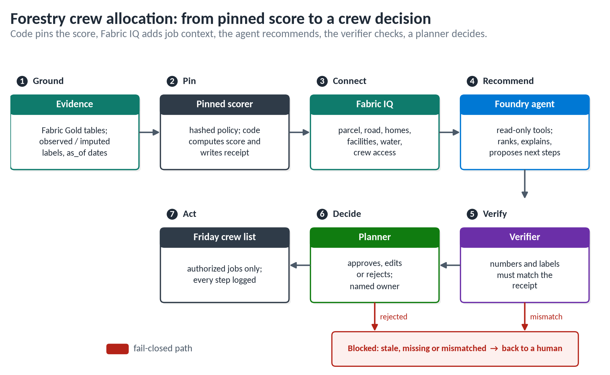
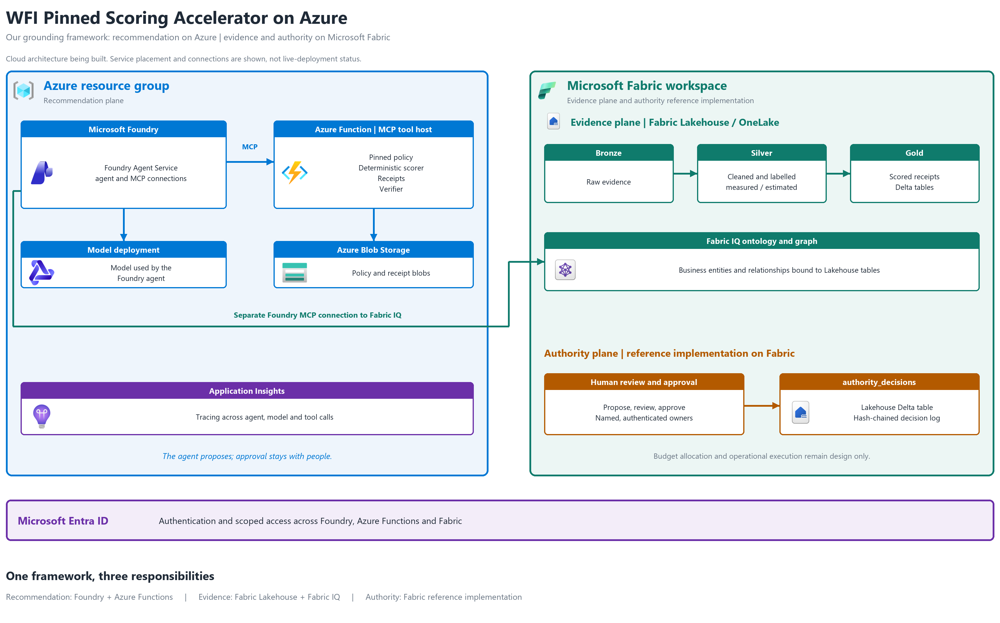
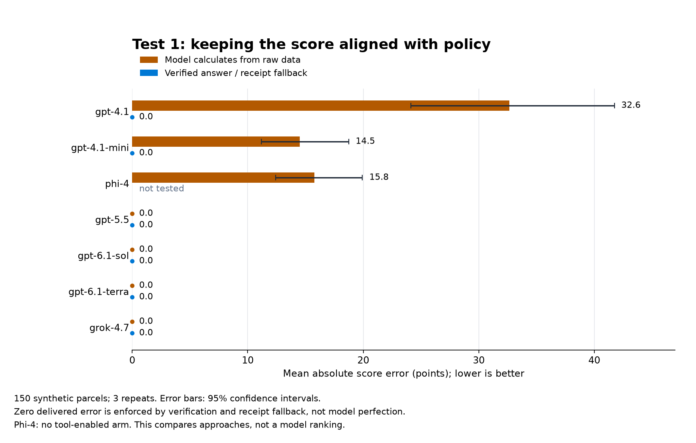
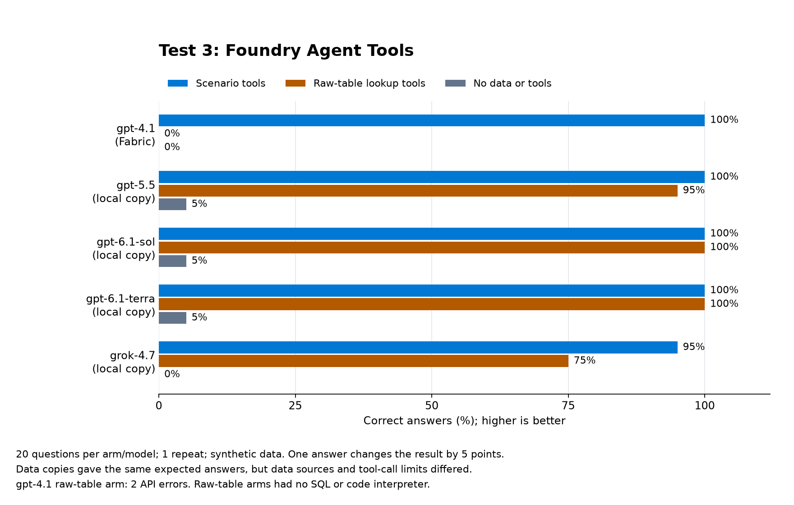

<h1 align="center">WFI Pinned Scoring Accelerator</h1>

<p align="center">
  <strong>Code computes the score. The agent explains it. A verifier checks it. A human decides.</strong><br/>
  A reference implementation of policy-pinned, provenance-labelled risk scoring on Microsoft Foundry and Microsoft Fabric.
</p>

<p align="center">
  <a href="https://github.com/enekazo/WFI-ScoringAccelerator/actions/workflows/tests.yml"></a>
  
  
  
  
  
  
</p>

<p align="center">
  <a href="#architecture">Architecture</a> ·
  <a href="#results">Results</a> ·
  <a href="#quick-start">Quick start</a> ·
  <a href="#how-the-score-is-calculated">How scoring works</a> ·
  <a href="#limitations">Limitations</a>
</p>

## Accelerator use case: forestry planning

This accelerator was **built for a wildfire use case**. A planner at a utility, fire agency, insurer or forestry team has to decide which land parcels get a work crew first (for example vegetation clearing). Each parcel is given a wildfire risk score from evidence such as fuel load, dead fuel, moisture, weather and wind, plus connected facts held in **Fabric IQ** (roads, nearby homes, water sources and crew access).

The planner needs three things the AI alone cannot guarantee:

- **The same score every time** for the same evidence, so the crew list can be defended and repeated.
- **An honest explanation** that says which inputs were measured, estimated or missing.
- **A human decision.** The planner chooses the crew list; the AI never does.

So the scorer pins the score, the agent explains it, the verifier blocks any answer that disagrees with the receipt, and the planner decides. The example runs on **synthetic parcels**. The pattern is not specific to wildfire: swap the policy and the evidence to apply it to another domain, after testing it there.

## What is this accelerator?

**The WFI Pinned Scoring Accelerator helps organisations turn risk scores into informed, explainable decisions.** It combines a deterministic scoring model, business context from Microsoft Fabric IQ, and LLM-generated explanations so users can understand **what the risk is, what it means in their situation, and which evidence supports it**.

The architecture gives each component a distinct responsibility:

- **The scoring model provides consistency.** It calculates the score using approved rules and evidence, not the LLM's judgement. The same inputs and policy produce the same result.
- **Fabric IQ provides business context.** It connects the scored item to related information. In the wildfire example, that includes nearby homes, road access, water sources and crew reachability: facts that help a planner interpret the significance of a high score.
- **The LLM makes the information understandable.** Users can ask questions, compare results and receive explanations grounded in stored scores or connected data.
- **Verification protects the calculated result.** Receipt-based explanations are checked against the authoritative scoring record, with contradictory narration replaced by receipt-based text.

**For the user, this means more than receiving a number:** they can understand why an item is high risk, explore the circumstances surrounding it, and use that information to make and explain their own decision.

**How do I get started?** You can deploy the included solution using the [Quick start](#quick-start). Once configured, use its AI agents to ask questions about scores and connected information. The included wildfire example uses synthetic data, so you can explore the workflow before adapting it to your own business evidence and approved rules.

**Can I use it outside wildfire?** The same approach can support questions about supplier risk, maintenance priorities or compliance assessments. Adapting it requires your own business rules, data and relationships, with domain-appropriate safeguards. It is a reusable starting point, not an out-of-the-box application for those industries.

**Code calculates. AI explains. Verification checks. A human decides.**

<p align="center">
  
</p>

> [!WARNING]
> This is a reference implementation, not a field-validated wildfire decision system. The evidence uses synthetic data and illustrative policy weights.

## Architecture

<p align="center">

</p>

| Component | Placement in the approved cloud architecture |
|---|---|
| Policy and deterministic scorer | Azure Function App; hash-pinned policy stored in Azure Blob Storage |
| Narration verifier | Azure Function App; mandatory answer verification and receipt-based fallback before delivery |
| Cloud MCP receipt tool host (4 read-only receipt tools) | Azure Functions Python v2 (`cloud/tool_host/`, `src/pinned_scoring/cloud_tool_host.py`) over streamable HTTP (`/api/mcp`), reading receipts from Azure Blob Storage via Managed Identity |
| Explanation agents (`pinned-score-agent` and `pinned-score-agent-fabric`) | [Foundry Agent Service](https://learn.microsoft.com/azure/ai-foundry/agents/overview), calling the cloud MCP tool host and Fabric IQ through Foundry `RemoteTool` MCP connections (no local caller loop required) |
| Evidence (Bronze, Silver, Gold, `authority_decisions`) | [Fabric Lakehouse](https://learn.microsoft.com/fabric/data-engineering/lakehouse-overview), [medallion pattern](https://learn.microsoft.com/fabric/onelake/onelake-medallion-lakehouse-architecture) |
| Connections (road, homes, water, crew access) | Fabric IQ ontology and graph, queried with GQL and through a connection-based MCP tool |
| Policy and receipts store | Azure Blob Storage, dataset/policy-scoped receipts and Entra-only auth |
| Tracing | Log Analytics and workspace-based Application Insights, wired to the Foundry project and Function App |
| Authentication | [Microsoft Entra ID](https://learn.microsoft.com/entra/identity/managed-identities-azure-resources/overview): `DefaultAzureCredential`, managed identity, no API keys |

The two agents are separate deployment components, not one combined agent. The shared receipt endpoint exposes inspection only; planning calculations and approval are separate workflows.

Details: [docs/azure-mapping.md](docs/azure-mapping.md).

## Results

We evaluated three parts of the accelerator: score consistency, answers from Fabric IQ, and calculations through Foundry Agent Tools. These are the same three experiments presented in the [v9 article](docs/dissemination/techcommunity-post-v9.md#evaluation-and-results).

| Experiment | Test scope | Models tested |
|---|---|---|
| [1. Locking the score](docs/reports/scenario-1-locking-the-score.md) | 150 parcels; three repeats per available test setup | gpt-4.1, gpt-4.1-mini, Phi-4, gpt-5.5, gpt-6.1-sol, gpt-6.1-terra, grok-4.7 |
| [2. Fabric IQ](docs/reports/scenario-2-ontology.md) | Five connection questions against 150 parcels; a separate 20-question usefulness comparison | Live checks: Foundry agent; usefulness: gpt-4.1, judged by gpt-4.1-mini |
| [3. Foundry Agent Tools](docs/reports/scenario-3-four-tools.md) | 20 questions covering four decision scenarios; one repeat per test setup per model | gpt-4.1, gpt-5.5, gpt-6.1-sol, gpt-6.1-terra, grok-4.7 |

<details>
<summary><strong>Experiment 1: Locking the score</strong></summary>

We tested whether code-calculated scores and verification keep delivered scores consistent with the policy by comparing them with the models' own score calculations across 150 parcels, repeating each available test three times.

**The challenge.** A model asked to calculate a risk score can return the wrong number, change its answer between runs or describe an estimated input as measured. The planner needs a result tied to the policy and evidence, not to the model's arithmetic.

**What we built.** A deterministic scorer applies the hash-pinned policy and writes receipts containing the score, band, input provenance and reasons for incomplete data. Read-only tools expose those receipts, and a verifier checks the model's explanation against them.

**How we tested it.** Seven models were evaluated across **150 parcels**, with **three repeats** per available test setup:

Each **test setup** is a different way of asking the AI the same question so we can compare the results. The full reports call these setups **"arms"**. The letters below identify the matching results in the evidence files.

| Test setup | What the AI is given | What we check |
|---|---|---|
| **A** (AI calculates the score) | The input data and the rules for calculating the score | The score and explanation written by the AI |
| **A+** (AI is shown the stored result) | The same data and rules, plus the stored result (the receipt) | Whether the AI correctly repeats and explains that result |
| **B** (AI looks up the result, then its answer is checked) | Read-only functions for looking up stored results | The answer after checking it against the receipt; if the check fails, text from the receipt is shown instead |
| **B(raw)** (Same AI answer, before the check) | The same test setup as the previous row | What the AI originally said before its answer was checked; this is not an extra test |

We measured **score errors, whether repeated answers agreed, detection of bad inputs, whether the AI correctly described where inputs came from, and how often the answer check rejected a response**. Phi-4 was not tested with tools.

**Results.** How close was the AI's score to the score calculated using the agreed rules? The table shows the **average difference** for parcels with a valid score, on a scale of 0 to 100. **Lower is better; 0 means the scores matched.** For example, if the rules give a score of 60 and the AI gives 70, the difference is 10 points.

| Model | A | B |
|---|:---:|:---:|
| gpt-4.1 | 32.646 | 0.000 |
| gpt-4.1-mini | 14.508 | 0.000 |
| Phi-4 | 15.771 | Not tested |
| gpt-5.5 | 0.000 | 0.000 |
| gpt-6.1-sol | 0.000 | 0.000 |
| gpt-6.1-terra | 0.000 | 0.000 |
| grok-4.7 | 0.000 | 0.000 |

<p align="center">
  
</p>

**What the result means.** Four models calculated every score correctly from raw data, but all six tool-enabled models delivered policy-matching scores through the verified path. For gpt-4.1, repeatability rose from **62% to 100%**, while fault detection was approximately **92% versus 91%**: the verified path did not improve every metric. The verifier rejected **76%** of its answers in setup B and replaced them with receipt-based text. Zero delivered score error is enforced by that check and fallback, not by a perfect model.

**Full report:** [Locking the score: methods and experiment history](docs/reports/scenario-1-locking-the-score.md) · [Pooled 150-parcel results and confidence intervals](docs/evidence/scenario-1-locking-the-score/combined-150/combined_150.md)

| Supporting evidence | Direct link |
|---|---|
| Pooled model metrics, coverage and block rates | [combined_stats.json](docs/evidence/scenario-1-locking-the-score/combined-150/combined_stats.json) |
| Final-verifier re-scoring record for P001–P050 | [rescore_report.json](docs/evidence/scenario-1-locking-the-score/combined-150/rescored-p001-p050/rescore_report.json) |
| Recorded gpt-4.1 answers for P001–P050, re-scored with that verifier | [runs.json](docs/evidence/scenario-1-locking-the-score/combined-150/rescored-p001-p050/main/runs.json) |
| Original rows retained when re-runs replaced them | [replaced_rows.json](docs/evidence/scenario-1-locking-the-score/combined-150/replaced_rows.json) |

</details>

<details>
<summary><strong>Experiment 2: Fabric IQ</strong></summary>

We tested whether a Foundry agent could answer five relationship-based planning questions by connecting it to Fabric IQ through MCP and checking its answers against results calculated in code.

**The challenge.** A risk score alone cannot tell a planner which roads reach a parcel, whether water is available along those roads or which crew types can get in. Those answers require relationships across several tables.

**What we built.** A Fabric IQ ontology with **five entity types and four relationships** connects parcels, roads, homes, water sources and crew access. A Foundry agent queries it through the connection-based `ask_ontology` MCP tool.

**How we tested it.** The latest live run used 150 parcels, 154 roads, 129 home groups, 75 water sources and 450 CrewAccess records. Code computed the C1–C5 answers from the deployment's receipt-scoped dataset. Direct GQL queries and the Foundry agent's `ask_ontology` calls were checked against those answers, including exact parcel sets and the C4 numeric value. The recorded model field is the deployment alias `scoring-agent-model2`, not an independently verified underlying model/version.

**Results.**

| Setup | Correct answers |
|---|:---:|
| Direct GQL queries on the 150-parcel Fabric graph | 5 of 5 |
| Microsoft Foundry agent using Fabric IQ ontology MCP | 5 of 5 |

C5 returned all **15** expected critical-facility parcels without engine access, including parcels whose passable roads are too narrow for an engine. C4 returned **59 homes on P057**.

**Was the advice more useful?** In a separate test, gpt-4.1-mini compared the Fabric IQ agent's answers with template answers across **20 questions and 60 judgements**, without being told which answer came from which source. The agent won **35**, tied **2** and lost **23**. Its mean advantage was **+0.57 out of 15**, with a 95% confidence interval of **−1.30 to +2.38**.

**What the result means.** Direct GQL and the Foundry ontology-connected agent matched all five current-dataset answers. This is a functional correctness check, not a new model-comparison or usefulness experiment. The separate 20-question usefulness result above was not rerun by this five-question check and remains inconclusive.

**Full report:** [Fabric IQ: setup, connection tests and usefulness evaluation](docs/reports/scenario-2-ontology.md)

| Supporting evidence | Direct link |
|---|---|
| Current dataset identity and live-check scope | [summary.json](docs/evidence/cloud-acceptance/2026-11-11/summary.json) |
| 150-parcel counts, GQL answers and computed ground truth | [fabric_graph_chain_gql.json](docs/evidence/cloud-acceptance/2026-11-11/fabric_graph_chain_gql.json) |
| Five Foundry answers, remote MCP calls and exact answer checks | [fabric-agent-smoke.json](docs/evidence/cloud-acceptance/2026-11-11/fabric-agent-smoke.json) |
| Agent/template answers, individual judgements and usefulness results | [foundry_ontology_usefulness.json](docs/evidence/scenario-2-ontology/foundry_ontology_usefulness.json) |

</details>

<details>
<summary><strong>Experiment 3: Foundry Agent Tools</strong></summary>

We tested whether Foundry agents using calculation functions could return correct, traceable decision answers with fewer requests by comparing them with agents using raw-table lookup tools and models given no data across 20 questions and five models. The questions included whether the recommended electricity feeder to switch off would change if wind received 20% more weight.

**The challenge.** Decision questions require more than retrieving a score: the planner needs to combine connected records and calculate who is exposed, which treatment gives the best return or whether a recommendation changes when the scoring weights move.

**What we built.** Calculation tools are **read-only Python functions** that the Foundry agent can call. Code performs the joins and arithmetic and returns results with the scoring-policy hash and a what-if label where applicable. The four decision scenarios are:

| Scenario | Planner question |
|---|---|
| Exposure | Who would be affected if a parcel ignites? |
| Mitigation | Which treatment gives the most risk reduction per dollar? |
| Feeder shutdown | Which electricity feeder should be switched off first? |
| Weight sensitivity | Does the recommendation change if a scoring weight moves by 20%? |

**How we tested it.** We asked **20 questions**, five per scenario, across **five models**, with one repeat per test setup. Correct answers were computed in advance by code. Each model was tested with calculation functions, with raw-table lookup tools that left the joins and arithmetic to the model, and with no data. Answers were checked for correctness, provenance and whether their numbers could be traced to returned data.

**Results.**

| Model | Correct with calculation functions | Correct with raw-table lookup | Correct with no data | Mean raw-table retrieval requests per question |
|---|:---:|:---:|:---:|:---:|
| gpt-4.1 | 100% | 0% | 0% | 11.0 |
| gpt-5.5 | 100% | 95% | 5% | 48.5 |
| gpt-6.1-sol | 100% | 100% | 5% | 43.8 |
| gpt-6.1-terra | 100% | 100% | 5% | 47.0 |
| grok-4.7 | 95% | 75% | 0% | 45.5 |

With calculation functions, every model made **one calculation request per question**, and every number passed the tool-output traceability check. Raw-table lookup needed roughly **46 retrieval requests per question** on the four newer-model runs.

<p align="center">
  
</p>

**What the result means.** Some models matched the calculation-function accuracy using raw tables, so the functions did not always improve correctness. They kept arithmetic in code, reduced data-retrieval work and returned traceable numbers. This is a separate evaluated workflow, not functionality exposed by the deployed receipt endpoint.

**Full report:** [Foundry Agent Tools: methods, per-model results and decision questions](docs/reports/scenario-3-four-tools.md)

| Supporting evidence | Direct link |
|---|---|
| gpt-4.1: questions, ground truth, answers and metrics | [foundry_arms.json](docs/evidence/scenario-3-four-tools/foundry_arms.json) |
| gpt-5.5: questions, ground truth, answers and metrics | [foundry_arms_gpt-5.5.json](docs/evidence/scenario-3-four-tools/foundry_arms_gpt-5.5.json) |
| gpt-6.1-sol: questions, ground truth, answers and metrics | [foundry_arms_gpt-6.1-sol.json](docs/evidence/scenario-3-four-tools/foundry_arms_gpt-6.1-sol.json) |
| gpt-6.1-terra: questions, ground truth, answers and metrics | [foundry_arms_gpt-6.1-terra.json](docs/evidence/scenario-3-four-tools/foundry_arms_gpt-6.1-terra.json) |
| grok-4.7: questions, ground truth, answers and metrics | [foundry_arms_grok-4.7.json](docs/evidence/scenario-3-four-tools/foundry_arms_grok-4.7.json) |

</details>

<a id="live-cloud-verification"></a>

<details>
<summary><strong>Installation verification</strong></summary>

The accelerator completed a full installation run from **Step 1 through Step 9** on **12 November 2026**, deploying and configuring the Azure, Microsoft Fabric and Microsoft Foundry components and completing the installer's verification stage. All nine stages completed successfully, and the installer recorded **`status: accepted`** and **`accepted: true`**.

The run took **35 minutes 17 seconds**, including **7 minutes 28 seconds** for automated tests and live verification. Checks covered the configured 150-parcel dataset, receipt-hash consistency, Fabric relationships, Function scoring and answer verification, and both Foundry agent paths.

These checks cover one 150-parcel deployment, not every tenant, model or dataset configuration.

| Check | Recorded result | Evidence |
|---|---|---|
| Installation | All nine stages completed; accepted | [Checkpoint](docs/evidence/installation-acceptance/checkpoint.json) |
| Function scoring and receipt hashes | 150/150 matched | [Runtime checks](docs/evidence/installation-acceptance/cloud-runtime.json) |
| Fabric SQL receipt hashes | 150/150 matched | [SQL parity](docs/evidence/installation-acceptance/fabric_hash_check.json) |
| Direct graph and Foundry relationship answers | C1–C5: 5/5 matched on each path | [GQL](docs/evidence/installation-acceptance/fabric_graph_chain_gql.json) · [Foundry MCP calls](docs/evidence/installation-acceptance/fabric-agent-smoke.json) |
| Answer verification and authentication | Valid narration accepted; contradiction replaced with receipt fallback; unauthenticated request returned HTTP 401 | [Runtime checks](docs/evidence/installation-acceptance/cloud-runtime.json) |
| Offline suite and receipt-agent check | Completed within Step 8; no separate console transcript saved | [Checkpoint](docs/evidence/installation-acceptance/checkpoint.json) |

The [installation evidence index](docs/evidence/installation-acceptance/summary.json) is the single acceptance record, linking the checkpoint, source fingerprint and supporting outputs. Private configuration, credentials, target URLs and personal filesystem paths are omitted; raw evidence is preserved privately.

</details>

<a id="how-the-score-is-calculated"></a>

<details>
<summary><strong>How the score is calculated</strong></summary>

The score is plain arithmetic driven by the policy file (for example `examples/wildfire/policy.json`), implemented in `src/pinned_scoring/scorer.py`. No model is involved.

For each factor in the policy, in order:

1. **Pick the reading.** Take the latest observation for the factor's metric observed at or before the scoring time.
2. **Check it.** Reject it if it is missing, flagged invalid, in the wrong unit, from a source not in `allowed_provenance`, past its `valid_until`, or older than `max_age_hours`. Each rejection records a reason such as `expired:fuel_moisture_pct`.
3. **Scale to 0–100.** `ratio = clamp((value - low) / (high - low), 0, 1)`; if `invert` is true, use `1 - ratio`; multiply by 100.
4. **Weight it.** `contribution = weight × scaled value`.

Then:

- If any factor was rejected, the result is **incomplete**: no score, no band, and the reasons are listed. The code never fills a gap with a guess.
- Otherwise `score = sum of contributions`, rounded to one decimal (half up). The **band** is the first entry in `bands` whose upper bound is above the score.
- The receipt records the policy's SHA-256 and a hash of the inputs, so any score can be recomputed and audited.

<details open>
<summary><strong>Worked example</strong> (wildfire example policy, all readings fresh and measured)</summary>

| Factor | Reading | Scaled (0–100) | Weight | Contribution |
|---|--:|--:|--:|--:|
| fuel_load | 20 t/ha | 50.0 | 0.30 | 15.00 |
| dead_fuel | 40 % | 40.0 | 0.15 | 6.00 |
| moisture (inverted) | 15 % | 71.4 | 0.25 | 17.86 |
| weather_danger | 51 | 60.0 | 0.20 | 12.00 |
| wind | 30 km/h | 50.0 | 0.10 | 5.00 |
| **Total** | | | **1.00** | **55.86 → 55.9 (high)** |

The 50–75 band gives **high**.

</details>

A receipt proves which policy and inputs produced a number, not that the policy is right; the policy owner remains accountable for the weights. To adapt the accelerator, edit the policy: factors, weights (they must sum to exactly 1), low and high limits, freshness limits, allowed sources and bands.

</details>

<a id="deploy-to-azure"></a>

## Quick start

The one-command installer deploys Azure resources, Function-hosted receipt tools, scoring and mandatory answer verification/fallback, Fabric data and both independent Foundry agents, then runs acceptance checks. The [live cloud verification record](#live-cloud-verification) documents the tested 150-parcel deployment and the separate clean-install acceptance boundary.

First install the [prerequisites](deploy/README.md#prerequisites), including the Python deployment dependencies. You need access to the target subscription and tenant, plus permission to use an active Fabric capacity (`F4+`) or provision the configured capacity when the workspace and capacity are absent. An existing workspace must already be assigned to the configured accessible capacity.

```powershell
git clone https://github.com/enekazo/WFI-ScoringAccelerator
cd WFI-ScoringAccelerator

Copy-Item deploy\parameters.template.json deploy\parameters.json
# Edit subscription, tenant, region, resource names, Fabric workspace and parcelCount

$config = Get-Content deploy\parameters.json -Raw | ConvertFrom-Json
az login --tenant $config.tenantId

.\deploy\deploy-all.ps1 -WhatIf   # dry-run preview, no cloud calls
.\deploy\deploy-all.ps1           # full install and verification
```

Your `deploy\parameters.json` stays private and is gitignored. Set `parcelCount` to the number of parcels to prepare; the default is **150**.

**[Detailed deployment instructions](deploy/README.md)** cover prerequisites, all parameters, deployment stages, verification, querying the cloud agent, troubleshooting and uninstall.

### Optional: run the planning-calculation experiment locally

The synthetic electricity-network experiment discussed in V9 is supplied separately
from the cloud installation. It includes 20 questions about exposure, mitigation,
feeder ranking and scoring-weight changes.

With Python 3.11+ installed, run this from the repository root for an **offline
calculation/harness check**; no Azure login, cloud deployment or model calls are needed:

```powershell
$env:PYTHONDONTWRITEBYTECODE = '1'
$out = Join-Path $env:TEMP ('wfi-scenarios-' + [guid]::NewGuid().ToString('N'))
python scripts\run_scenarios.py --dry-run --repeats 1 --workers 2 --out $out
Get-Content (Join-Path $out 'scenarios-dryrun-summary.md')
```

This uses a simulated agent, so its metrics are **not Foundry model results**.
To reproduce the actual agent comparison, follow the
[local-data Foundry experiment instructions](docs/experiment.md#run-the-foundry-comparison-with-local-data).
The Python tools execute on your computer, while Foundry hosts the agents;
that mode requires an isolated Foundry project and incurs model charges, but
does not require Fabric or the Azure Function deployment.

## Repository layout

```text
src/pinned_scoring/      Scoring, receipts, verification, agents, experiments, decision calculations and review controls
src/pinned_scoring/fabric/ Fabric data access, loading and transforms
cloud/tool_host/        Azure Function App: authenticated, read-only MCP receipt service
examples/wildfire/       Example pinned policy (policy.json)
data/                   Example datasets, relationship graph and reference receipts
scripts/                Dataset generation, experiments, agent setup and queries, verification, tracing and charts
fabric/                 Fabric provisioning, parameter template, notebooks, Livy scripts and SQL
deploy/                 One-click installer, private-parameter template, Bicep, tracing, uninstall and deployment guide
docs/                   Architecture, business case, evaluation, Foundry, Fabric and review/approval guides
docs/reports/           Full reports for the three experiments
docs/dissemination/      Current v9 article and shared publication assets
docs/evidence/           Metrics, runs, receipts, summaries, charts
results/                Additional recorded experiment runs
tests/                  Automated tests for scoring, tools, deployment, Fabric and review controls
```

<details>
<summary><strong>Developer checks and chart regeneration</strong></summary>

Run the automated checks and rebuild the current article's charts from committed evidence:

```powershell
pip install -e ".[dev]"
$env:PYTHONPATH="src;scripts"; python -m pytest -q

pip install -e ".[charts]"
python scripts/make_v9_test_charts.py
```

</details>

## Recommendations

1. **Keep scoring in code.** Use the pinned policy and receipts independently of the model selected for narration.
2. **Require checked delivery.** Function-hosted verification and receipt fallback are a release gate; an optional caller-side `--verify` check does not satisfy it.
3. **Configure one dataset.** Set `parcelCount` once in `deploy\parameters.json`; do not edit counts in individual scripts.
4. **Keep approval separate.** A proposal or explanation is not approval to allocate crews or start work.
5. **Re-evaluate changes.** Compare against the [150-parcel evidence](docs/evidence/scenario-1-locking-the-score/combined-150/combined_150.md) when changing a model, policy or dataset.

## Limitations

- We used synthetic data for the evaluation.
- Our Fabric IQ ontology has five entity types and four relationships. We have not tested larger or more complex ontologies.
- Experiment 3 (Foundry Agent Tools) ran its Python tools locally. These tools are not yet integrated into the provided cloud deployment.
- The solution does not allocate budgets or assign crews, check whether field work can begin or carry out that work.
- We have not measured performance or reliability at larger deployment sizes.

### When not to use it

- There are no stable rules to pin (the result is a judgement or forecast).
- Answers contain no numbers or labels the verifier can check.
- A wrong or unrepeatable answer costs nothing.
- Very high-volume, real-time use where extra tool calls and a verifier pass are too slow or costly (unmeasured here).

## More

| What you need | Start here |
|---|---|
| Install or configure the cloud solution | [Detailed deployment instructions](deploy/README.md) |
| Understand the design and what has actually been verified | [Architecture and release status](docs/azure-mapping.md#verified-baseline-and-release-gates) |
| Check an existing deployment without reinstalling | [Testing and operations](docs/testing.md) |
| Reproduce the three experiments or inspect their evidence | [Reproduction guide](docs/experiment.md) · [Evidence reports](docs/reports/README.md) |
| Read the companion article and its business context | [Forestry planning with AI (v9)](docs/dissemination/techcommunity-post-v9.md) · [Business case](docs/business-case.md) |
| Understand the separate human decision workflow | [Review and approval](docs/authority.md) · [Recorded approval evidence](docs/evidence/authority-plane/summary.md) |
| Contribute or check security and attribution | [Contributing](CONTRIBUTING.md) · [Security](SECURITY.md) · [Notice](NOTICE.md) |

## Built On + Thanks

- Architecture artwork uses the official [Azure service icons](https://learn.microsoft.com/azure/architecture/icons/) and [Microsoft Fabric icons](https://learn.microsoft.com/fabric/fundamentals/icons), copyright Microsoft. See [NOTICE.md](NOTICE.md) for sources and permitted use.

## License

[MIT](LICENSE)
