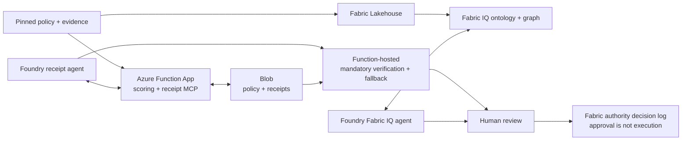

# What the accelerator does, end to end

This is the **cloud solution**, not a local-versus-cloud product choice. The installer
targets a chosen Azure tenant/subscription and an **existing active Fabric capacity**
(`F4+`), reusing the configured Fabric workspace when present or creating it on that
capacity in stage 4 when absent. It does not create a tenant, subscription or Fabric
capacity. See [detailed installation](../deploy/README.md) for all parameters and
prerequisites.

## The pattern in one paragraph

Deterministic code applies a hash-pinned policy to evidence and produces receipts.
Foundry explains receipts through the Function App's read-only MCP tools; a separate
Foundry agent queries Fabric IQ relationships. The approved cloud boundary places
scoring and mandatory receipt-answer verification/fallback in the Function App.
People make and record decisions in a separate Fabric approval workflow. Approval
does not allocate crews, release funds or execute operational work.

## Architecture

The diagram is the approved cloud boundary, **not a claim that every runtime change
has passed live acceptance**. See the [baseline and release gates](azure-mapping.md#verified-baseline-and-release-gates).

Entra ID secures hosted access; Application Insights and Log Analytics provide tracing
wiring. The agents are independent. The four decision-calculation scenarios remain
an evaluated workflow, not tools exposed by the deployed receipt MCP endpoint.

## Steps

| Stage | Responsibility | Important boundary |
|---|---|---|
| Configure | Copy the private parameter template, select tenant/subscription/resources, target Fabric workspace and existing active capacity | Set `parcelCount` once; default 150 |
| Preview | Run the installer with `-WhatIf` | Offline plan, not a live permission/quota test |
| Deploy | Azure resources, Function package, Blob inputs and Fabric data/relationships | Mutating and billable, not a tests-only command |
| Connect | Independent Foundry receipt and Fabric IQ MCP connections/agents | No caller-hosted product tool loop |
| Verify | Tests, current receipt parity, current graph answers and agent traces | Use generated dataset/policy paths; never fixed historical C1-C5 answers |
| Query | Receipt explanations and separate Fabric IQ relationship questions | Server-side receipt verification remains a release gate until integrated and verified |
| Reproduce | Run explicitly selected experiment harnesses in isolation | Historical methods are not cloud deployment acceptance |
| Uninstall | Preview, then deliberately remove configured resources | Destructive; capacity cleanup is a separate operator responsibility |

## One-click install (step by step)

The canonical commands are maintained in [deploy/README.md](../deploy/README.md), not
duplicated here. That guide covers configure, preview, deployment, tracing and teardown.
Use [independent testing](testing.md) without rerunning the installer when only checks
are required, and [experiment reproduction](experiment.md) for new evaluations.

Keep GraphModel refresh manual and preserve the CrewAccess composite key
`["parcel_id", "crew_type"]` in the ontology entity, graph node and edge. Portal
re-saving can collapse that key. Expected CrewAccess coverage is three entries per
configured parcel; the historical 150 entries belonged to 50 parcels.

See [Fabric](fabric.md), [Foundry agent](foundry-agent.md),
[Scenario 2](reports/scenario-2-ontology.md), [human approval](authority.md) and
[security](../SECURITY.md).
