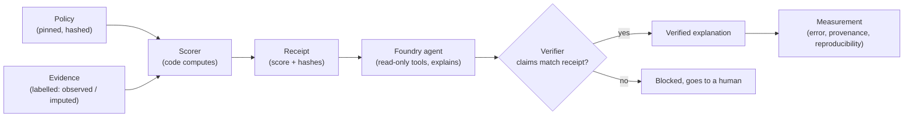
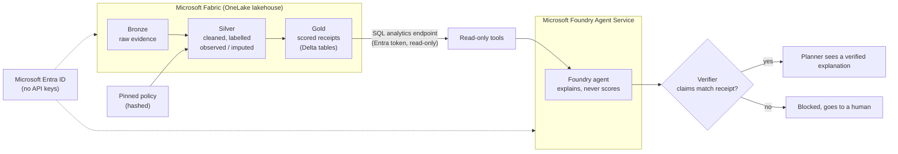
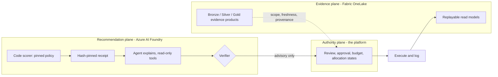
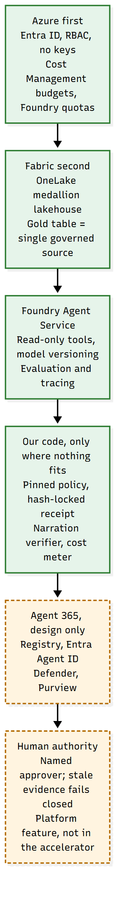
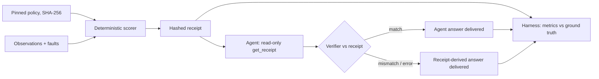

<!--
DRAFT v2 - NOT PUBLISHED. Target: Microsoft Tech Community, Azure Architecture Blog. US English.
v2 re-frames v1 (techcommunity-post.md): Foundry agents for wildfire prevention, forest maintenance and crew allocation,
and how the right data makes them accurate. All numbers are unchanged from v1 and come from docs/evidence/.
Open items before publishing: every "TODO(human)" marker, the pending newer-model results, the "From scores to decisions"
section (waits for docs/decision-scenarios.md), the four chart PNGs, and mermaid-to-image conversion if the editor needs it.
-->

# Making Foundry agents accurate on wildfire decisions: right data, pinned scores

## The Tuesday morning problem

It is 06:40 on a Tuesday in a dry spring. A forestry operations planner opens her queue: 40 parcels, each with a proposed fuel-reduction job, and a crew window that closes Friday. A Foundry agent has already ranked the parcels and written a fluent paragraph for each one, to help her decide which parcels get crews first. Parcel 17 reads "high risk, score 7.2, fully assessed from measured inputs."

By Thursday, three things have gone wrong, and none of them looks like a failure of the model:

1. **A confident, wrong number.** The agent worked out the 7.2 itself, from raw readings and a scoring rubric in its prompt. The real score under the operator's own policy was different.
2. **A guess called a measurement.** The wind reading behind parcel 17 came from a gap-filling routine, yet the paragraph said "observed."
3. **Stale evidence.** A weather update arrived after the crew was reserved, and nothing noticed that the assessment behind the booking was no longer valid.

(This opening is an illustrative scenario, not a reported incident.)

The agent is not unintelligent. It was given the wrong job and the wrong data: it was asked to compute, it was not given labelled evidence, and nothing checked its answer against a source of truth. This article shows how to give a Foundry agent the right data and the right limits, and what we measured when we tested it.

> **The claim: a Foundry agent over regulated numbers is accurate when it is fed pinned, labelled data and checked against it. The accuracy comes from the data and the checks, not from a smarter model. Code computes and pins the score; the agent explains; a verifier checks.**

The pattern is one chain, and every link leaves an artifact you can inspect: **policy → labelled evidence → receipt → verified agent explanation → measurement**.



*Figure 1. Where the agent sits. Numbers come only from the scorer; the agent can read and explain them but cannot change them.*

Three distinctions follow from it:

- A receipt is not a correct decision. It proves which policy and inputs produced a number, not that the policy was right.
- A fluent explanation is not a verified one. The verifier compares each claim with the receipt before the planner sees it.
- A source label is not a source. "Observed" and "imputed" travel as data from the input onward, never inferred from prose.

## The pattern on Microsoft technology: the accelerator design

The accelerator in the repository is this pattern built on two Microsoft services: **Microsoft Fabric** holds the pinned, labelled data, and **Microsoft Foundry Agent Service** hosts the agent that explains it. **Microsoft Entra ID** controls access throughout, with no API keys.



*Figure 2. The accelerator design on Microsoft services. The live Gold read through the SQL endpoint, least-privilege grants and managed identity are design; the status table below says what ran.*

| Pattern step | Microsoft technology | Status |
|---|---|---|
| Right data, labelled | Fabric lakehouse, medallion tables (Bronze, Silver, Gold) | Demonstrated live |
| Pinned policy, scorer, receipt | Versioned code and a hashed policy, run in Fabric; receipts stored as Gold Delta tables | Demonstrated; 50 of 50 receipt hashes match |
| The agent | Foundry Agent Service with read-only function tools | Demonstrated live |
| Verifier | Code between the agent and the planner | Demonstrated |
| Identity | Entra ID with `DefaultAzureCredential` | Demonstrated; managed identity is design |
| Agent reads Gold | Lakehouse SQL analytics endpoint with an Entra token | Code and tests only; not run against a live endpoint |
| Measurement | Foundry tracing and evaluation export | Tested with mocks; no Foundry evaluator run |

The per-service mapping and a Well-Architected assessment are in the repository's `docs/azure-mapping.md`.

## What a Foundry agent can do for forest maintenance and crew allocation

Used this way, the agent helps a planner with four jobs:

| Job | What the agent does | What it must be given |
|---|---|---|
| **Rank the work** | Explains why parcel 17 ranks above parcel 22 for fuel reduction | A pinned score and its labelled inputs, not raw readings to interpret |
| **Book crews** | Summarizes which parcels are ready for the Friday window and which are not | The receipt status (`complete` or `incomplete`) and the reason |
| **Catch change** | Tells the planner that a booking rests on evidence that has expired or been superseded | Evidence with an `as_of` date and a freshness window |
| **Answer afterward** | Shows a regulator or landowner why one parcel was treated first, and on what evidence | Receipts and hashes that can be replayed |

In each row, the right-hand column is the real lever. The agent is only as accurate as the data it reads. The rest of this article is about that column.

## What informed this pattern

This pattern comes from two sources that we want to keep clearly separate.

**Engagement experience.** The governance framing, the three planes and the gate policy come from a governance-first blueprint for EU forestry operators, grounded in public guidance [1]-[10]. It was shaped by work on a wildfire-prevention platform where the requirement was to let a user approve or reject proposed prevention jobs without turning a planning conversation into permission to dispatch crews.

> **TODO(human):** Add the real, anonymised engagement facts you are cleared to share: sector and rough size of the operator (for example, "a regional forestry operator"), how many parcels or jobs per planning cycle, what the approval process looked like before, and which of the five gaps below the team felt most. Do not name the customer without written permission. Do not add numbers you cannot source. If nothing can be shared, delete this paragraph and say only that the pattern is a synthesis of public governance guidance and a reference implementation.

**A simulated executable specification.** One scenario in the source blueprint tests the boundary between preserving a past decision and permitting the next action. An intervention receives a reservation after its prerequisites are met. A simulated weather-change event then invalidates the supporting assessment for that same release and job. The reservation stays in history, but the operations approval is rejected, and the reservation's status becomes "requires reassessment; starting work is not authorized."

We label this clearly: **it is a simulated executable specification.** It uses simulated identities, controlled inputs and an in-memory transactional store. It is not evidence of live weather integration, field incidents or reduced wildfire risk. It defines the behavior we expect; it does not show that crews were safer.

The operational gaps behind the design are familiar to anyone who has tried to put AI into a regulated workflow:

| Gap | What goes wrong |
|---|---|
| Regulatory translation | Legal and governance obligations are prose; field teams need decision rules per scope and timing [1][3] |
| Evidence and reporting | You must defend the evidence path behind each decision, not just the outcome [2][6] |
| Signal to action | Fire signals arrive quickly; approvals do not [4][5] |
| Governance control | Recommendation quality and execution authority get mixed in everyday workflows [6][7] |
| Accountability replay | After an event you must reconstruct who decided what, when, on which evidence [2][6] |

## Giving the agent the right data: three planes, three Azure homes

The pattern anchors on the NIST AI Risk Management Framework lifecycle (Govern, Map, Measure, Manage) [6] and is consistent with the human-oversight, logging and robustness expectations of the EU AI Act's risk-based approach [7]. We implement it as three planes. The point is not one smart agent. It is that the agent reads from controlled data, and nothing executes without passing controlled transitions.



**Evidence plane (Fabric OneLake): where the agent's data comes from.** Evidence must be scope-correct, current for the decision window, traceable to source and reviewable afterward. Medallion products (Bronze, Silver, Gold) in OneLake hold governed evidence and read models. If evidence is missing, stale, conflicting or not bound to the exact decision context, progression is blocked. This is what turns "the agent says so" into "the data says so."

**Recommendation plane (Azure AI Foundry): where the agent works.** The Foundry agent proposes risk prioritization, scheduling options and evidence drafts. Everything here is advisory. It reads receipts through read-only tools, explains them, and passes through a verifier. It can say what to do next and why. It cannot decide whether the action is authorized.

**Authority plane: where decisions are made.** In the Wildfire platform this is a transactional layer that sits outside the accelerator; the accelerator hands recommendations to it. Decision rights live in that system with explicit workflow states for review, approval, budget, allocation and execution readiness. High model confidence does not advance a state. Only a designated, authenticated owner does. Microsoft Entra ID separates user and service identities and scopes roles across all three planes. Microsoft 365 agents are a fine channel for briefings and notifications, but they should not be the decision engine for interventions.

A wildfire-prevention action is safe to operationalize only when all three planes converge on the same decision instance: the same intervention, the same location scope and the same execution window.

## A control framework for Foundry agents, built Microsoft-first

The three planes say where things live. A control framework says what stops the agent doing harm, and which Microsoft service enforces it. We choose in this order: Azure first, then Fabric, then Microsoft Agent 365 for governing the agent as an organizational asset. Only where none fits do you write your own code.

| Layer | What is controlled | Microsoft service first | Our code adds | Status in the accelerator |
|---|---|---|---|---|
| 1. Data | Evidence is scoped, fresh and traceable | Fabric OneLake medallion lakehouse; Fabric workspace roles | Provenance labels on every input | Built and measured (50/50 hashes) |
| 2. Score | The number cannot be invented or drift | Fabric (Gold table as the single governed source) | Pinned policy version and hash-locked receipt | Built and measured |
| 3. Agent | The agent can read, not change | Foundry Agent Service with read-only function tools; model versioning | Tool allow-list and read-only flag | Built; flag tested offline |
| 4. Verification | Every sentence is checked against the receipt | Foundry evaluation and tracing | Narration verifier that blocks wrong numbers | Verifier built and measured; tracing export is a mock |
| 5. Identity and access | Who and what may call what | Microsoft Entra ID, no API keys; Azure RBAC | Secrets-scan test | Entra and no keys built; managed identity is design only |
| 6. Agent governance | The agent is registered, owned and monitored like a coworker | Microsoft Agent 365 (agent registry, Entra Agent ID, Defender, Purview) | Nothing; this is configuration | Design only. Not built or tested here |
| 7. Authority | A named human approves, and stale evidence fails closed | Microsoft Entra roles for planner and approver | Transactional approval service (in the platform, not the accelerator) | Platform feature; simulated in tests |
| 8. Cost | Spend is visible and capped | Azure Cost Management and budgets; Foundry quotas; Fabric capacity pause and resume | Per-run cost meter and budget guard | Meter and guard built; Azure budgets design only |



*Figure 3. Control layers in the order we choose them. Green is built and tested in the accelerator; dashed amber is design only or a platform feature.*

**How you would do it, in order.**
1. **Start in Azure.** Create the Foundry project, give the agent an Entra identity with least-privilege roles and no keys, and set a budget and quota before the first call.
2. **Put the data in Fabric.** Load the Gold table, make it the only thing the agent's tools can read, and lock the receipts.
3. **Add the code controls Microsoft does not provide.** Pin the policy, hash the receipt and verify each sentence. These are small, testable and portable.
4. **Register and govern the agent with Agent 365.** This gives you an inventory, an accountable owner, access policy and threat and data-loss monitoring across all your agents. We describe it as the target operating model. We did not build or test it, and it depends on your Microsoft 365 and Entra licensing.
5. **Keep authority with people.** The agent can advise. Only a named approver advances a decision.

The accelerator demonstrates layers 1 to 5 and 8 in code, and says plainly where a layer is design only. The next section shows the decision lifecycle those layers protect.

## How a decision moves, and where it stops

A repeatable lifecycle beats an ad hoc sequence of checks:

1. **Recommend** with explicit assumptions, confidence and freshness context.
2. **Screen for policy eligibility.** Out-of-policy operations are rejected before deeper work.
3. **Check authority readiness.** Required owners and prerequisites are verified.
4. **Validate evidence** for scope, validity window, provenance and version against the exact decision instance.
5. **Authorize or block.** Only decisions passing both gates become executable.
6. **Execute and log** with immutable metadata linking recommendation, approvals and evidence.
7. **Replay and review.** Reconstruct causality from input to action.

Every step fails closed. A scope mismatch, expired evidence, missing authority or unresolved policy leaves the state blocked, and no model output can promote it. For crew allocation this means a parcel with incomplete or stale evidence never reaches the Friday crew list on the agent's say-so. It goes back to a human. Blocked decisions become a measurable signal (recurring freshness failures, recurring approval bottlenecks) that you can improve without weakening a guardrail. The trade-off is deliberate: progression pauses for reassessment rather than continuing on outdated evidence.

### The decision packet

Before any state is execution-eligible, the packet should carry:

- Intervention ID, parcel scope and execution window.
- Recommendation metadata: `as_of`, confidence, assumptions, model or release ID.
- Authority chain: required approvers, current approval state, budget state.
- Evidence set: source IDs, version or hash, freshness window, policy checks.
- Outcome state (`blocked`, `eligible`, `authorized`, `executed`) with timestamped transitions.

### The gate policy

- **No scope match, no progression.** Recommendation, authority and evidence must name the same intervention and window.
- **No freshness, no progression.** Expired or superseded evidence is never current.
- **No authority, no progression.** Confidence does not replace approval.
- **No replay trail, no progression.** Missing immutable decision metadata invalidates the state.

Prompt quality alone cannot enforce these boundaries. They need to be explicit state controls.

## Measured evidence: does the right data make the agent accurate?

Parcel 17 is an illustration, not a statistic. To find out how often an agent makes the same mistakes, we ran 50 synthetic parcels three times each and counted. The test varies one thing: **how much of the right data the agent is given.**

| Tuesday failure | What we tested | Status |
|---|---|---|
| A confident, wrong score | Score error against the scorer's answer | Measured |
| A guess called a measurement | How often provenance is misstated | Measured |
| The same question, a different answer | Reproducibility across three repeats | Measured |
| Bad inputs slipping through | Detection of injected faults (missing, stale, tampered) | Measured |
| Receipts breaking when data moves platform | Hash match across a Fabric medallion run | Reproduced on Fabric (50 of 50) |
| Weather changing after the crew was booked | Reassessment on a simulated weather event | Simulation only, not measured here |

The source blueprint describes the architecture. This repository, the **WFI Pinned Scoring Accelerator**, tests one slice of it: the recommendation plane's "code computes, the agent explains, a verifier checks" rule. It does not implement the authority plane. Its Fabric lakehouse is an optional add-on. Everything below was measured on **50 synthetic parcels**, 3 repeats, with `gpt-4.1` and `gpt-4.1-mini` on Azure OpenAI at temperature 0. All numbers are from committed files under `docs/evidence/`, and the charts regenerate from them without any LLM calls.

### Three ways of feeding the agent

- **Arm A, raw data.** The model sees raw evidence and the rubric and does the scoring itself.
- **Arm A+, a hint.** The same, plus the scorer's receipt as a hint, with no tools or verifier.
- **Arm B, pinned data and a check.** The model sees nothing up front, can call read-only receipt tools, and its answer passes through the verifier. We report Arm B twice: the delivered answer after verification (B) and the model's raw output before it (B(raw)).

Ground truth comes from the scorer on injected faults such as missing, stale and tampered inputs.

A policy (weights, ranges, bands, allowed provenance) is pinned by SHA-256. A deterministic scorer turns evidence into a hashed **receipt** containing score, band, status and per-factor provenance. Missing, expired or wrongly sourced evidence yields `incomplete`, never a guess. The verifier compares every number and label in the agent's answer with the receipt and, on any mismatch, delivers a receipt-derived text instead.



### What we found

| Measure (gpt-4.1) | Arm A (raw data) | Arm B (pinned data + check) |
|---|---|---|
| Score error, mean absolute (points) | 49.2 (95% CI 34.0 to 63.5) | 0.0 |
| Provenance misstated | 0.21 | 0.00 |
| Fault detection | 0.78 | 0.989 |
| Reproducible across repeats | 0.34 | 1.00 |

**An agent that does the scoring is far off.** Arm A mean absolute error was 49.2 points for gpt-4.1 and 25.8 for gpt-4.1-mini. Giving it the receipt as a hint helped but did not remove the error: Arm A+ was 11.7 and 18.3. The unverified agent output (B(raw)) was 57.7 and 55.0 points off, so tools alone are not enough.


**It misstates where data came from.** In 21% of gpt-4.1 Arm A answers (25% for gpt-4.1-mini) the stated provenance of a factor differed from what was injected, for example calling generated weather "observed." That is the failure that would hurt in an audit.


**It does not repeat itself.** Only 34% and 36% of parcels got an identical (status, score, band) across three repeats in Arm A, at temperature 0.

**Pinned data plus a check removes these errors in delivered answers.** Arm B delivered zero score error and zero provenance misstatement, fault detection of 0.989 (gpt-4.1) and 1.0 (gpt-4.1-mini), and 1.0 reproducibility.

### Do newer models fix it?

Partly, and we want to be plain about it. We re-ran the same experiment (same 50 parcels, same seeds, three repeats) on `gpt-6.1-sol`, a newer reasoning model. It scored every arm with zero score error, zero provenance misstatement, fault detection of 1.0 and reproducibility of 1.0, **including the arm with no pinned data at all.** The gap we measured on gpt-4.1 (score error of 49.2, reproducibility of 0.34) did not appear.

So "a raw model cannot be trusted with the arithmetic" is a property of the weaker model we tested, not of language models in general. On this benchmark the measured accuracy benefit of the pattern for a strong model is nil, and the benchmark is saturated: with zero variance it cannot rank strong models or reveal rare failures.

What the pattern still gives you is a guarantee rather than a measured improvement: a score and receipt that do not depend on the model happening to be accurate, and protection if the model is swapped back to a weaker one (gpt-4.1 without the check had a score error of 57.7).

Caveats. This is one model and one benchmark. It ran at default reasoning effort rather than temperature 0, because it rejects that setting, so part of the gain may be extra reasoning compute. We could not test Anthropic models: both deployments were refused by a Marketplace policy on our subscription, so we have no Anthropic data and imply none. Full detail is in `docs/model-comparison.md`.

### Read the zero carefully

The zero is largely true by construction. Arm B's verifier blocked 91% of gpt-4.1 runs and 87% of gpt-4.1-mini runs, and a blocked answer is replaced by receipt-derived text, which is correct by definition. The verifier is doing the work, not the model. We investigated the block rate rather than celebrate it:

- About 41% of the original blocks (108 of 262) were HTTP 429 rate-limit errors. The fallback is delivered on errors, so they were counted as blocks, but they are not verifier decisions.
- For gpt-4.1, the blocks were real: 93 of 150 runs skipped the tool and hallucinated a score, a band and "fully scored."
- For gpt-4.1-mini, most blocks were over-strict wording rules (hedged but true phrasing, negation scope). We relaxed the clause-level checks, which cut its block rate from 87% to 52%, while still blocking a wrong score, band, reason or provenance.


### Evidence that the receipts survive a platform move

The same 50 parcels were also run through a Fabric medallion path (raw, silver, gold) and compared hash by hash with the committed receipts. The first run matched 43 of 50. The seven misses were real defects, and the hash check caught them:

- **A unit conversion that hid a fault.** Two parcels carried a dead-fuel value of 40.4 labelled as a fraction when the policy expects a percentage. The silver step multiplied it by 100 and scored 4,040%. It now refuses to convert a "fraction" outside 0 to 1 and the receipt reads `incomplete` with reason `unit:dead_fuel_pct`.
- **A quality flag silently dropped.** Five parcels had factors the source had marked `invalid`. The bronze layer discarded the flag, so the factor was scored. The flag is now carried through, and the receipt drops that factor with reason `invalid:<metric>`.

After both fixes all 50 gold receipt hashes match the committed evidence, locked by a regression test (`tests/test_medallion_matches_evidence.py`). Pinning by hash turns "the numbers look plausible" into "the numbers are identical", and it found bugs that spot checks would have missed. It is also the practical answer to "is the agent's data the right data": the agent reads the Gold receipt, and the receipt is provably the one the policy produced.

### Is the agent worth having?

We ran a second experiment: 20 fixed questions over 14 parcels, the verified agent's delivered answer versus a deterministic template, scored blind by an LLM judge (`gpt-4.1-mini`, randomized A/B order) on three rubric criteria. Faithfulness was a hard code check, not a judgment, and neither arm had a violation.

The agent won 53% of judgments, tied 5% and lost 42%. The mean rubric difference was +0.23 out of 15, with a 95% confidence interval of -1.80 to +2.25. **That is not statistically significant.** It helps on "why is this incomplete" (100% wins) and "what if" (67% wins, 33% ties), and loses on "what should I do next" (25% wins) and "compare" (33%). Seven of the 20 agent answers were blocked and replaced with terse fallback text, and our own reading is that several were false blocks, which is a cost of a conservative verifier.


So the honest value claim is this: **if you put a Foundry agent over regulated numbers, this pattern makes it safe and measurable. The agent adds convenience, not accuracy.** The accuracy comes from the pinned data and the verifier. The template is already exactly right. If all you need is correct numbers and reasons, ship the template. Add the agent when natural-language access is worth having, and when you value a guarantee that it cannot silently contradict the receipt.

## From scores to decisions: ranking parcels and allocating crews

A score on its own does not move a crew. The planner asks questions such as "who is exposed if this parcel ignites?" To test that, we added a small graph to the accelerator: parcel, asset, power feeder, then the customers and critical facilities that feeder serves. **The graph data is synthetic and assumed**: customer counts, costs and mitigation effects are invented, and nothing here validates real feeders.

### Understanding the job, not just the score

A risk score says how urgent a parcel is. It does not say what the job involves or how to carry it out. That depends on how things connect: which road reaches the parcel, which homes and facilities sit downwind, where the nearest water source is, and whether a crew can get in and out safely. An ontology (a shared model of the things in the domain and the relationships between them) holds those connections in one place, so the agent reads them from the model and does not have to guess:

`parcel → access road → homes and critical facilities → water source → crew access`

Following that chain turns a ranked list into a workable job. The agent can answer "which parcel first?" and also "who is exposed, how do crews get there, what water is within reach, and what has to be true before they start?" Fabric holds the graph, the scorer fixes the numbers, and the agent reads the relationships, explains them and flags what is missing.

Three limits apply. The accelerator's tested graph covers parcel, asset, feeder and the customers and facilities served. Road, water and crew-access links are the design this chain describes, not something we tested. Each link needs the same provenance label as a score, because a missing or wrong edge produces a confident but wrong explanation, and the verifier checks only against pinned data, not the graph itself. And the ontology informs the people who decide; it does not approve the job, which stays with the authority plane.

We built four scenarios, each computed by the real scorer, never by the model:

- **Exposure:** which customers and facilities are exposed if high-score parcels ignite, to decide where to pre-position crews and whom to warn.
- **Mitigation:** which action gives the biggest risk reduction per dollar, to decide what to fund first.
- **Red-flag day:** which feeder to de-energise first when wind and weather danger rise.
- **Robustness:** whether any of those calls change if a policy weight moves by 20%.

Only the 25 of 50 parcels that score are used. The other 25 carry injected data faults and are listed as excluded, never guessed. Every what-if figure is marked as a counterfactual and carries the hash of the policy it was computed under.

We then compared two Foundry agents on 20 questions, with the same model, receipts and scorer. The graph agent had tools for the scenarios above. The flat agent had raw tables and had to join and total them itself.

| Agent | Correct | Provenance right | Numbers pinned |
|---|---|---|---|
| With scenario tools | 100% | 100% | 100% |
| Flat tables | 5% | 75% | 35% |

The flat agent hit its round limit on all five red-flag questions. Read this fairly: the flat agent had no scenario tools, so the result shows pre-computed pinned tools beating model-side arithmetic. It does not show that graphs are better in themselves, and a flat agent with SQL or code execution was not tested. This was one model, one repeat and one data seed. The point for planners is the same as before: the agent should fetch decision numbers from code that is pinned and checked, not total them in its head.

## Agent roles and guardrails

Agents should speed analysis and preparation, not replace accountability.

| Agent | May do | May not do | Human gate |
|---|---|---|---|
| Risk and fuel assessment | Read-only scoring with `as_of`, confidence and source metadata | Expose any operational write path | Planning owner |
| Prevention scheduling | Propose sequencing and packages | Commit execution state or bypass blocked controls | Operations and budget owner |
| Ignition alert | Create alert candidates | Issue a dispatch; uncertain detections stay unresolved | Incident or operations lead |
| Compliance evidence | Assemble the evidence pack | Grant legal clearance; stale evidence blocks | Compliance owner |
| Reporting and insights | Serve read models with lineage | Alter operational state | Governance review |

A shared baseline applies to every operational path:

1. **Bounded tool surface.** The model gets approved read and recommendation functions only. Operational writes sit behind non-LLM endpoints.
2. **Strict contract validation** of schema, types, sizes and allowed fields before any read.
3. **Scope and version pinning** with exact dataset, scenario and release identifiers on every request and response.
4. **Authority separation.** Authority flags in recommendation outputs are non-authoritative; approvals are separate transactions.
5. **Trusted identity path.** Identity comes from host authentication, never from model arguments.
6. **Fail-closed errors.** Source and policy failures are blocking states, with no fallback to weaker data.
7. **State and expiry integrity.** Invalidated, expired and superseded statuses are preserved verbatim.
8. **Replay-by-design logging** of scope, owner, evidence and version identifiers, timestamps and outcome.

These controls are consistent with secure-AI and LLM-application guidance [8][9]. For Azure-specific design guidance, see the [Well-Architected Framework workload guidance for AI](https://learn.microsoft.com/azure/well-architected/ai/), the [Microsoft Foundry documentation](https://learn.microsoft.com/azure/ai-foundry/) and the [Microsoft Fabric documentation](https://learn.microsoft.com/fabric/).

## Anti-patterns

| Anti-pattern | Resulting risk | Design decision |
|---|---|---|
| Asking the agent to compute the score from raw readings | Confident wrong numbers (49.2 points off in our test) | Compute in code, pin the policy, let the agent read the receipt |
| One API returns both recommendation and execution status | A de facto auto-approval path | Separate recommendation APIs from authority transaction APIs |
| Flexible identifier handling across services | Scope drift across parcel, time and release | Enforce exact scope and version equality at every gate |
| "Best effort" fallback on source or policy failure | Silent downgrade to weak or stale evidence | Fail closed with an explicit blocked state |
| Mutable audit fields overwritten by the latest state | Post-event decisions cannot be defended | Keep an immutable transition log and evidence digests |
| Agent-generated identity context | Broken accountability and role confusion | Bind identity only from trusted Entra-authenticated context |

If any of these remains at design review, the system is not ready for operational use.

## When not to use it, and what we did not prove

**When not to use the pinned-scoring pattern.** There are no stable rules to pin, because the output is a judgment or a forecast. Answers contain no numbers or labels a verifier can check. A wrong or unrepeatable answer costs nothing. Or volume and latency requirements rule out extra tool calls and a verifier pass (we did not measure this cost).

**Limits of this evidence.**

- **Synthetic data only.** 50 synthetic parcels, one domain. Not validated on real data.
- **Simulated tests only.** The reservation-versus-weather scenario is an executable specification with simulated identities and an in-memory store.
- **No measured field outcomes.** We have no measurements of wildfire-risk reduction, dispatch decisions, crew safety, crew utilization or operational cost. Nothing here shows the pattern changes outcomes on the ground.
- **Arm B's zero is largely by construction**, as explained above.
- **The authority and evidence planes are design arguments here**, apart from the Fabric hash-match run. The platform's authority workflow, Entra identity binding and live Fabric replay are specified in the blueprint and not tested in this repository; only the recommendation plane's scoring, receipts and verifier were.
- **Other caveats.** The usefulness study used an LLM judge on 20 questions, not a human study, and the judge is a smaller model from the same family. Cost, latency and verifier overhead versus analyst time saved were not measured. Policy weights are owner-chosen examples, not calibrated. The verifier still has some false blocks.

## Monday-start checklist

1. Write down the decision states (`blocked`, `eligible`, `authorized`, `executed`) and who may move each one.
2. Define the decision packet and make every transition carry scope, window, evidence version and approver.
3. Pin your scoring policy by hash, and compute scores in code, not in a prompt.
4. Label every input as observed or imputed, and carry the label as data into the receipt.
5. Give the agent read-only tools over receipts. Keep every write behind a non-LLM endpoint.
6. Add a verifier that compares each delivered number and label to the receipt, and decide what text ships when it blocks.
7. Fail closed on missing, stale, conflicting and unverifiable evidence. Log blocks by cause, and separate infrastructure errors from real decisions.
8. Build an immutable transition log so a reviewer can replay any decision.
9. Measure against a plain template before you claim the agent helps.

## Where each part lives in Azure

| Part | Azure home |
|---|---|
| Policy, scorer, receipts, verifier | Plain Python; no service needed |
| Explanation agent with read-only tools | Foundry Agent Service |
| Evidence (Bronze, Silver, Gold) | Fabric Lakehouse, medallion tables |
| Gold read for the agent | Lakehouse SQL analytics endpoint, Entra ID auth |
| Deployment | Bicep and a Fabric provisioning script |
| Identity | Microsoft Entra ID, `DefaultAzureCredential`, managed identity; no API keys |

What runs today: the scorer, the Foundry agent with the verifier, and the Fabric load (50 receipts match the committed evidence). What is design only: live SQL-endpoint reads, least-privilege grants, trace export, and any cost, latency or availability targets, none of which we measured. A pillar-by-pillar Well-Architected assessment is in the repository's `docs/azure-mapping.md`.

## Try it

The repository contains the policy, scorer, receipts, verifier, agent, experiment harness, optional Fabric transforms and Bicep deployment, with all evidence committed.

A bounded pilot, in three steps:

1. Replace the example policy with your own scoring rules and run the scorer on a small set of your parcels or assets. Confirm the receipts reproduce on a second run.
2. Run the experiment harness with your own faults injected, and compare the arms. Our numbers come from synthetic data, so yours are the ones that matter.
3. Put the agent behind the verifier for a limited group of users, and review the verifier's rejections weekly before widening access.

Stop if receipts do not reproduce or if the verifier rejects too many explanations to be useful.

> **TODO(human):** Insert the public repository URL here once you have approved release. The repository is private today.

```powershell
pip install -e .[dev]
python -m pytest -q
pip install -e .[charts]
python scripts/make_charts.py
```

## References

[1] European Commission, Regulation on deforestation-free products (EUDR): https://environment.ec.europa.eu/topics/forests/deforestation/regulation-deforestation-free-products_en

[2] European Commission, Corporate sustainability reporting: https://finance.ec.europa.eu/financial-markets/company-reporting-and-auditing/company-reporting/corporate-sustainability-reporting_en

[3] European Commission, Nature Restoration Regulation: https://environment.ec.europa.eu/topics/nature-and-biodiversity/nature-restoration-regulation_en

[4] Copernicus, European Forest Fire Information System (EFFIS): https://forest-fire.emergency.copernicus.eu/

[5] NASA, Fire Information for Resource Management System (FIRMS): https://firms.modaps.eosdis.nasa.gov/

[6] NIST, AI Risk Management Framework: https://www.nist.gov/itl/ai-risk-management-framework

[7] European Commission, EU AI Act regulatory framework: https://digital-strategy.ec.europa.eu/en/policies/regulatory-framework-ai

[8] UK NCSC, Guidelines for secure AI system development: https://www.ncsc.gov.uk/collection/guidelines-secure-ai-system-development

[9] OWASP GenAI Security Project, Top 10 for LLM Applications 2026: https://genai.owasp.org/resource/owasp-genai-llm-top-10-2026/

[10] Stanford HAI, AI Index Report 2025: https://hai.stanford.edu/ai-index/2025-ai-index-report

Microsoft Learn: [Well-Architected Framework, AI workloads](https://learn.microsoft.com/azure/well-architected/ai/) · [Microsoft Foundry](https://learn.microsoft.com/azure/ai-foundry/) · [Microsoft Fabric](https://learn.microsoft.com/fabric/)
