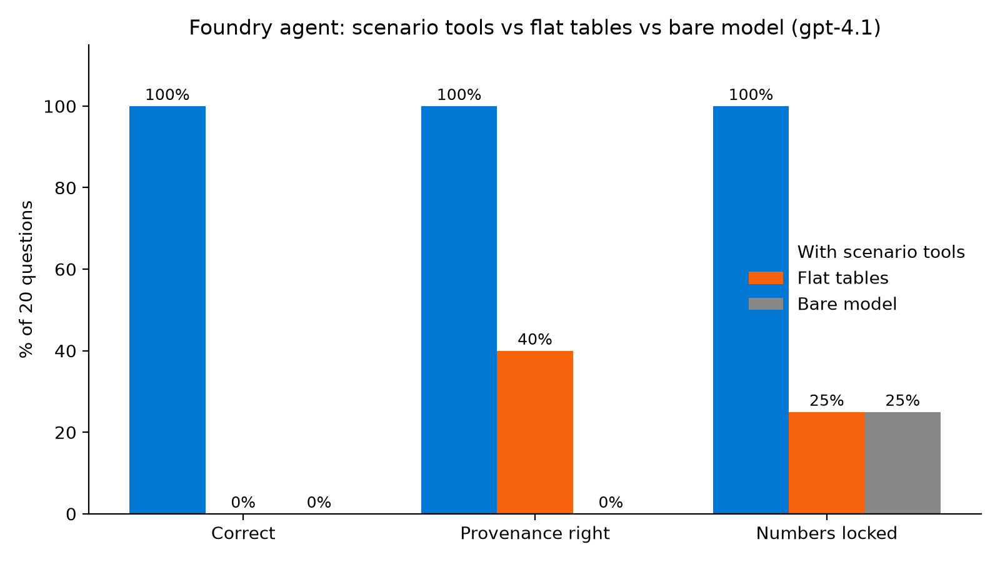
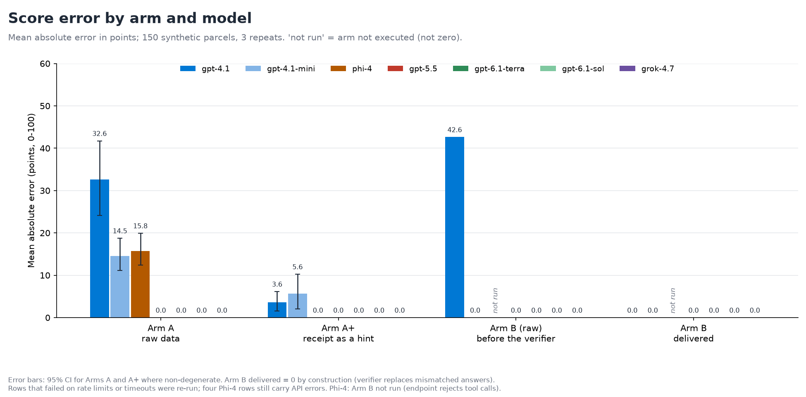
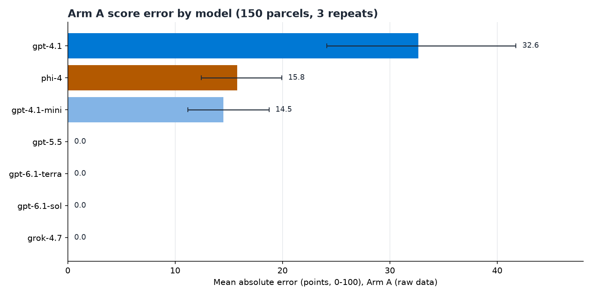

# Forestry crew allocation with Foundry agents: pin the score, ground the agent, keep the decision human

*By Eneko Vallecillo, Principal Solution Engineer, Microsoft UK*

*How a Microsoft Foundry agent, pinned risk scores and a Fabric ontology can help a forestry planner decide which parcels get crews first, without the agent inventing a number or approving its own work.*

**In short:** We tested one use case: allocating forestry crews to fuel-reduction jobs before a fire-weather window. The approach has four parts. Code computes and pins each parcel's risk score. Fabric grounds the agent in labelled evidence and an ontology of roads, homes, water and crew access. A Foundry agent turns that into ranked recommendations and next steps, which a verifier checks. A named planner makes the decision. On synthetic data, a gpt-4.1 agent left to compute scores itself was 49 points off on average; with pinned scores and the verifier, delivered answers had zero score error. This post covers the use case, the approach, the security and governance controls, what we measured and what we did not prove.

## The Tuesday morning problem

It is 06:40 on a Tuesday in a dry spring. A forestry operations planner opens her queue: 40 parcels, each with a proposed fuel-reduction job, and a crew window that closes on Friday. She has fewer crews than jobs. Her question is simple: **which parcels get a crew first, and can the crews actually do the work?**

A Foundry agent has already ranked the parcels and written a fluent paragraph for each one. Parcel 17 reads "high risk, score 7.2, fully assessed from measured inputs." By Thursday, three things have gone wrong, and none of them looks like a failure of the model.

- **A confident, wrong number.** The agent worked out the 7.2 itself, from raw readings and a scoring rubric in its prompt. The real score under the operator's own policy was different.
- **A guess called a measurement.** The wind reading behind parcel 17 came from a gap-filling routine, yet the paragraph said "observed."
- **Stale evidence.** A weather update arrived after the crew was reserved, and nothing noticed that the assessment behind the booking was no longer valid.

*(This is an illustrative scenario, not a reported incident.)*

The agent was not unintelligent. It was given the wrong job and the wrong data: it was asked to compute, it was not given labelled evidence, and nothing checked its answer. Crew allocation makes this worse, because a ranked list is not a plan. Knowing that parcel 17 is urgent says nothing about whether a crew can reach it, who lives downwind or where the nearest water is.

### What the planner actually needs

| Planner's question | What the agent should do | What it must be grounded in |
|---|---|---|
| Which parcels first? | Rank and explain why parcel 17 comes before parcel 22 | Pinned scores and their labelled inputs, not raw readings |
| Can a crew do the job? | Show access, exposure, water and what is missing | An ontology linking parcel, road, homes, facilities, water and crew access |
| What should happen next? | Propose next steps and crew pre-positioning | Scenario tools computed by code, not arithmetic in the prompt |
| Is the booking still valid? | Flag evidence that has expired or been superseded | Evidence with an as_of date and a freshness window |
| Why did we choose this? | Show a regulator or landowner the evidence afterward | Receipts and hashes that can be replayed |

The right-hand column is the real lever. The agent is only as accurate as the data it reads.

## The approach: pin, ground, recommend, verify, decide

We built the WFI Pinned Scoring Accelerator to test this approach on Microsoft Fabric and Microsoft Foundry. The idea is to let each component do what it is good at. Code is good at arithmetic. Fabric is good at governed, versioned data. A language model is good at explaining and connecting information in plain language. People are accountable for decisions.

![Flow diagram of forestry crew allocation in seven numbered steps: evidence in Fabric Gold tables, a pinned scorer that writes a receipt, an ontology of parcel, road, homes, facilities, water and crew access, a Foundry agent with read-only tools that ranks and proposes next steps, a verifier that checks numbers and labels against the receipt, a planner who approves, and the Friday crew list. A verifier mismatch or a planner rejection sends the job to a blocked state that returns to a human. A security and governance band underneath lists Microsoft Entra ID, least privilege, cost controls, Agent 365 (design only) and an immutable decision log](../../dissemination/figures/fig00_crew_allocation_flow.png)

*Figure 1. Forestry crew allocation, end to end. Numbers come only from the scorer; the agent recommends; a named planner decides.*

1. **Ground the agent in labelled evidence.** Parcels, readings and receipts live in a Fabric lakehouse. Every input carries a label saying whether it was observed or imputed, and an as_of date.
2. **Pin the score.** Code computes each parcel's score under a fixed, hashed policy and writes a receipt containing inputs, weights, band, status and hashes. Missing, expired or wrongly sourced evidence produces "incomplete," never a guess.
3. **Connect the job context with an ontology.** A Fabric ontology links each parcel to its access road, the homes and critical facilities downwind, the nearest water source and crew access.
4. **Recommend with a Foundry agent.** The agent reads receipts and the ontology through read-only tools, ranks the parcels, explains them and proposes next steps. It never changes a score.
5. **Verify.** A checker compares every number and label in the agent's answer with the receipt and blocks any mismatch.
6. **Decide.** Only a named planner moves a job onto the crew list, and every step is logged.

> **Author note:** Author to confirm: the ontology's status wording ("defined", "bound" or "queried") once the end-to-end run reports.

What we do not claim: fewer fires, safer crews or faster work. The ontology informs the decision and people approve it. Anything we did not test is labelled design only.

## Step 1: Pin the score

A Foundry agent should never be the thing that computes a regulated number. The scorer is plain Python. It takes a policy (weights, ranges, bands and allowed provenance) that is pinned by SHA-256, and it turns each parcel's evidence into a hashed receipt. The receipt records the score, band, status and, for each factor, whether it was observed or imputed.

Three rules follow:

- **A receipt is not a correct decision.** It proves which policy and inputs produced a number, not that the policy was right. The policy owner remains accountable for the weights.
- **A source label is not a source.** "Observed" and "imputed" travel as data from the input onward and are never inferred from prose.
- **A fluent explanation is not a verified one.** The verifier compares each claim with the receipt before the planner sees it.

## Step 2: Ground the agent in the right data

Grounding means the agent can reach only controlled, labelled data, and nothing it says can move a decision forward on its own. We organize this as three planes, anchored on the four functions of the NIST AI Risk Management Framework (Govern, Map, Measure, Manage) [6] and consistent with the human-oversight, logging and robustness expectations of the EU AI Act [7].


*Figure 2. Three planes. Recommendations and evidence flow into the authority plane; only a designated owner advances a decision.*

- **Evidence plane (Microsoft Fabric OneLake).** Bronze, Silver and Gold tables hold scope-correct, timestamped and traceable evidence. The agent's tools can read Gold only, never raw or Silver data. Missing, stale or conflicting evidence blocks progression.
- **Recommendation plane (Microsoft Foundry).** The agent ranks, explains and proposes next steps. Everything here is advisory, and it passes through the verifier.
- **Authority plane (the operator's platform).** Review, approval, budget, allocation and execution readiness are explicit workflow states owned by named people. High model confidence never advances a state. This plane sits outside the accelerator; the accelerator hands recommendations to it.

A crew job is safe to schedule only when all three planes agree on the same parcel, the same intervention and the same execution window.

**Proof that the grounding holds.** We ran the same 50 parcels through a Fabric medallion pipeline and compared every receipt hash with the committed evidence. The first run matched 43 of 50, and the seven misses were real defects that the hash check caught. Two parcels had a dead-fuel value of 40.4 labelled as a fraction, which Silver multiplied to 4,040%; it now refuses the conversion and marks the receipt incomplete. Five parcels had factors the source had flagged invalid, but Bronze dropped the flag; it is now carried through and the factor is excluded. After both fixes, all 50 Gold receipts match, locked by a regression test. That is the practical answer to "is the agent reading the right data?": the receipt it reads is provably the one the policy produced.

## Step 3: From scores to recommendations with an ontology

A risk score says how urgent a parcel is. It does not say what the job involves or how to carry it out. That depends on connections: which road reaches the parcel, which homes and facilities sit downwind, where the nearest water is, and whether a crew can get in and out safely. An ontology, a shared model of the things in the domain and how they relate, holds those connections in one place so the agent reads them rather than guesses.


*Figure 3. The ontology behind a crew recommendation. Solid boxes are tested in the accelerator; dashed boxes are the design.*

Following the chain turns a ranked list into a workable job. The agent can answer "which parcel first?" and also "who is exposed, how do crews get there, what water is within reach, and what has to be true before they start?" To test this, we gave the agent four scenario tools, each computed by the real scorer, never by the model:

- **Exposure:** which customers and facilities are exposed if high-score parcels ignite, to decide where to pre-position crews and whom to warn.
- **Mitigation:** which action gives the biggest risk reduction per dollar, to decide what to fund first.
- **Red-flag day:** which feeder to de-energize first when wind and fire danger rise.
- **Robustness:** whether any of those calls change if a policy weight moves by 20%.

Only the 25 of 50 parcels that score are used. The other 25 carry injected data faults and are listed as excluded, never guessed. Every what-if figure is marked as a counterfactual and carries the hash of the policy it was computed under.

We then compared two Foundry agents on 20 questions, with the same model, receipts and scorer. One had the scenario tools; the other had raw tables and had to join and total them itself.

| Agent | Correct | Provenance right | Numbers pinned |
|---|--:|--:|--:|
| With scenario tools | 100% | 100% | 100% |
| Flat tables | 5% | 75% | 35% |



*Figure 4. Scenario tools versus flat tables.*

The flat agent hit its round limit on all five red-flag questions. Read this fairly: it shows pinned, pre-computed tools beating model-side arithmetic, not that graphs are better in themselves. A flat agent with SQL or code execution was not tested, and this was one model, one repeat and one data seed.

Three limits apply to the ontology. The tested graph covers parcel, asset, feeder, customers and facilities; road, water and crew-access links are the design, not yet tested. Each link needs the same provenance label as a score, because a wrong edge produces a confident but wrong recommendation, and the verifier checks against pinned data, not the graph. And the ontology informs the planner; it does not approve the job.

## Step 4: Secure and govern the agent

The planes say where things live. The controls say what stops the agent doing harm, and which Microsoft service enforces each one. We choose in this order: Azure first, then Fabric, then Microsoft Agent 365 for governing the agent as an organizational asset. Only where none of these fits do we write our own code.


*Figure 5. Control layers in the order we choose them, with each layer's status in the accelerator.*

**Security.**

- **Identity without keys.** Microsoft Entra ID with DefaultAzureCredential; a test asserts there are no API keys in the code. A user-assigned managed identity with least-privilege roles is in the Bicep templates but is design only.
- **Read-only, bounded tools.** The agent gets approved read and recommendation functions only. Every write sits behind a non-LLM endpoint, and identity comes from host authentication, never from model arguments.
- **Tamper evidence.** Policy and receipts are hashed with SHA-256, and a tampered policy is detected.
- **Fail closed.** Source or policy failures are blocking states, with no fallback to weaker data.
- **Not yet done:** read-only grants on the SQL endpoint, private networking and content-safety controls.

**Governance.**

- **Cost.** A cost meter, budget guard, kill switch and secrets scan are built and tested; Azure budgets are design only.
- **Agent inventory and ownership.** Microsoft Agent 365 gives an inventory, an accountable owner, access policy and threat and data-loss monitoring across agents. It is our target operating model; we did not build or test it, and it depends on Microsoft 365 and Entra licensing.
- **Human authority.** The agent advises; only a named approver advances a decision.

These controls are consistent with secure-AI and LLM-application guidance [8][9].

### How a crew decision moves, and where it stops


*Figure 6. The decision lifecycle. Every gate fails closed.*

A job is recommended with its assumptions and freshness, screened against policy, checked for owners and prerequisites, and validated against the exact parcel and window. Only then can it be authorized, executed and logged for replay. A parcel with incomplete or stale evidence never reaches the Friday crew list on the agent's say-so; it goes back to a human. Four gate rules make this explicit:

- **No scope match, no progression.** Recommendation, authority and evidence must name the same intervention and window.
- **No freshness, no progression.** Expired or superseded evidence is never current.
- **No authority, no progression.** Confidence does not replace approval.
- **No replay trail, no progression.** Each transition carries scope, evidence version, approver and timestamp in an immutable log.

Prompt quality alone cannot enforce these boundaries; they need explicit state controls. The weather change in the Tuesday scenario is the test case: in a simulated run, the reservation stays in history, the operations approval is rejected, and the job becomes "requires reassessment; starting work is not authorized." This is a simulated executable specification, not evidence of live weather integration.

| Anti-pattern | Risk | Design decision |
|---|---|---|
| Agent computes the score from raw readings | Confident wrong numbers (49.2 points off in our test) | Compute in code, pin the policy, let the agent read the receipt |
| One API returns both recommendation and approval | A hidden auto-approval path | Separate recommendation APIs from authority transactions |
| "Best effort" fallback on source failure | Silent downgrade to stale evidence | Fail closed with an explicit blocked state |
| Agent-supplied identity context | Broken accountability | Bind identity only from Entra-authenticated context |

## Where each part lives in Azure

The core (policy, scorer, receipts and verifier) is plain Python and runs anywhere. Two Microsoft services carry the rest: Microsoft Foundry for the agent and Microsoft Fabric for evidence, with Microsoft Entra ID throughout.

![Azure architecture diagram: a caller host runs the pinned policy, scorer, receipts, verifier, tool executor, GoldReader and experiment harness; an Azure resource group deployed with Bicep holds the Foundry account and project with Foundry Agent Service and a model deployment, plus a storage account and managed identity that are design only; a Microsoft Fabric workspace runs a notebook or Livy session that loads Bronze, Silver and Gold lakehouse tables, with a SQL analytics endpoint that is designed but not run live; Microsoft Entra ID spans everything; seven numbered flows and the observability hooks are shown](../../dissemination/figures/fig02_azure_architecture.png)

*Figure 7. The accelerator on Azure. Solid lines are demonstrated; dashed lines are design only or code not run live; dotted lines are described but not set up.*

| Part | Azure home | Status |
|---|---|---|
| Policy, scorer, receipts, verifier | Plain Python; no service needed | Demonstrated |
| Recommendation agent with read-only tools | Foundry Agent Service | Demonstrated live |
| Evidence (Bronze, Silver, Gold) | Fabric lakehouse, medallion tables | Demonstrated live; 50 of 50 hashes match |
| Gold read for the agent | Lakehouse SQL analytics endpoint, Entra token | Code and tests only; not run live |
| Identity | Entra ID, DefaultAzureCredential; managed identity | Demonstrated with user sign-in; managed identity is design only |
| Deployment | Bicep and a Fabric provisioning script | Authored |
| Measurement | Foundry tracing and evaluation export | Tested with mocks; no Foundry evaluator run |

## What we measured

To find out how often an agent makes the Tuesday mistakes, we ran 50 synthetic parcels three times each with gpt-4.1 and gpt-4.1-mini on Azure OpenAI at temperature 0, varying how much of the right data the agent was given:

- **Arm A, raw data.** The model sees raw evidence and the rubric and scores it itself.
- **Arm A+, a hint.** The same, plus the receipt as a hint, with no tools or verifier.
- **Arm B, pinned data and a check.** The model reads receipts through read-only tools, and its answer passes through the verifier. B raw is the model's output before verification.

| Measure (gpt-4.1) | Arm A (raw data) | Arm B (pinned data and a check) |
|---|--:|--:|
| Score error, mean absolute (points) | 49.2 (95% CI 34.0 to 63.5) | 0.0 |
| Provenance misstated | 0.21 | 0.00 |
| Fault detection | 0.78 | 0.989 |
| Reproducible across repeats | 0.34 | 1.00 |



*Figure 8. Mean absolute score error by arm, for gpt-4.1 and gpt-4.1-mini.*

An agent that does its own scoring was far off (49.2 points for gpt-4.1, 25.8 for gpt-4.1-mini), misstated provenance in about a fifth of answers, and gave the same answer across three repeats for only about a third of parcels. A hint helped but did not remove the error. Tools without the verifier (B raw) were worse still, at 57.7 and 55.0 points.

> **Author note:** Insert chart from the repository: provenance misstatement by arm and model.

**Read the zero carefully.** Arm B's zero is largely true by construction. The verifier blocked 91% of gpt-4.1 runs and 87% of gpt-4.1-mini runs, and a blocked answer is replaced by text derived from the receipt. About 41% of the original blocks (108 of 262) were HTTP 429 rate-limit errors, not verifier decisions. For gpt-4.1 the rest were real: 93 of 150 runs skipped the tool and invented a score. For gpt-4.1-mini, most came from over-strict wording rules; relaxing them cut its block rate to 52% while still blocking any wrong score, band, reason or provenance.

> **Author note:** Insert chart from the repository: verifier block causes.

**Do newer models fix it?** Partly. gpt-6.1-sol and gpt-6.1-terra had no score or provenance errors even with raw data. Phi-4 behaved like the weaker models (9.6 points off with raw data), and we could not run its Arm B because tool calling was switched off on our endpoint.



*Figure 9. Arm A (raw data) score error by model. Stronger models close the gap; weaker ones do not.*

So on a strong model the pattern adds a guarantee rather than a measured improvement: the score cannot depend on the model happening to be right, and you stay protected if the model is swapped. This benchmark is now saturated for strong models. Caveats: five models and one benchmark; gpt-6.1-sol ran at default reasoning effort because it rejects temperature 0; Anthropic models were refused by a Marketplace policy on our subscription, so we have no data on them.

> **Author note:** Author to confirm: grok-4.7 is still running; add its results or delete this note.

**Is the agent worth having?** On 20 fixed questions, judged blind by an LLM against a deterministic template, the agent won 53%, tied 5% and lost 42%, a difference that is not statistically significant. It helped most on "why is this incomplete" and "what if," and lost on "what should I do next" and "compare." Those are the questions the ontology and scenario tools are designed to help with; whether they close that gap was not measured. The honest claim: the accuracy comes from the pinned data and the verifier; the agent adds natural-language access and recommendations. If all you need is correct numbers, ship the template.

> **Author note:** Insert chart from the repository: usefulness, agent versus template.

## What we did not prove

- **Synthetic data only:** 50 synthetic parcels in one domain, not validated on real operations.
- **No field outcomes:** nothing here shows fewer fires, safer crews, better crew utilization or lower cost.
- **Ontology partly tested:** road, water and crew-access links are design only.
- **Authority plane not built:** approvals and the weather-change reassessment are simulated.
- **Cost and latency not measured**, including verifier overhead against analyst time saved.
- **The usefulness study** used an LLM judge on 20 questions, not a human study.

**When not to use this pattern:** when there are no stable rules to pin, when answers contain no numbers or labels a verifier can check, when a wrong answer costs nothing, or when latency rules out extra tool calls and a verifier pass.

## What informed this pattern

The governance framing, three planes and gate policy come from a governance-first blueprint for EU forestry operators, grounded in public guidance [1]–[10], and from work on a wildfire-prevention platform where users needed to approve or reject proposed prevention jobs without a planning conversation turning into permission to dispatch crews.

> **Author note:** Author to complete before publishing: add the anonymized engagement facts you are cleared to share (sector, rough size, parcels or jobs per planning cycle, the approval process before). Do not name the customer without written permission. If nothing can be shared, delete this note.

## Getting started: a Monday checklist

1. Write down the crew-allocation decision states (blocked, eligible, authorized, executed) and who may move each one.
2. Pin your scoring policy by hash, and compute scores in code, not in a prompt.
3. Label every input as observed or imputed, with an as_of date, and carry the label into the receipt.
4. Model the job context in an ontology: parcel, access road, homes and facilities, water, crew access. Give every link a provenance label.
5. Give the Foundry agent read-only tools over receipts and scenario results. Keep every write behind a non-LLM endpoint, with Entra identity and no keys.
6. Add a verifier, decide what text ships when it blocks, and log blocks by cause.
7. Fail closed on missing, stale or unverifiable evidence, and keep an immutable decision log.
8. Pilot with a small group of planners, review the verifier's rejections weekly, and measure against a plain template before you claim the agent helps.

> **Author note:** Author to complete before publishing: insert the public repository URL once release is approved. The repository is private today.

```
pip install -e .[dev]
python -m pytest -q
pip install -e .[charts]
python scripts/make_charts.py
```

## References

[1] European Commission, Regulation on deforestation-free products (EUDR): https://environment.ec.europa.eu/topics/forests/deforestation/regulation-deforestation-free-products_en

[2] European Commission, Corporate sustainability reporting: https://finance.ec.europa.eu/financial-markets/company-reporting-and-auditing/company-reporting/corporate-sustainability-reporting_en

[3] European Commission, Nature Restoration Regulation: https://environment.ec.europa.eu/topics/nature-and-biodiversity/nature-restoration-regulation_en

[4] Copernicus, European Forest Fire Information System (EFFIS): https://forest-fire.emergency.copernicus.eu/

[5] NASA, Fire Information for Resource Management System (FIRMS): https://firms.modaps.eosdis.nasa.gov/

[6] NIST, AI Risk Management Framework: https://www.nist.gov/itl/ai-risk-management-framework

[7] European Commission, EU AI Act regulatory framework: https://digital-strategy.ec.europa.eu/en/policies/regulatory-framework-ai

[8] UK NCSC, Guidelines for secure AI system development: https://www.ncsc.gov.uk/collection/guidelines-secure-ai-system-development

[9] OWASP GenAI Security Project, Top 10 for LLM Applications 2026: https://genai.owasp.org/resource/owasp-genai-llm-top-10-2026/

[10] Stanford HAI, AI Index Report 2025: https://hai.stanford.edu/ai-index/2025-ai-index-report

Further reading on Microsoft Learn: Azure Well-Architected Framework for AI workloads; Microsoft Foundry documentation; Microsoft Fabric documentation.
