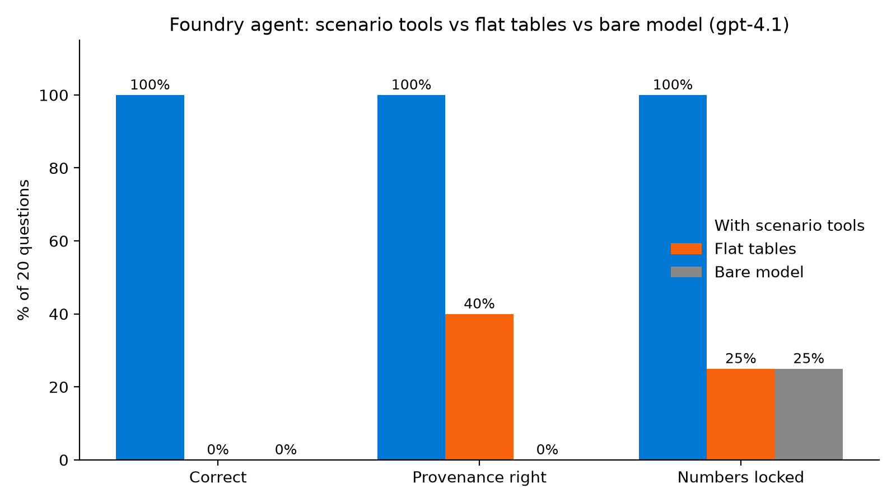
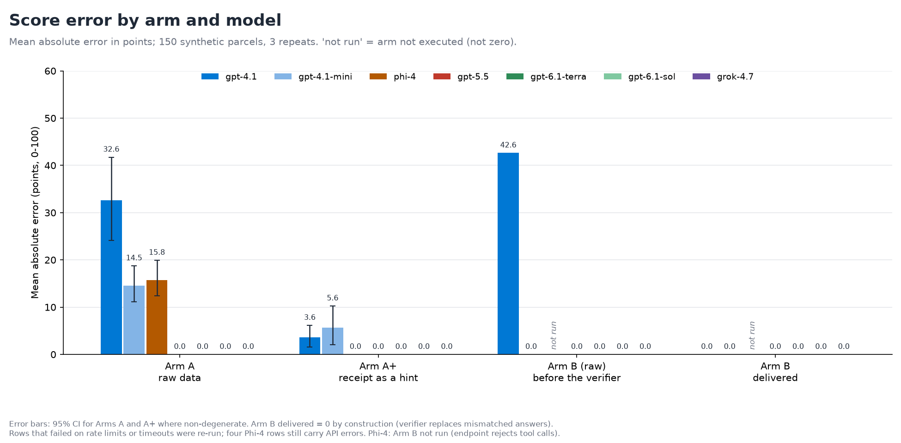
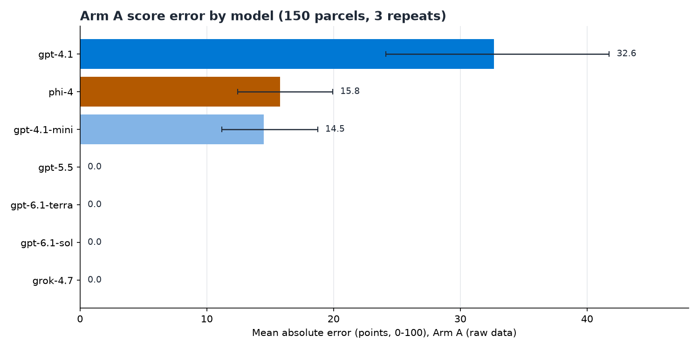

# Forestry crew allocation with Foundry agents: pin the score, ground the agent, keep the decision human

*By Eneko Vallecillo, Principal Solution Engineer, Microsoft UK*

*How a Microsoft Foundry agent, pinned risk scores and a Microsoft Fabric ontology can help a forestry planner decide which parcels get crews first, without the agent inventing a number or approving its own work.*

**In short:** We tested one use case: allocating forestry crews to fuel-reduction jobs before a fire-weather window. Code computes and pins each parcel's risk score. Fabric grounds the agent in labelled evidence and an ontology of roads, homes, water and crew access. A Foundry agent turns that into ranked recommendations and next steps, a verifier checks every number, and a named planner decides. On synthetic data, a gpt-4.1 agent that computed scores itself was 49 points off on average; with pinned scores and the verifier, delivered answers had zero score error.

## The Tuesday morning problem

It is 06:40 on a Tuesday in a dry spring. A forestry planner opens her queue: 40 parcels, each with a proposed fuel-reduction job, fewer crews than jobs, and a window that closes on Friday. Her question: **which parcels get a crew first, and can the crews actually do the work?**

A Foundry agent has already ranked the parcels. Parcel 17 reads "high risk, score 72.4, fully assessed from measured inputs." By Thursday, three things have gone wrong:

- **A confident, wrong number.** The agent computed 72.4 itself from raw readings and a rubric in its prompt. The real score under the operator's policy was different.
- **A guess presented as a measurement.** The wind reading came from a gap-filling routine, yet the agent called it "observed."
- **Stale evidence.** A weather update arrived after the crew was booked, and nothing flagged that the booking was no longer valid.

*(An illustrative scenario, not a reported incident.)*

The model was not the problem. It was asked to calculate, given unlabelled data, and nobody checked its answer. A ranked list is also not a plan: knowing parcel 17 is urgent says nothing about whether a crew can reach it, who lives downwind or where the nearest water is. An agent is only as accurate as the data it is allowed to read.

## The approach: pin, ground, recommend, verify, decide

We built the WFI Pinned Scoring Accelerator on Microsoft Fabric and Microsoft Foundry so that each component does what it is good at: code does the arithmetic, Fabric holds the governed data, the model explains and connects, and people decide.

![Flow diagram of forestry crew allocation in seven numbered steps: evidence in Fabric Gold tables, a pinned scorer that writes a receipt, Fabric IQ (parcel, road, homes, facilities, water and crew access), a Foundry agent with read-only tools that ranks and proposes next steps, a verifier that checks numbers and labels against the receipt, a planner who approves, and the Friday crew list. A verifier mismatch or a planner rejection sends the job to a blocked state that returns to a human. A security and governance band underneath lists Microsoft Entra ID, least privilege, cost controls, Agent 365 (design only) and an immutable decision log](../../dissemination/figures/v6/fig00_crew_allocation_flow.png)

*Figure 1. Forestry crew allocation, end to end. Numbers come only from the scorer; the agent recommends; a named planner decides.*

1. **Ground** the agent in Fabric evidence where every input is labelled observed or imputed, with an as_of date.
2. **Pin** each score in code under a hashed policy and write a receipt. Missing, expired or wrongly sourced evidence produces "incomplete", never a guess.
3. **Connect** the job context with an ontology: access road, homes and facilities downwind, water and crew access.
4. **Recommend** with a Foundry agent that reads receipts and the ontology through read-only tools. It never changes a score.
5. **Verify** every number and label in the answer against the receipt, and block any mismatch.
6. **Decide:** only a named planner moves a job onto the crew list, and every step is logged.

## Step 1: Pin the score

A Foundry agent should never compute a regulated number. The scorer is a deterministic scoring model (implemented in Python). It applies a policy (weights, ranges, bands, allowed provenance) pinned by SHA-256 and writes a hashed receipt with the score, band, status and the observed or imputed label of each factor. A receipt proves which policy and inputs produced a number, not that the policy is right: the policy owner stays accountable for the weights.

## Step 2: Ground the agent in the right data

Grounding means the agent can reach only controlled, labelled data, and nothing it says can move a decision forward on its own. We organise this as three planes, anchored on the NIST AI Risk Management Framework [6] and consistent with the oversight and logging expectations of the EU AI Act [7].


*Figure 2. Three planes. Only a designated owner in the authority plane advances a decision.*

- **Evidence (Microsoft Fabric OneLake).** Bronze, Silver and Gold tables hold timestamped, traceable evidence. The agent reads Gold only. Missing, stale or conflicting evidence blocks progression.
- **Recommendation (Microsoft Foundry).** The agent ranks, explains and proposes next steps. Everything here is advisory and passes through the verifier.
- **Authority (the operator's platform).** Approval, budget, allocation and readiness are workflow states owned by named people. Model confidence never advances a state.

**Proof that the grounding holds.** We ran the same 50 parcels through a Fabric medallion pipeline and compared every receipt hash with the committed evidence. The first run matched 43 of 50. The seven mismatches exposed two real defects: a unit conversion that turned 40.4 into 4,040%, and an invalid-data flag that the Bronze layer dropped. After both fixes, all 50 Gold receipts match, locked in by a regression test. The receipt the agent reads is provably the one the policy produced.

## Step 3: From scores to recommendations with an ontology

A score says how urgent a parcel is, not how to do the job. That depends on connections: which road reaches the parcel, who sits downwind, where the water is, and whether a crew can get in and out safely. An ontology holds those connections, so the agent reads them rather than guesses.


*Figure 3. The ontology behind a crew recommendation, built and queried in Fabric on synthetic data.*

**What we built.** The ontology is defined in Fabric, bound to lakehouse tables, and materialised as a graph queried with GQL; 5 of 5 chain questions matched ground truth. The Foundry agent queries it through a connection-based MCP tool and answered the same five questions correctly in 9 of 9 runs.

**Scenario tools.** We also gave the agent four scenario tools, each computed by the real scorer, never by the model: **exposure** (who is affected if high-score parcels ignite), **mitigation** (largest risk reduction per dollar), **red-flag day** (which feeder to de-energise first) and **robustness** (whether the calls change if a weight moves 20%). Parcels with faulty data are listed as excluded, and every what-if carries the hash of its policy. On 20 questions, with the same model, receipts and scorer, the agent with scenario tools clearly beat one given flat tables to join itself:

| Agent | Correct | Provenance right | Numbers pinned |
|---|--:|--:|--:|
| With scenario tools | 100% | 100% | 100% |
| Flat tables | 5% | 75% | 35% |



*Figure 4. Scenario tools versus flat tables.*

This shows pinned, pre-computed tools beating model-side arithmetic, not that graphs are better in themselves; it was one model and one data seed, with no flat agent given SQL or code execution. The chain data is synthetic, so it shows the plumbing works, not that real access data would give the same answers. Every link needs a provenance label, because a wrong edge produces a confident, wrong recommendation.

## Step 4: Secure and govern the agent

We choose controls in a fixed order: Azure first, then Fabric, then Microsoft Agent 365 to govern the agent as an organisational asset, and our own code only where none of these fits.


*Figure 5. Control layers in the order we choose them, with each layer's status.*

**What the accelerator enforces today**

- **Identity without keys:** [Microsoft Entra ID keyless authentication](https://learn.microsoft.com/en-us/azure/foundry/foundry-models/how-to/configure-entra-id) via DefaultAzureCredential; a test asserts there are no API keys in the code. The least-privilege managed identity in Bicep is design only.
- **Read-only tools:** the agent can only read and recommend. Every write sits behind a non-LLM endpoint, and identity comes from Entra, never from model arguments.
- **Tamper evidence:** policy and receipts are SHA-256 hashed, and a tampered policy is detected.
- **Cost:** a cost meter, budget guard, kill switch and secrets scan are built and tested; Azure budgets are design only.
- **Not yet done:** read-only grants on the SQL endpoint and [private networking](https://learn.microsoft.com/en-us/azure/foundry/how-to/configure-private-link).

**Microsoft platform controls (target state)**

Our code limits what the agent can do; these controls limit what can be said to it and what it can reach. None is switched on or tested in the accelerator yet.

| Risk (OWASP LLM Top 10 [9]) | Microsoft control | What it adds |
|---|---|---|
| Prompt injection, jailbreak | [Foundry guardrails](https://learn.microsoft.com/en-us/azure/foundry/guardrails/guardrails-overview) with Prompt Shields | Screens user input, output and, for agents, tool calls and responses (preview) |
| Harmful or ungrounded output | Foundry guardrails and content filters | Blocks or annotates unsafe content |
| Borrowed or shared agent identity | [Microsoft Entra Agent ID](https://learn.microsoft.com/en-us/entra/agent-id/security-for-ai-overview) | A distinct identity per agent, with Conditional Access and time-bound access |
| Misconfiguration, live attacks | [Microsoft Defender for Cloud](https://learn.microsoft.com/en-us/azure/foundry/control-plane/how-to-manage-compliance-security) | Posture recommendations and attack alerts for Foundry |
| Sensitive data in prompts and answers | [Microsoft Purview](https://learn.microsoft.com/en-us/azure/foundry/control-plane/how-to-manage-compliance-security) | Audit, classification and DLP for AI interactions |
| No fleet view or audit trail | [Foundry Control Plane](https://learn.microsoft.com/en-us/azure/foundry/control-plane/overview) and Microsoft Agent 365 | Inventory, ownership, observability and compliance across agents |

A guardrail is a filter, not an authority: the pinned scorer, read-only tools and verifier still decide what is true and what is allowed. Several of these controls are in preview, so check current status and region support on Microsoft Learn before relying on them.


*Figure 6. The decision lifecycle. Every gate fails closed.*

**Human authority.** The agent advises; only a named approver advances a decision. Four gate rules make this enforceable, because prompt quality alone cannot: **no scope match, no freshness, no authority or no replay trail means no progression.** In the Tuesday scenario, a simulated weather change rejects the operations approval and the job becomes "requires reassessment; starting work is not authorised". This is a simulated specification, not a live weather integration.

## Where each part lives in Azure

The core (policy, scorer, receipts and verifier) is plain Python and runs anywhere. Microsoft Foundry hosts the agent, Microsoft Fabric holds the evidence and the ontology, and Microsoft Entra ID spans both. The Foundry agent, the Fabric pipeline, the ontology graph, the agent's MCP route to it and Application Insights tracing were demonstrated live. The Gold read through the SQL analytics endpoint is code and tests only; the managed identity is design only.

![Azure architecture: a caller host runs the pinned policy, scorer, receipts, verifier, tool executor, GoldReader and experiment harness; an Azure resource group deployed with Bicep holds the Foundry account and project with Foundry Agent Service and a model deployment, plus a storage account and managed identity that are design only; a Microsoft Fabric workspace runs a notebook that loads Bronze, Silver and Gold, with an ontology graph the agent queries through an MCP tool and a SQL endpoint that is code and tests only; Microsoft Entra ID spans everything; eight numbered flows; Application Insights tracing demonstrated with one run](../../dissemination/figures/fig02_azure_architecture.png)

*Figure 7. The accelerator on Azure. Solid lines are demonstrated; dashed lines are design only or not run live; dotted lines are described but not set up.*

## What we measured

We ran 50 synthetic parcels three times each. In Arm A the model scored the raw evidence itself; in Arm B it read receipts through read-only tools and its answer passed through the verifier.

| Measure | Arm A (raw data) | Arm B (pinned data and a check) |
|---|--:|--:|
| Score error, mean absolute (points) | 49.2 (95% CI 34.0 to 63.5) | 0.0 |
| Provenance misstated | 21% | 0% |
| Fault detection | 78% | 98.9% |
| Same answer across repeats | 34% | 100% |



*Figure 8. Mean absolute score error by model and arm.*

**Read the zero carefully.** It is largely true by construction. The verifier blocked 91% of gpt-4.1 runs and 87% of gpt-4.1-mini runs, and blocked answers are replaced with text derived from the receipt. About 41% of blocks were rate-limit errors rather than verifier decisions; for gpt-4.1 most of the rest were real, with 93 of 150 runs skipping the tool and inventing a score.

**Do newer models fix it?** Partly. gpt-6.1-sol, gpt-6.1-terra and grok-4.7 made no score errors even with raw data, while Phi-4 was 9.6 points off. grok-4.7 still had a verifier block rate of 42% (95% CI 32% to 53%), mostly wording or strictness disagreements that we did not adjudicate. The benchmark is saturated for strong models, so it cannot rank them. On a strong model the pattern adds a guarantee rather than an improvement: the score no longer depends on the model being right, and you stay protected when the model changes.



*Figure 9. Arm A (raw data) score error by model.*

**Is the agent worth having?** Judged blind by an LLM on 20 questions, three times each, the agent that queries the ontology won 58%, tied 3% and lost 38% against a deterministic template. That is not statistically significant (mean difference +0.57, 95% CI −1.30 to +2.38). It was strongest on "what should I do next" (75% wins, against 25% in an earlier run without the ontology) and weakest on "compare options" (0% wins). The two runs are not like-for-like: the second agent did not see the pinned receipts. The accuracy comes from pinned data and the verifier; the agent adds plain-language access and recommendations.

**Can you see what the agent did?** Yes. With Application Insights enabled, one traced question showed the agent, model and ontology tool calls as separate client-side spans, verified by query. The portal Traces tab was not checked. That is one trace, not a monitoring study.

## What we did not prove

This was a controlled test, not a field trial: 50 synthetic parcels in one domain, so nothing here shows fewer fires, safer crews or lower costs.

- **Synthetic data.** Road, water and crew-access data was generated, and crew-access links are rule-derived.
- **Simulated approval.** The planner's approval step is not connected to a live platform.
- **Cost and speed unmeasured.** Token spend and latency are still open.
- **No human judges.** An AI model, not planners, rated usefulness.
- **No clean-subscription deployment.** The one-click install has been dry-run only.
- **One domain.** Only wildfire was demonstrated.

**Skip this pattern** if there are no stable rules to pin, nothing a verifier can check, or no cost to a wrong answer.

The governance approach builds on a blueprint for EU forestry operators, grounded in public guidance [1]–[10].

## Getting started

1. Define the crew-allocation decision states and who may move each one.
2. Pin your scoring policy by hash and compute scores in code, not in a prompt.
3. Label every input observed or imputed, with an as_of date.
4. Model parcel, road, homes, water and crew access in an ontology, with provenance on every link.
5. Give the Foundry agent read-only tools, Entra identity and no keys.
6. Add a verifier, fail closed on stale or unverifiable evidence, and log every block and decision.
7. Pilot with a few planners and compare against a plain template before claiming the agent helps.

> **Author note:** Insert the public repository URL once release is approved. The repository is private today.

```
pip install -e .[dev]
python -m pytest -q
pip install -e .[charts]
python scripts/make_charts.py
```

## References

[1] European Commission, Regulation on deforestation-free products (EUDR): https://environment.ec.europa.eu/topics/forests/deforestation/regulation-deforestation-free-products_en

[2] European Commission, Corporate sustainability reporting: https://finance.ec.europa.eu/financial-markets/company-reporting-and-auditing/company-reporting/corporate-sustainability-reporting_en

[3] European Commission, Nature Restoration Regulation: https://environment.ec.europa.eu/topics/nature-and-biodiversity/nature-restoration-regulation_en

[4] Copernicus, European Forest Fire Information System (EFFIS): https://forest-fire.emergency.copernicus.eu/

[5] NASA, Fire Information for Resource Management System (FIRMS): https://firms.modaps.eosdis.nasa.gov/

[6] NIST, AI Risk Management Framework: https://www.nist.gov/itl/ai-risk-management-framework

[7] European Commission, EU AI Act regulatory framework: https://digital-strategy.ec.europa.eu/en/policies/regulatory-framework-ai

[8] UK NCSC, Guidelines for secure AI system development: https://www.ncsc.gov.uk/collection/guidelines-secure-ai-system-development

[9] OWASP GenAI Security Project, Top 10 for LLM Applications 2026: https://genai.owasp.org/resource/owasp-genai-llm-top-10-2026/

[10] Stanford HAI, AI Index Report 2025: https://hai.stanford.edu/ai-index/2025-ai-index-report

Further reading on Microsoft Learn: Azure Well-Architected Framework for AI workloads; Microsoft Foundry documentation; Microsoft Fabric documentation.
