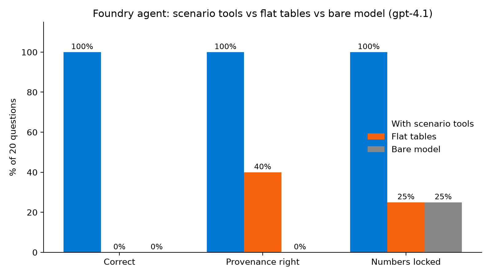
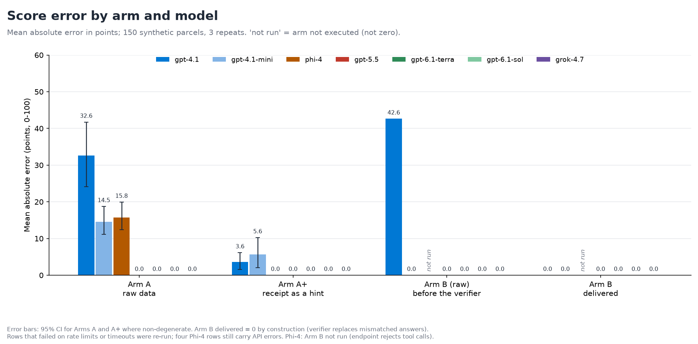
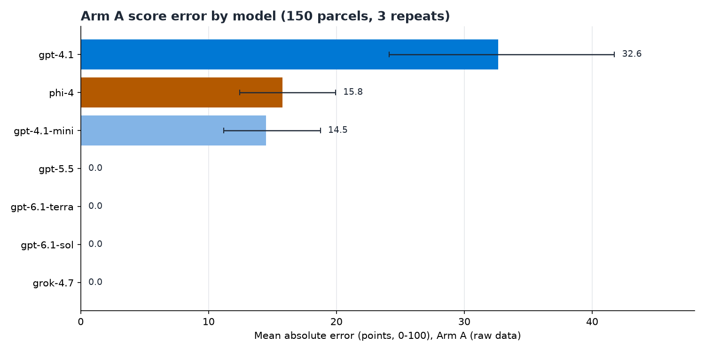

# Forestry crew allocation with Foundry agents: lock the score, ground the agent, keep the decision human

*By Eneko Vallecillo, Principal Solution Engineer, Microsoft UK*

*Forest companies, such as pulp and paper producers, manage thousands of plantation parcels, and in southern Europe they are legally responsible for the fuel on that land. In Portugal, Decree-Law 82/2021 [11] requires owners to manage fuel in a strip of up to 50 metres around homes and businesses that border forest land. In Spain, the Forest Law 43/2003, as amended by Law 21/2015 [12], makes forest owners responsible for managing and protecting their forests, including preventing fires, and the regional governments set the detailed rules. A company always has more parcels needing work than crews and weeks to do it, so its forestry planner has to choose which parcels go first, and be able to explain that choice to the board, an auditor or a regulator.*

*This article tests whether a Microsoft Foundry agent can help that planner prioritize the right parcels in the most effective way possible, to maximize crew efficiency.*

**The accelerator:** Everything in this article is available in a companion repository, the [WFI Pinned Scoring Accelerator](https://github.com/enekazo/WFI-ScoringAccelerator) [13]. It is a reference implementation of policy-locked, provenance-labelled risk scoring on Microsoft Foundry and Microsoft Fabric, built around the crew-allocation use case. It includes the deterministic scorer and its policy file, the receipts it writes, the Fabric lakehouse and Fabric IQ ontology, the Foundry agent with its read-only tools and verifier, the experiment harness and results, and deployment scripts that stand the whole solution up in a new subscription.

## The problem under test

Picture a forestry planner with 40 parcels in her queue, each with a proposed fuel-reduction job, fewer crews than jobs and a window that closes on Friday. She needs to know which parcels get a crew first, and whether the crews can actually do the work.

Say an agent has already ranked the parcels and parcel PAX-0017 reads "high risk, score 72.4, fully assessed from measured inputs". There are three ways this can go wrong:

- The agent worked out 72.4 itself from raw readings, but the policy's real score was different. Ask the same question again and a model can return a different number, so a single check proves nothing.
- The wind reading for that parcel was missing and had been estimated to fill the gap, yet the agent described it as "observed", as if a sensor had measured it.
- A weather update arrived after the crew was booked and changed the parcel's risk, but nothing flagged the booking as out of date, so the crew could have been sent out on weather that was no longer safe.

In none of these is the model the main problem. It was asked to calculate, it was given unlabelled data, and nobody checked its answer. A ranked list is also not a plan. Knowing PAX-0017 is urgent does not say whether a crew can reach it, who lives downwind or where the nearest water is.

## The approach

The WFI Pinned Scoring Accelerator is built on Microsoft Fabric and Microsoft Foundry around one idea: code does the arithmetic, Fabric holds the governed data, the model explains and connects, and people decide.

![Flow diagram of forestry crew allocation in seven numbered steps: evidence in Fabric Gold tables, a locked scorer that writes a receipt, Fabric IQ (parcel, road, homes, facilities, water and crew access), a Foundry agent with read-only tools that ranks and proposes next steps, a verifier that checks numbers and labels against the receipt, a planner who approves, and the Friday crew list. A verifier mismatch or a planner rejection sends the job to a blocked state that returns to a human. A security and governance band underneath lists Microsoft Entra ID, least privilege, cost controls, Agent 365 (design only) and an immutable decision log](../../dissemination/figures/v6/fig00_crew_allocation_flow.png)

*Figure 1. Forestry crew allocation, end to end. Numbers come only from the scorer; the agent recommends; a named planner decides.*

Each parcel passes through seven steps before it can reach the crew list:

1. **Evidence:** every piece of data in Fabric is labelled as either measured or estimated, and carries the date it was last assessed.
2. **Scorer:** each score is calculated and locked by deterministic Python code under a hashed policy. The score is never guessed. Missing, expired or wrongly sourced evidence is marked as "incomplete".
3. **Fabric IQ:** adds context: access road, homes and facilities downwind, water and crew access.
4. **Agent:** a Foundry agent reads receipts and Fabric IQ through read-only tools, ranks the jobs and proposes next steps. It never changes a score.
5. **Verifier:** checks every number and label in the answer against the receipt and blocks any mismatch.
6. **Planner:** a named planner approves or rejects. A rejection or a verifier block sends the job back to the planner.
7. **Crew list:** only approved jobs reach the Friday crew list, and every step is logged.

## Locking the score

As part of this accelerator, a design decision was made that the Foundry agent should not compute the parcel risk score. The score is calculated by a deterministic scoring model. It applies a policy (weights, ranges, bands, allowed provenance) locked by SHA-256 and writes a hashed receipt with the score, band, status and the observed or imputed label of each factor. The receipt proves where a score came from: the policy that was applied and the evidence behind it. It does not prove the policy itself is right, so the policy owner remains accountable for the weights.

## Grounding the agent in the right data

Grounding here means the agent can reach only controlled, labelled data, and nothing it says can move a decision forward on its own. The design is organised as three planes. It borrows from the NIST AI Risk Management Framework [6] and is in the spirit of the record-keeping (Article 12) and human-oversight (Article 14) requirements that the EU AI Act [7] sets for high-risk systems. This use case has not been assessed against the Act's risk classes.


*Figure 2. Three planes. Only a designated owner in the authority plane advances a decision.*

- **Evidence (Microsoft Fabric OneLake).** Bronze, Silver and Gold tables hold timestamped, traceable evidence. The agent reads Gold only. Missing, stale or conflicting evidence blocks progression.
- **Recommendation (Microsoft Foundry).** The agent ranks, explains and proposes next steps. Everything here is advisory and passes through the verifier.
- **Authority (the operator's platform).** Approval, budget, allocation and readiness are workflow states owned by named people. Model confidence never advances a state.

**Checking that the grounding holds.** The same 50 parcels were run through a Fabric medallion pipeline and compared every receipt hash with the committed evidence. The first run matched only 43 of 50. The seven mismatches exposed two real defects: a unit conversion that turned 40.4 into 4,040%, and an invalid-data flag that the Bronze layer dropped. After both were fixed, all 50 Gold receipts match, locked in by a regression test. So the receipt the agent reads is provably the one the policy produced.

## From scores to recommendations with Fabric IQ

A score says how urgent a parcel is, not how to do the job. That depends on connections: which road reaches the parcel, who sits downwind, where the water is, and whether a crew can get in and out safely. Fabric IQ, Microsoft's semantic layer for business entities and relationships, holds those connections as an ontology, so the agent reads them rather than guesses.


*Figure 3. The Fabric IQ ontology behind a crew recommendation, built and queried in Fabric on synthetic data.*

**What was built.** Two parts sit between the locked score and the planner:

- **The ontology.** Defined in Fabric IQ with five entities (parcel, road segment, home group, water source and crew access), bound to the lakehouse tables and materialised as a graph queried with GQL. The Foundry agent reaches it through a connection-based MCP tool.
- **Four scenario tools.** Python functions on the Foundry agent. Each runs the real scorer and returns the result with the policy fingerprint, so the model chooses the tool and explains the answer but never does the arithmetic. They cover exposure (who is affected if high-score parcels ignite), mitigation (which actions give the largest risk reduction per dollar), the red-flag day (which feeder to de-energise first) and robustness (whether the calls change if a weight moves 20%).

Each part was tested separately, in the same four steps: the challenge, what we built, how we tested it and the results.

**Test 1: connection questions with the ontology**

**The challenge.** A crew planner asks about connections: which parcels a road reaches, who is exposed, whether a crew can get in. The answer is spread across several tables, and a model that guesses the joins gives plausible but wrong answers.

**What we built.** The ontology and the MCP tool described above.

**How we tested it.** We wrote five connection questions (C1 to C5) whose correct answers were computed by code. We ran them as GQL queries on the graph, then through the Foundry agent using the ontology tool. For comparison, gpt-4.1 answered the same questions with the chain data as Python tools, with the raw tables, and with no data, three repeats each.

**Results.**

| Setup | Correct |
|---|--:|
| GQL on the ontology graph | 5 of 5 |
| Foundry agent using the ontology tool | 9 of 9 |
| Agent with chain tools (Python) | 100% |
| Agent with flat tables | 20% |
| Bare model (no data) | 0% |

The ontology route returns correct answers. It does not beat the Python chain tools, which also scored 100%, so this shows the ontology works, not that it is better. One question (C3) failed on its first phrasing and passed once the wording matched the data. The data is synthetic and the crew-access links are labelled as assumed. Evidence: [`foundry_ontology_chain.json`](https://github.com/enekazo/WFI-ScoringAccelerator/blob/main/docs/evidence/e2e-fabric-foundry-ontology/foundry_ontology_chain.json) and [`chain_arms.json`](https://github.com/enekazo/WFI-ScoringAccelerator/blob/main/docs/evidence/e2e-fabric-foundry-ontology/chain_arms.json).

**Is the ontology agent's answer more useful?** We also asked whether the ontology agent's explanations are better than the fixed template text the platform would otherwise show. A second model, which did not know which answer was which, judged 20 questions three times each (60 judgements). The agent won 58% (95% CI 46% to 70%), tied 3% and lost 38%. The average score gain was +0.57 points out of 15, but its confidence interval (−1.30 to +2.38) includes zero, so the result is inconclusive. The agent won on explanations and on "why is this incomplete", and lost every comparison question. Delivered text had no faithfulness violations, and 5 of 20 answers fell back to the receipt text. This compares the agent against a template, not against an agent without the ontology, so it does not isolate the ontology's value. Evidence: [`foundry_ontology_usefulness_summary.md`](https://github.com/enekazo/WFI-ScoringAccelerator/blob/main/docs/evidence/e2e-fabric-foundry-ontology/foundry_ontology_usefulness_summary.md).

**Test 2: decision questions with the four tools**

**The challenge.** A planner also asks decision questions: who is exposed if these parcels ignite, which mitigation buys the most risk reduction per dollar, which feeder to de-energise first. Answering means joining parcels, roads, homes, feeders and mitigations, then adding up the result. This is the wider problem of the article in its most practical form: if the model does the sums itself, it returns confident numbers that cannot be traced back to the locked policy.

**What we built.** The four scenario tools described above.

**How we tested the tools.** We wrote 20 planner questions, five for each of the four tools. The correct answer to each one was computed in advance by the scorer code, not by a model. We then gave every question to two versions of the published Foundry agent, reading the data from Fabric, and to the bare model as a baseline. All used the same model (gpt-4.1), the same receipts and the same scorer, and each question was asked once. The only difference was how the agent got its data:

- **With the four tools:** the agent called the tool and reported what it returned.
- **With flat tables:** the agent was given the raw parcel, asset, customer and mitigation tables plus a tool to re-score one parcel at a time. It had to join, loop and add up the answer itself, with a cap of 12 tool rounds.
- **Bare model (baseline):** the same model, with no tools and no data, so it could only guess.

Each answer was graded on three things: whether the decision and key figure matched the pre-computed answer (correct), whether it quoted the right policy hash and said when a figure was a what-if (provenance right), and whether every number came from a tool result or the question (numbers locked). Two design decisions built into the tools were part of the test. Only 25 of the 50 parcels have usable data; the tools list the other 25 as excluded instead of guessing, and the correct answers do the same. Every tool answer also carries the fingerprint (hash) of the policy that produced it, and what-if answers are labelled as such, so each result can be traced. We chose a fixed question set, answers computed by code and one shared model so that the only thing being compared was the tools.

**Results.**

| Foundry agent | Correct | Provenance right | Numbers locked |
|---|--:|--:|--:|
| With scenario tools | 100% | 100% | 100% |
| Flat tables | 0% | 40% | 25% |
| Bare model (no data) | 0% | 0% | 25% |



*Figure 4. Scenario tools versus flat tables.*

The agent with the tools answered 20 of 20 correctly and the flat-table agent 0 of 20. The run used one model, one repeat and synthetic data; the flat agent hit two API throttling errors, so it is slightly under-measured.

This shows locked, pre-computed tools beating model-side arithmetic, not that graphs are better in themselves; it was one model and one data seed, with no flat agent given SQL or code execution. The chain data is synthetic, so it shows the plumbing works, not that real access data would give the same answers. Every link needs a provenance label, because a wrong edge produces a confident, wrong recommendation.

## Securing and governing the agent

Controls are chosen in a fixed order: Azure first, then Fabric, then Microsoft Agent 365 to govern the agent as an organisational asset, and custom code only where none of these fits.


*Figure 5. Control layers in the order they are chosen, with each layer's status.*

**What the accelerator enforces today**

- **Identity without keys:** [Microsoft Entra ID keyless authentication](https://learn.microsoft.com/en-us/azure/foundry/foundry-models/how-to/configure-entra-id) via DefaultAzureCredential; a test asserts there are no API keys in the code. The least-privilege managed identity in Bicep is design only.
- **Read-only tools:** the agent can only read and recommend. Every write sits behind a non-LLM endpoint, and identity comes from Entra, never from model arguments.
- **Tamper evidence:** policy and receipts are SHA-256 hashed, and a tampered policy is detected.
- **Cost:** a cost meter, budget guard, kill switch and secrets scan are built and tested; Azure budgets are design only.
- **Not yet done:** read-only grants on the SQL endpoint and [private networking](https://learn.microsoft.com/en-us/azure/foundry/how-to/configure-private-link).

**Microsoft platform controls (target state)**

Custom code limits what the agent can do; these controls limit what can be said to it and what it can reach. None is switched on or tested in the accelerator yet.

| Risk (OWASP LLM Top 10 [9]) | Microsoft control | What it adds |
|---|---|---|
| Prompt injection, jailbreak | [Foundry guardrails](https://learn.microsoft.com/en-us/azure/foundry/guardrails/guardrails-overview) with Prompt Shields | Screens user input, output and, for agents, tool calls and responses (preview) |
| Harmful or ungrounded output | Foundry guardrails and content filters | Blocks or annotates unsafe content |
| Borrowed or shared agent identity | [Microsoft Entra Agent ID](https://learn.microsoft.com/en-us/entra/agent-id/security-for-ai-overview) | A distinct identity per agent, with Conditional Access and time-bound access |
| Misconfiguration, live attacks | [Microsoft Defender for Cloud](https://learn.microsoft.com/en-us/azure/foundry/control-plane/how-to-manage-compliance-security) | Posture recommendations and attack alerts for Foundry |
| Sensitive data in prompts and answers | [Microsoft Purview](https://learn.microsoft.com/en-us/azure/foundry/control-plane/how-to-manage-compliance-security) | Audit, classification and DLP for AI interactions |
| No fleet view or audit trail | [Foundry Control Plane](https://learn.microsoft.com/en-us/azure/foundry/control-plane/overview) and Microsoft Agent 365 | Inventory, ownership, observability and compliance across agents |

A guardrail is a filter, not an authority: the locked scorer, read-only tools and verifier still decide what is true and what is allowed. Several of these controls are in preview, so check current status and region support on Microsoft Learn before relying on them.


*Figure 6. The decision lifecycle. Every gate fails closed.*

**Human authority.** The agent advises; only a named approver advances a decision. Four gate rules make this enforceable, because prompt quality alone cannot: **no scope match, no freshness, no authority or no replay trail means no progression.** In the Tuesday scenario, a simulated weather change rejects the operations approval and the job becomes "requires reassessment; starting work is not authorised". This is a simulated specification, not a live weather integration.

## Where each part lives in Azure

The core (policy, scorer, receipts and verifier) is plain Python and runs anywhere. Microsoft Foundry hosts the agent, Microsoft Fabric holds the evidence and Fabric IQ, and Microsoft Entra ID spans both. The Foundry agent, the Fabric pipeline, the ontology graph, the agent's MCP route to it and Application Insights tracing were demonstrated live. The Gold read through the SQL analytics endpoint is code and tests only; the managed identity is design only.

![Azure architecture: a caller host runs the locked policy, scorer, receipts, verifier, tool executor, GoldReader and experiment harness; an Azure resource group deployed with Bicep holds the Foundry account and project with Foundry Agent Service and a model deployment, plus a storage account and managed identity that are design only; a Microsoft Fabric workspace runs a notebook that loads Bronze, Silver and Gold, with an ontology graph the agent queries through an MCP tool and a SQL endpoint that is code and tests only; Microsoft Entra ID spans everything; eight numbered flows; Application Insights tracing demonstrated with one run](../../dissemination/figures/fig02_azure_architecture.png)

*Figure 7. The accelerator on Azure. Solid lines are demonstrated; dashed lines are design only or not run live; dotted lines are described but not set up.*

## What was measured

50 synthetic parcels were run three times each. In Arm A the model scored the raw evidence itself; in Arm B it read receipts through read-only tools and its answer passed through the verifier.

| Measure | Arm A (raw data) | Arm B (locked data and a check) |
|---|--:|--:|
| Score error, mean absolute (points) | 49.2 (95% CI 34.0 to 63.5) | 0.0 |
| Provenance misstated | 21% | 0% |
| Fault detection | 78% | 98.9% |
| Same answer across repeats | 34% | 100% |



*Figure 8. Mean absolute score error by model and arm.*

**Read the zero carefully.** It is largely true by construction. The verifier blocked 91% of gpt-4.1 runs and 87% of gpt-4.1-mini runs, and blocked answers are replaced with text derived from the receipt. About 41% of blocks were rate-limit errors rather than verifier decisions; for gpt-4.1 most of the rest were real, with 93 of 150 runs skipping the tool and inventing a score. The zero should not be read as "the agent is perfect". It means the delivered number cannot be wrong, because the agent is not allowed to be the source of it.

**Do newer models fix it?** Partly. gpt-6.1-sol, gpt-6.1-terra and grok-4.7 made no score errors even with raw data, while Phi-4 was 9.6 points off. grok-4.7 still had a verifier block rate of 42% (95% CI 32% to 53%), mostly wording or strictness disagreements that were not adjudicated. The benchmark is saturated for strong models, so it cannot rank them. On a strong model the pattern adds a guarantee rather than an improvement: the score no longer depends on the model being right, and protection holds when the model changes.



*Figure 9. Arm A (raw data) score error by model.*

**Is the agent worth having?** Judged blind by an LLM on 20 questions, three times each, the agent that queries Fabric IQ won 58%, tied 3% and lost 38% against a deterministic template. That is not statistically significant (mean difference +0.57, 95% CI −1.30 to +2.38). It was strongest on "what should I do next" (75% wins, against 25% in an earlier run without Fabric IQ) and weakest on "compare options" (0% wins). The two runs are not like-for-like: the second agent did not see the locked receipts. The accuracy comes from locked data and the verifier; the agent adds plain-language access and recommendations.

**Can the agent's actions be seen?** Yes. With Application Insights enabled, one traced question showed the agent, model and Fabric IQ tool calls as separate client-side spans, verified by query. The portal Traces tab was not checked. That is one trace, not a monitoring study.

## What was unexpected

> **Author to complete (2 to 4 sentences, third person):** which result was not expected, and what was done about it? For example: the gpt-4.1 gap of 49 points, newer models scoring 0 error even on raw data, or the first Fabric run matching only 43 of 50. Only record what actually happened.

## What was not proved

This was a controlled test, not a field trial: 50 synthetic parcels in one domain, so nothing here shows fewer fires, safer crews or lower costs.

- **Synthetic data.** Road, water and crew-access data was generated, and crew-access links are rule-derived.
- **Simulated approval.** The planner's approval step is not connected to a live platform.
- **Cost and speed unmeasured.** Token spend and latency are still open.
- **No human judges.** An AI model, not planners, rated usefulness.
- **No ontology against no-ontology comparison.** The usefulness test compared the ontology agent with a template, and the result was inconclusive. The four-tools test does not use the ontology.
- **No clean-subscription deployment.** The one-click install has been dry-run only.
- **One domain.** Only wildfire was demonstrated.

**Skip this pattern** if there are no stable rules to lock, nothing a verifier can check, or no cost to a wrong answer.

The governance approach builds on a blueprint for EU forestry operators, grounded in public guidance [1]–[10].

## Adopting the pattern

Start by defining the crew-allocation decision states and who may move each one. Lock the scoring policy by hash and compute scores in code, not in a prompt, and label every input observed or imputed with an as_of date. Model parcel, road, homes, water and crew access in Fabric IQ, with provenance on every link. Give the Foundry agent read-only tools and an Entra identity, with no keys. Add a verifier that fails closed on stale or unverifiable evidence, and log every block and decision. Before claiming the agent helps, pilot it with a few planners and compare it against a plain template.

> **Author note:** Insert the public repository URL once release is approved. The repository is private today.

```
pip install -e .[dev]
python -m pytest -q
pip install -e .[charts]
python scripts/make_charts.py
```

## References

[1] European Commission, Regulation on deforestation-free products (EUDR): https://environment.ec.europa.eu/topics/forests/deforestation/regulation-deforestation-free-products_en

[2] European Commission, Corporate sustainability reporting: https://finance.ec.europa.eu/financial-markets/company-reporting-and-auditing/company-reporting/corporate-sustainability-reporting_en

[3] European Commission, Nature Restoration Regulation: https://environment.ec.europa.eu/topics/nature-and-biodiversity/nature-restoration-regulation_en

[4] Copernicus, European Forest Fire Information System (EFFIS): https://forest-fire.emergency.copernicus.eu/

[5] NASA, Fire Information for Resource Management System (FIRMS): https://firms.modaps.eosdis.nasa.gov/

[6] NIST, AI Risk Management Framework: https://www.nist.gov/itl/ai-risk-management-framework

[7] European Commission, EU AI Act regulatory framework: https://digital-strategy.ec.europa.eu/en/policies/regulatory-framework-ai

[8] UK NCSC, Guidelines for secure AI system development: https://www.ncsc.gov.uk/collection/guidelines-secure-ai-system-development

[9] OWASP GenAI Security Project, Top 10 for LLM Applications 2026: https://genai.owasp.org/resource/owasp-genai-llm-top-10-2026/

[10] Stanford HAI, AI Index Report 2025: https://hai.stanford.edu/ai-index/2025-ai-index-report

[11] Portugal, Decreto-Lei n.º 82/2021, Sistema de Gestão Integrada de Fogos Rurais (article 49, fuel management strips). Municipal summary: https://www.cm-vendasnovas.pt/municipe/areas-de-acao/ambiente/florestas/faixas-de-gestao-de-combustivel/

[12] Spain, Ley 43/2003 de Montes, as amended by Ley 21/2015: https://www.boe.es/buscar/act.php?id=BOE-A-2015-8146
[13] WFI Pinned Scoring Accelerator (companion repository): https://github.com/enekazo/WFI-ScoringAccelerator

Further reading on Microsoft Learn: Azure Well-Architected Framework for AI workloads; Microsoft Foundry documentation; Microsoft Fabric documentation.
