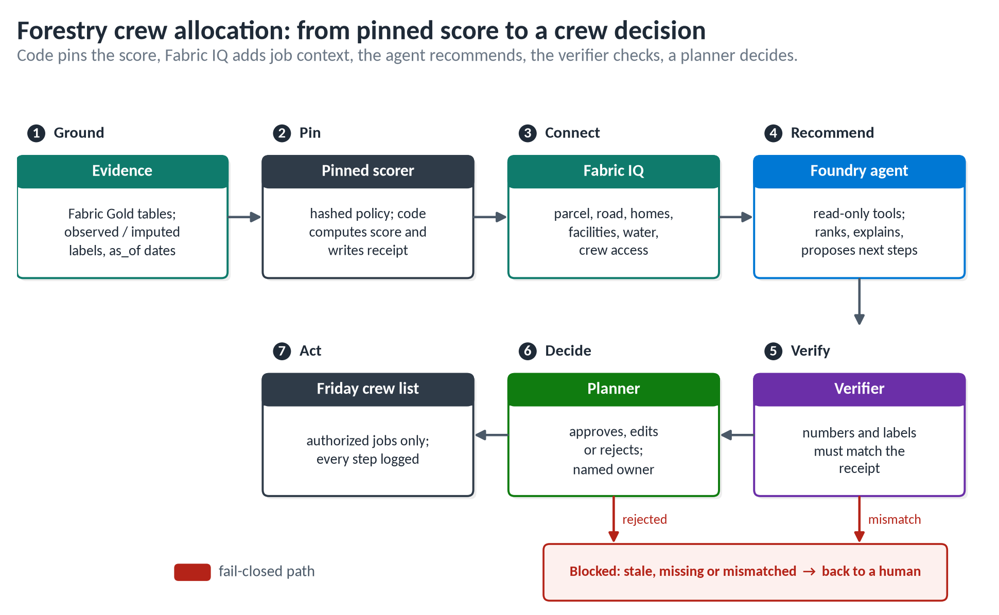
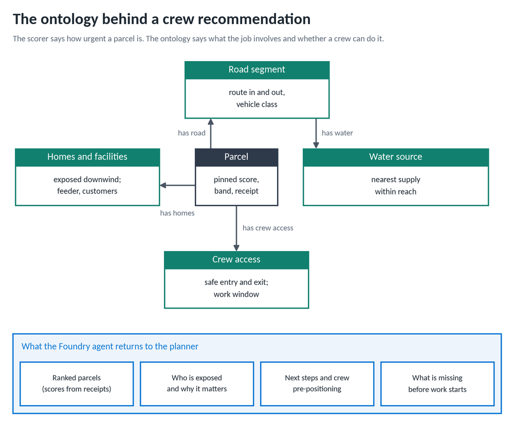
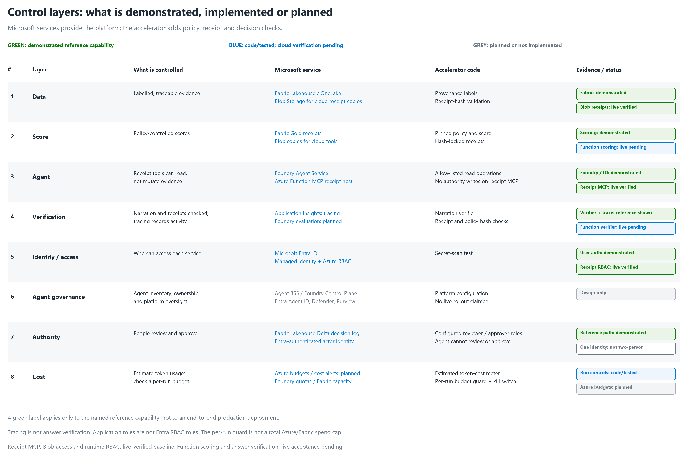
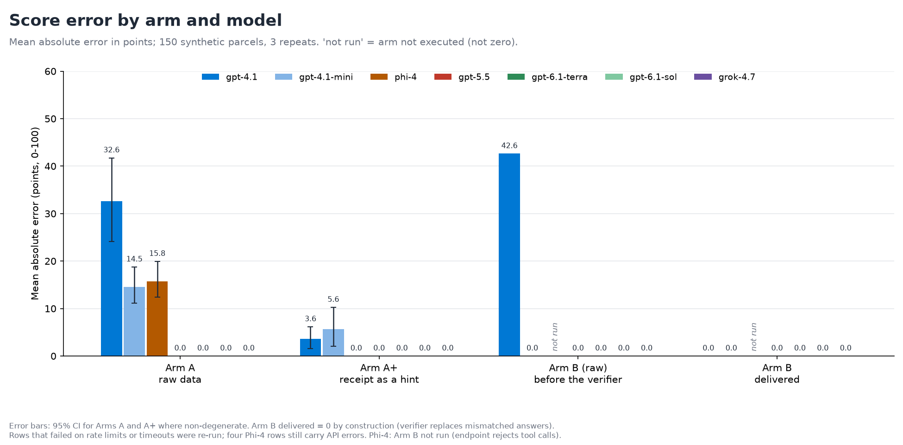
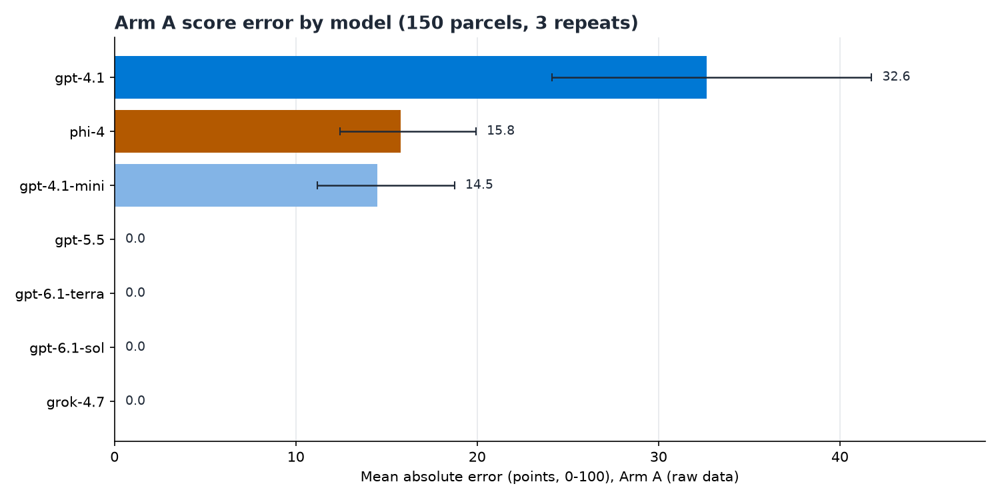
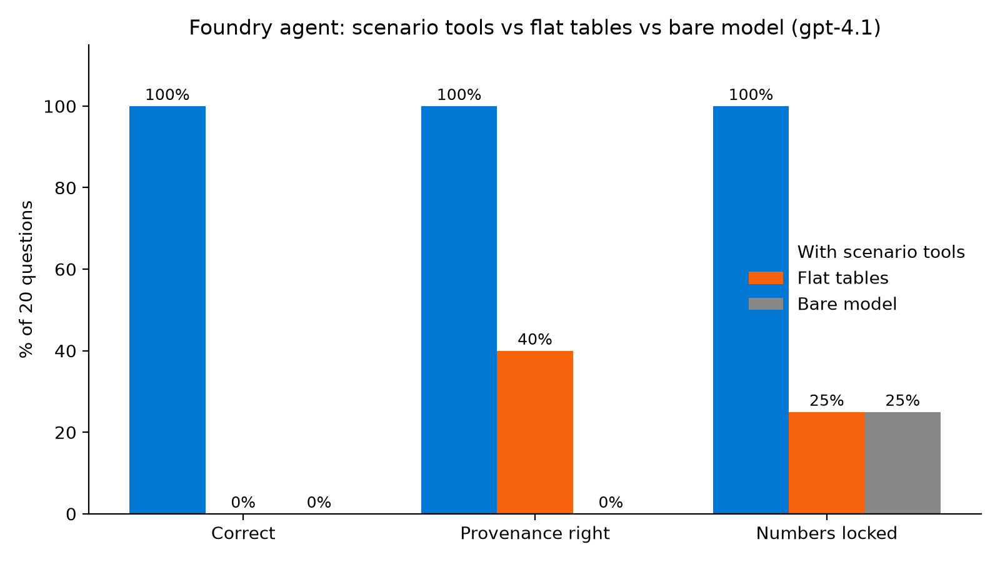

# Forestry crew allocation with Foundry agents: lock the score, ground the agent, keep the decision human

*By Eneko Vallecillo, Principal Solution Engineer, Microsoft UK*

*Forest companies, such as pulp and paper producers, manage thousands of plantation parcels, and in southern Europe they are legally responsible for the fuel on that land. In Portugal, Decree-Law 82/2021 [11] requires owners to manage fuel in a strip of up to 50 metres around homes and businesses that border forest land. In Spain, the Forest Law 43/2003, as amended by Law 21/2015 [12], makes forest owners responsible for managing and protecting their forests, including preventing fires, and the regional governments set the detailed rules. A company always has more parcels needing work than crews and weeks to do it, so its forestry planner has to choose which parcels go first, and be able to explain that choice to the board, an auditor or a regulator.*

*This article tests whether a Microsoft Foundry agent can help that planner prioritize the right parcels in the most effective way possible, to maximize crew efficiency.*

**The accelerator:** Everything in this article is available in a companion repository, the [WFI Pinned Scoring Accelerator](https://github.com/enekazo/WFI-ScoringAccelerator) [13]. It is a reference implementation of policy-locked, provenance-labelled risk scoring on Microsoft Foundry and Microsoft Fabric, built around the crew-allocation use case. It includes the deterministic scorer and its policy file, the receipts it writes, the Fabric lakehouse and Fabric IQ ontology, the Foundry agent with its read-only tools and verifier, the experiment harness and results, and deployment scripts that stand the whole solution up in a new subscription.

## The problem under test

Picture a forestry planner with 40 parcels in her queue, each with a proposed fuel-reduction job, fewer crews than jobs and a window that closes on Friday. She needs to know which parcels get a crew first, and whether the crews can actually do the work.

Say an agent has already ranked the parcels and parcel PAX-0017 reads "high risk, score 72.4, fully assessed from measured inputs". There are three ways this can go wrong:

- The agent worked out 72.4 itself from raw readings, but the policy's real score was different. Ask the same question again and a model can return a different number, so a single check proves nothing.
- The wind reading for that parcel was missing and had been estimated to fill the gap, yet the agent described it as "observed", as if a sensor had measured it.
- A weather update arrived after the crew was booked and changed the parcel's risk, but nothing flagged the booking as out of date, so the crew could have been sent out on weather that was no longer safe.

In none of these is the model the main problem. It was asked to calculate, it was given unlabelled data, and nobody checked its answer. A ranked list is also not a plan. Knowing PAX-0017 is urgent does not say whether a crew can reach it, who lives downwind or where the nearest water is.

## The approach

The WFI Pinned Scoring Accelerator is built on Microsoft Fabric and Microsoft Foundry around one idea: code does the arithmetic, Fabric holds the governed data, the model explains and connects, and people decide.

### The grounding framework

Grounding here means the agent can reach only controlled, labelled data, and nothing it says can move a decision forward on its own. The design is organised as three planes. It borrows from the NIST AI Risk Management Framework [6] and is in the spirit of the record-keeping (Article 12) and human-oversight (Article 14) requirements that the EU AI Act [7] sets for high-risk systems. This use case has not been assessed against the Act's risk classes.

<p align="center">

</p>

*Figure 1. Three planes. Only a designated owner in the authority plane advances a decision. Coloured parts are built; grey parts are design only.*

- **Evidence (Microsoft Fabric OneLake).** Bronze, Silver and Gold tables hold timestamped, traceable evidence. The agent reads Gold only. Missing, stale or conflicting evidence blocks progression.
- **Recommendation (Microsoft Foundry).** The agent ranks, explains and proposes next steps. Everything here is advisory and passes through the verifier.
- **Authority (the operator's platform).** Review and approval are built as a reference implementation on Fabric. Budget, allocation and execution readiness are workflow states owned by named people and are design only. Model confidence never advances a state.

### How forestry crew allocation works

The following process describes how each parcel is assessed to determine crew allocation priorities.

<p align="center">

</p>

*Figure 2. Forestry crew allocation, end to end. Numbers come only from the scorer; the agent recommends; a named planner decides.*

Each parcel passes through seven steps before it can reach the crew list:

1. **Evidence:** every piece of data in Fabric is labelled as either measured or estimated, and carries the date it was last assessed.
2. **Scorer:** each score is calculated and locked by deterministic Python code under a hashed policy. The score is never guessed. Missing, expired or wrongly sourced evidence is marked as "incomplete".
3. **Fabric IQ:** adds context: access road, homes and facilities downwind, water and crew access.
4. **Agent:** a Foundry agent reads receipts and Fabric IQ through read-only tools, ranks the jobs and proposes next steps. It never changes a score.
5. **Verifier:** checks every number and label in the answer against the receipt and blocks any mismatch.
6. **Planner:** a named planner approves or rejects. A rejection or a verifier block sends the job back to the planner.
7. **Crew list:** only approved jobs reach the Friday crew list, and every step is logged.

### Locking the score

As part of this accelerator, a design decision was made that the Foundry agent should not compute the parcel risk score. The score is calculated by a deterministic scoring model. It applies a policy (weights, ranges, bands, allowed provenance) locked by SHA-256 and writes a hashed receipt with the score, band, status and the measured or estimated label of each factor. The receipt proves where a score came from: the policy that was applied and the evidence behind it. It does not prove the policy itself is right, so the policy owner remains accountable for the weights.


### Foundry agent: context from Fabric IQ

We added a Fabric IQ ontology to give the Foundry agent context for crew allocation. The score tells us how urgently a parcel needs treatment; Fabric IQ helps answer practical questions such as:

- Which road reaches the parcel?
- Which homes and facilities could be affected?
- Where is the nearest accessible water source?
- What access restrictions or work windows apply to the crew?

Fabric IQ is Microsoft's semantic layer for business entities and relationships. The Fabric IQ ontology holds these connections, so the agent reads them rather than guessing.

<p align="center">

</p>

*Figure 3. The Fabric IQ ontology behind a crew recommendation, built and queried in Fabric on synthetic data.*

The agent helps the planner understand the parcel’s score, the homes and facilities linked to it, and any recorded gaps in road access, water supply or crew access. It can also explain why evidence is incomplete. These answers support planning; they do not allocate crews or authorise field work.


## Solution Architecture


<p align="center">

</p>

*Figure 4. The cloud architecture maps the grounding framework to Azure and Fabric services. Connections show service relationships, not deployment-verification status.*

Figure 4 shows how the services connect. The Foundry agent accesses the Azure Function's receipt tools and Fabric IQ through separate MCP connections. Fabric stores the evidence and decision log, Microsoft Entra ID provides authentication, and Application Insights records traces.

The Azure Function exposes receipt tools to the Foundry agent through MCP. When answering a planner's question, the agent can use these tools to retrieve or compare parcel scores and their supporting evidence. The Function checks the receipt hashes and pinned policy before returning the results.

## Security and governance

Figure 5 summarises the accelerator’s security and governance controls, distinguishing demonstrated capabilities from implemented code awaiting cloud verification and planned controls.

<p align="center">

</p>

*Figure 5. Control layers and their evidence status. Each status applies to the named capability, not to a complete production deployment.*

### What the agent can access

We give the agent tools to read and compare receipts, not change them. The accelerator uses [Microsoft Entra ID](https://learn.microsoft.com/en-us/azure/foundry/foundry-models/how-to/configure-entra-id) to authenticate users and services, with managed identities and Azure role assignments giving services the permissions they need, such as read access to receipt storage.

In the separate approval workflow, the agent can submit a proposal. Only people named in the accelerator's reviewer and approver lists can review or approve it.

### Answer verification controls

We calculate each score using the pinned policy, then check the policy and receipt hashes for mismatches and compare the agent's answer with the receipt. This helps keep the answer tied to the evidence used, but it cannot tell us whether the original observations are accurate or the policy is right. Application Insights lets us follow what happened during a run, rather than judge whether the answer was correct.

Tested run controls also include an estimated token-cost meter, a budget guard and a kill switch. The guard checks accumulated estimated spending before further model calls. It is not a cap on the Azure or Fabric bill, and its tests do not establish that it governs every deployed cloud call.

### What remains before production

Before using the accelerator in production, we still need to:

- Set up private networking, read-only access to the SQL endpoint and Azure budget alerts.
- Choose and test protections against prompt injection and sensitive-data exposure, along with controls for managing and monitoring agents. Microsoft options include Foundry guardrails, Entra Agent ID, Defender, Purview and Agent 365, but we have not configured or tested them in this accelerator.

The reference implementation demonstrates specific checks, not a complete production security posture or a compliance assessment.

## Planner authority: from proposal to approval

<p align="center">

</p>

*Figure 6. Where the decision stops. Coloured steps are built and tested in the reference implementation; grey, dashed steps are design only.*

The agent can submit a proposal only if the evidence is complete and recent enough, and its explanation passes verification. From there, the planner takes over, with each accepted step recorded in the Fabric decision log. Before accepting another step, the application checks the log's hash chain for signs of tampering. The Accelerator workflow currently ends at approval; it does not allocate crews or start work.

Allocating operational budgets and crews, carrying out the work and reporting on outcomes are still outside the current implementation. We can check the decision log for signs of tampering, but cannot yet replay a field operation from its original evidence. There is also no live weather feed to trigger a reassessment or withdraw an approval when conditions change.

## What we measured

To evaluate our proposed accelerator solution, we conducted a series of tests across three scenarios: keeping scores consistent with the policy, answering questions through Fabric IQ and using tools for scenario calculations. For each scenario, we explain the problem, what we built, how we tested it and what we found, with links to the supporting evidence in the repository.

| Scenario | Question it answers | Tests |
|---|---|---|
| 1. Locking the score | Can the score be wrong if the model is not the source of it? | 150 parcels, seven models |
| 2. Fabric IQ | Can the agent answer connection questions from Fabric IQ? | 25 questions: 5 on connected data and 20 on answer usefulness, with alternative tool setups for comparison |
| 3. Foundry Agent Tools | Do locked decision tools beat model-side arithmetic? | 20 questions: 5 per tool, comparing agents using scenario tools or raw tables with a model given no data |

### Scenario 1: locking the score

**The challenge.** If a model calculates the risk score, the number can be wrong, can be different each time and can carry the wrong "measured" label, and nobody sees it.

**What we built.** The deterministic scorer, the hashed policy and receipts, read-only tools and the verifier described in the approach.

**How we tested it.** 150 synthetic parcels were run three times each. In Arm A the model scored the raw evidence itself; in Arm B it read receipts through read-only tools and its answer passed through the verifier. Seven models were compared on the same data. Rows that failed because of rate limits or timeouts were re-run, so the results below contain no infrastructure errors, apart from four Phi-4 rows.

**Results (gpt-4.1, the weakest model tested).**

| Measure | Arm A (raw data) | Arm B (locked data and a check) |
|---|--:|--:|
| Score error, mean absolute (points) | 32.6 (95% CI 24.1 to 41.7) | 0.0 |
| Same answer across repeats | 62% | 100% |
| Fault detection | 92% | 91% |

Fault detection did not improve: with 150 parcels the two arms are within the margin of error. Without the verifier, the model's own answer in Arm B caught only 25% of the faults, so the verifier and the locked receipts, not the model, are what catch them.

<p align="center">

</p>

*Figure 7. Mean absolute score error by model and arm.*

**Read the zero carefully.** It is largely true by construction. The verifier blocked 76% of gpt-4.1 runs, and blocked answers are replaced with text derived from the receipt. gpt-4.1 called the tool only 0.12 times per run (56 calls in 450 runs), so most of its runs answered without reading a receipt. The block rates for the other models were 49% for gpt-5.5, 43% for grok-4.7, 19% for gpt-6.1-terra, 11% for gpt-4.1-mini and 9% for gpt-6.1-sol. These are verifier decisions only; rate-limit failures were re-run and are not counted. The zero should not be read as "the agent is perfect". It means the delivered number cannot be wrong, because the agent is not allowed to be the source of it.

**Do newer models fix it?** Partly. gpt-5.5, gpt-6.1-sol, gpt-6.1-terra and grok-4.7 made no score errors even with raw data, while gpt-4.1-mini was 14.5 points off and Phi-4 15.8. Phi-4 could only be tested without tools. grok-4.7 had a verifier block rate of 43% (95% CI 37% to 50%), and gpt-5.5 49% (43% to 55%), mostly wording or strictness disagreements that were not adjudicated. The benchmark is saturated for strong models, so it cannot rank them. On a strong model the pattern adds a guarantee rather than an improvement: the score no longer depends on the model being right, and protection holds when the model changes.

<p align="center">

</p>

*Figure 8. Arm A (raw data) score error by model.*

**Can the agent's actions be seen?** Yes. With Application Insights enabled, one traced question showed the agent, model and Fabric IQ tool calls as separate client-side spans, verified by query. The portal Traces tab was not checked. That is one trace, not a monitoring study.


### Scenario 2: Fabric IQ (connection questions)

**The challenge.** A crew planner asks about connections: which parcels a road reaches, who is exposed, whether a crew can get in. The answer is spread across several tables, and a model that guesses the joins gives plausible but wrong answers.

**What we built.** The Fabric IQ ontology and its MCP tool described above.

**How we tested it.** We wrote five connection questions (C1 to C5) whose correct answers were computed by code. We ran them as GQL queries on the Fabric IQ ontology, then through the Foundry agent using the Fabric IQ MCP tool. For comparison, gpt-4.1 answered the same questions with the chain data as Python tools, with the raw tables, and with no data, three repeats each.

**Results.**

| Setup | Correct |
|---|--:|
| GQL on the Fabric IQ ontology | 5 of 5 |
| Foundry agent using the Fabric IQ MCP tool | 9 of 9 |
| Agent with chain tools (Python) | 100% |
| Agent with flat tables | 20% |
| Bare model (no data) | 0% |

The Fabric IQ route returns correct answers. It does not beat the Python chain tools, which also scored 100%, so this shows the Fabric IQ ontology works, not that it is better. One question (C3) failed on its first phrasing and passed once the wording matched the data. The data is synthetic and the crew-access links are labelled as assumed. Evidence: [`foundry_ontology_chain.json`](https://github.com/enekazo/WFI-ScoringAccelerator/blob/main/docs/evidence/e2e-fabric-foundry-ontology/foundry_ontology_chain.json) and [`chain_arms.json`](https://github.com/enekazo/WFI-ScoringAccelerator/blob/main/docs/evidence/e2e-fabric-foundry-ontology/chain_arms.json).

**Does Fabric IQ help the agent give a more useful answer?** We also asked whether the explanations from the agent using Fabric IQ are better than the fixed template text the platform would otherwise show. A second model, which did not know which answer was which, judged 20 questions three times each (60 judgements). The agent won 58% (95% CI 46% to 70%), tied 3% and lost 38%. The average score gain was +0.57 points out of 15, but its confidence interval (−1.30 to +2.38) includes zero, so the result is inconclusive. The agent won on explanations and on "why is this incomplete", and lost every comparison question. Delivered text had no faithfulness violations, and 5 of 20 answers fell back to the receipt text. This compares the agent against a template, not against an agent without the Fabric IQ ontology, so it does not isolate the value of the Fabric IQ ontology. Evidence: [`foundry_ontology_usefulness_summary.md`](https://github.com/enekazo/WFI-ScoringAccelerator/blob/main/docs/evidence/e2e-fabric-foundry-ontology/foundry_ontology_usefulness_summary.md).

### Scenario 3: Foundry Agent Tools (decision questions)

**The challenge.** A planner also asks decision questions: who is exposed if these parcels ignite, which mitigation buys the most risk reduction per dollar, which feeder to de-energise first. Answering means joining parcels, roads, homes, feeders and mitigations, then adding up the result. This is the wider problem of the article in its most practical form: if the model does the sums itself, it returns confident numbers that cannot be traced back to the locked policy.

**What we built.** Four scenario tools that run calculations in code and return results with the scoring-policy fingerprint:

- **Exposure:** who would be affected if the high-risk parcels caught fire?
- **Mitigation:** which treatments would reduce risk most for the money spent?
- **Red-flag day:** which electricity feeder should be switched off first during high fire-risk conditions?
- **Robustness:** would the recommendation change if a scoring-policy weight changed by 20%?

These tools were tested separately from the cloud receipt tools and are not exposed by the current Azure Function receipt endpoint.

**How we tested the tools.** We wrote 20 planner questions, five for each of the four tools. The correct answer to each one was computed in advance by the scorer code, not by a model. We then gave every question to two versions of the published Foundry agent, reading the data from Fabric, and to the bare model as a baseline. All used the same model (gpt-4.1), the same receipts and the same scorer, and each question was asked once. The only difference was how the agent got its data:

- **With Foundry Agent Tools:** the agent called the tool and reported what it returned.
- **With flat tables:** the agent was given the raw parcel, asset, customer and mitigation tables plus a tool to re-score one parcel at a time. It had to join, loop and add up the answer itself, with a cap of 12 tool rounds.
- **Bare model (baseline):** the same model, with no tools and no data, so it could only guess.

Each answer was graded on three things: whether the decision and key figure matched the pre-computed answer (correct), whether it quoted the right policy hash and said when a figure was a what-if (provenance right), and whether every number came from a tool result or the question (numbers locked). Two design decisions built into the tools were part of the test. Only 25 of the 50 parcels have usable data; the tools list the other 25 as excluded instead of guessing, and the correct answers do the same. Every tool answer also carries the fingerprint (hash) of the policy that produced it, and what-if answers are labelled as such, so each result can be traced. We chose a fixed question set, answers computed by code and one shared model so that the only thing being compared was the tools.

**Results.**

| Foundry agent | Correct | Provenance right | Numbers locked |
|---|--:|--:|--:|
| With scenario tools | 100% | 100% | 100% |
| Flat tables | 0% | 40% | 25% |
| Bare model (no data) | 0% | 0% | 25% |

<p align="center">

</p>

*Figure 9. Scenario tools versus flat tables.*

The agent with the tools answered 20 of 20 correctly and the flat-table agent 0 of 20. The run used one model, one repeat and synthetic data; the flat agent hit two API throttling errors, so it is slightly under-measured.

This shows locked, pre-computed tools beating model-side arithmetic, not that graphs are better in themselves; it was one model and one data seed, with no flat agent given SQL or code execution. The chain data is synthetic, so it shows the plumbing works, not that real access data would give the same answers. Every link needs a provenance label, because a wrong edge produces a confident, wrong recommendation.

## What was unexpected

> **Author to complete (2 to 4 sentences, third person):** which result was not expected, and what was done about it? For example: the gpt-4.1 gap of 33 points, newer models scoring 0 error even on raw data, or the first Fabric run matching only 43 of 50. Only record what actually happened.

## What was not proved

This was a controlled test, not a field trial: 150 synthetic parcels in one domain, so nothing here shows fewer fires, safer crews or lower costs.

- **Synthetic data.** Road, water and crew-access data was generated, and crew-access links are rule-derived.
- **Simulated approval.** The planner's approval step is not connected to a live platform.
- **Cost and speed unmeasured.** Token spend and latency are still open.
- **No human judges.** An AI model, not planners, rated usefulness.
- **No comparison with and without Fabric IQ.** The usefulness test compared the agent using Fabric IQ with a template, and the result was inconclusive. The Foundry Agent Tools test does not use the Fabric IQ ontology.
- **No clean-subscription deployment.** The one-click install has been dry-run only.
- **One domain.** Only wildfire was demonstrated.

**Skip this pattern** if there are no stable rules to lock, nothing a verifier can check, or no cost to a wrong answer.

The governance approach builds on a blueprint for EU forestry operators, grounded in public guidance [1]–[10].

## Conclusion and recommendations

The study supports separating calculation, explanation and authority rather than asking a model to do all three. In the synthetic tests, locked receipts and the verifier kept delivered scores aligned with the policy. Several newer models also scored correctly from raw data, so the results do not identify a best model or show that every model needs an accuracy improvement. The architectural benefit is that the delivered score is checked against a policy-controlled source rather than accepted on the model's authority.

The other findings reinforce that distinction. Fabric IQ made the business relationships queryable, but the usefulness comparison did not establish that its agent gave better advice than a template. The four scenario tools outperformed model-side arithmetic in their limited comparison. These results support giving the agent controlled access to evidence and calculations; they do not prove safer field operations or justify autonomous execution.

**Recommendations.** Use the three-plane framework as the starting point, then validate each part against the decision it supports.

Start by defining the crew-allocation decision states and who may move each one. Lock the scoring policy by hash and compute scores in code, not in a prompt, and label every input observed or imputed with an as_of date. Model parcel, road, homes, water and crew access in Fabric IQ, with provenance on every link. Give the Foundry agent read-only tools and an Entra identity, with no keys. Add a verifier that fails closed on stale or unverifiable evidence, and log every block and decision. Before claiming the agent helps, pilot it with a few planners and compare it against a plain template.

> **Author note:** Insert the public repository URL once release is approved, or state that the code is available on request. The repository is private today.

```
pip install -e .[dev]
python -m pytest -q
pip install -e .[charts]
python scripts/make_charts.py
```

## References

[1] European Commission, Regulation on deforestation-free products (EUDR): https://environment.ec.europa.eu/topics/forests/deforestation/regulation-deforestation-free-products_en

[2] European Commission, Corporate sustainability reporting: https://finance.ec.europa.eu/financial-markets/company-reporting-and-auditing/company-reporting/corporate-sustainability-reporting_en

[3] European Commission, Nature Restoration Regulation: https://environment.ec.europa.eu/topics/nature-and-biodiversity/nature-restoration-regulation_en

[4] Copernicus, European Forest Fire Information System (EFFIS): https://forest-fire.emergency.copernicus.eu/

[5] NASA, Fire Information for Resource Management System (FIRMS): https://firms.modaps.eosdis.nasa.gov/

[6] NIST, AI Risk Management Framework: https://www.nist.gov/itl/ai-risk-management-framework

[7] European Commission, EU AI Act regulatory framework: https://digital-strategy.ec.europa.eu/en/policies/regulatory-framework-ai

[8] UK NCSC, Guidelines for secure AI system development: https://www.ncsc.gov.uk/collection/guidelines-secure-ai-system-development

[9] OWASP GenAI Security Project, Top 10 for LLM Applications 2026: https://genai.owasp.org/resource/owasp-genai-llm-top-10-2026/

[10] Stanford HAI, AI Index Report 2025: https://hai.stanford.edu/ai-index/2025-ai-index-report

[11] Portugal, Decreto-Lei n.º 82/2021, Sistema de Gestão Integrada de Fogos Rurais (article 49, fuel management strips). Municipal summary: https://www.cm-vendasnovas.pt/municipe/areas-de-acao/ambiente/florestas/faixas-de-gestao-de-combustivel/

[12] Spain, Ley 43/2003 de Montes, as amended by Ley 21/2015: https://www.boe.es/buscar/act.php?id=BOE-A-2015-8146
[13] WFI Pinned Scoring Accelerator (companion repository): https://github.com/enekazo/WFI-ScoringAccelerator

Further reading on Microsoft Learn: Azure Well-Architected Framework for AI workloads; Microsoft Foundry documentation; Microsoft Fabric documentation.
