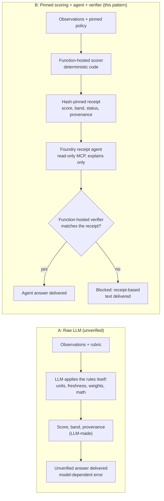

# Business case: pinned scoring for wildfire risk

## How the pattern maps to wildfire

The wildfire platform scores parcels for fire risk from fuel load, dead fuel, moisture, weather and wind. A utility, fire agency or insurer uses those scores to decide where to prioritise patrols, vegetation clearing, power shut-offs or underwriting.

An LLM assistant on top of those scores is attractive:

- "Why is parcel P007 high-risk?"
- "What changed since yesterday?"
- "What if the wind weight goes up?"

## The business problem

Those scores drive money and safety decisions, and they must be defensible after the fact. A raw LLM that applies the scoring rules itself fails in four ways:

- In the original 50-parcel test, gpt-4.1's raw score error averaged 49.2 points;
  its unverified tool-path answer averaged 57.7. These are historical results,
  not representative of every tested model.
- It can mislabel provenance, for example calling generated weather "observed".
  Rates vary by model and arm; the pooled 150-parcel results include newer models
  with zero raw arithmetic error.
- It cannot be reproduced, so an auditor cannot re-run the decision.
- It silently accepts stale, wrong-unit or tampered inputs.

## Raw LLM versus the pattern

In A the LLM both calculates and explains, so its mistakes reach the user. In B code calculates, the LLM only explains, and the verifier catches contradictions.

The diagram shows the approved cloud boundary. Mandatory Function-hosted scoring
and answer verification/fallback require the [runtime release checks](azure-mapping.md#verified-baseline-and-release-gates)
before being described as deployed.

## Reusable contribution

This standalone accelerator expands one aspect of a broader, unpublished wildfire
capstone. The original project is separate and is not required to install, evaluate
or reuse this accelerator; no public availability or production readiness of that
project is implied.

The reusable contribution is the combination of pinned policy, provenance-bearing
receipts, read-only explanation tools and checked delivery with explicit fallback,
plus a separate human decision trail. It is not merely the originating capstone
deck repackaged or a tour of Foundry/Fabric features. An adopter can reuse the code
and policy/evidence contracts beyond the synthetic forestry example, but must
evaluate any new domain. The defensible claim is narrower than "AI is safer":
on the recorded synthetic tests, checked delivery preserves receipt consistency
while raw model arithmetic and narration vary; high block rates and inconclusive
usefulness quantify the trade-off. No external adoption or customer outcome is claimed.

## What the pattern gives the business

- **Defensibility:** each score has a hash-pinned receipt of policy, inputs and provenance that an auditor can replay.
- **Bounded AI use:** staff get natural-language explanations without delegating the
  policy number to the model. This is not a blanket safety or compliance guarantee.
- **Data-quality gate:** invalid, missing, stale or disallowed inputs produce incomplete
  receipts. Detection metrics depend on the experiment/arm; 0.989 belonged to the
  original gpt-4.1 checked-delivery test, not a production guarantee.
- **Governed change:** the policy is pinned by hash, so a changed rubric is detected as a mismatch.
- **Measurable assurance:** the harness produces error and misstatement rates for risk and compliance sign-off.

## What it does not claim

The LLM does not make scores more accurate, because code already computes them.
Its potential value is convenience; checked delivery bounds receipt contradictions
and provides an audit trail, not a general safety guarantee.

In one line: code computes, AI explains, verification checks consistency, and a human
decides. Receipt consistency does not prove that the policy predicts real fire risk.

## Decision scenarios

The separate decision-calculation experiment covers exposure, mitigation return,
feeder shutdown priority and weight sensitivity: 20 questions per model. The Foundry
calculation-tool arm achieved 95-100% correctness across five models; raw-table
correctness ranged from 0% to 100%. The earlier direct gpt-4.1 test was 20/20 versus
1/20 and is a different sample, not the Foundry headline result. Code calculations
reduced retrieval work and returned traceable numbers, but tool counts are not latency
measurements. These are experimental functions, not tools on the shared cloud receipt
endpoint, and a recommendation does not authorise execution.
See the [full decision report](reports/scenario-3-four-tools.md) and
[reproduction guide](experiment.md).

## Where the business case applies

The pattern fits when all four conditions hold:

1. **A rule-based score or decision already exists.** Weights, thresholds and data-quality rules can be written down as a versioned policy, and code can compute the result.
2. **The decision has consequences.** Money, safety or regulation is involved, and someone may later ask "why did we decide that?"
3. **People want to ask questions in natural language.** Explanations, comparisons and what-if questions are the use case, not producing the number.
4. **Inputs vary in quality.** Mixed units, stale readings, estimated or generated values, or incomplete data make silent mistakes likely.

### Wildfire buyers and decisions

| Who | Decision the score supports | Why defensibility matters |
|---|---|---|
| Electric utility | Vegetation clearing, patrol priority, public safety power shut-offs | Regulators and courts may review the decision |
| Fire agency | Pre-positioning crews and resources | Public accountability after an incident |
| Insurer | Underwriting and pricing by parcel | Regulators require explainable, reproducible rates |
| Land manager | Prescribed burn and fuel-reduction planning | Auditable justification for spend |

### Other domains with the same shape

The scorer, policy and receipt are domain-neutral. Only the policy file and the observations change. Examples with the same shape include credit or fraud risk scoring, supplier risk, clinical triage scores, and compliance or control scoring. These are illustrations of fit. This repository only measures the wildfire case.

### Where it does not apply

- **No stable rules.** If the result is a judgement or a forecast that cannot be written as a policy, there is nothing to pin.
- **Free-text answers with no numbers or labels to check.** The verifier needs facts to compare against a receipt.
- **Low-stakes questions.** If a wrong or unrepeatable answer costs nothing, the extra machinery is not worth it.
- **Real-time, very high volume use.** Each answer adds tool calls and a verifier pass, so latency and cost grow. This is not measured here.

### What an adopter must supply

- A written policy (weights, thresholds, freshness and unit rules) and an owner who approves changes to it.
- Observations with units, timestamps and a provenance label.
- A decision on what happens when the verifier blocks an answer, such as showing the receipt-based text.
- A pilot on their own data to confirm the error and block rates before relying on the pattern.

## Limits of the evidence

- The score experiment pools 150 synthetic parcels. Historical Fabric relationship
  tests cover 50 parcels and 150 CrewAccess entries; decision tests cover 20 questions
  per model. Deployment `parcelCount` defaults to 150 but does not expand old results.
- Recorded token-price estimates are not bills. Analyst time saved, production cost,
  latency and verifier overhead have not been established.
- Block rates depend on model and run; zero delivered error is enforced by fallback.
  The [agent/template usefulness comparison](usefulness.md) was inconclusive.
