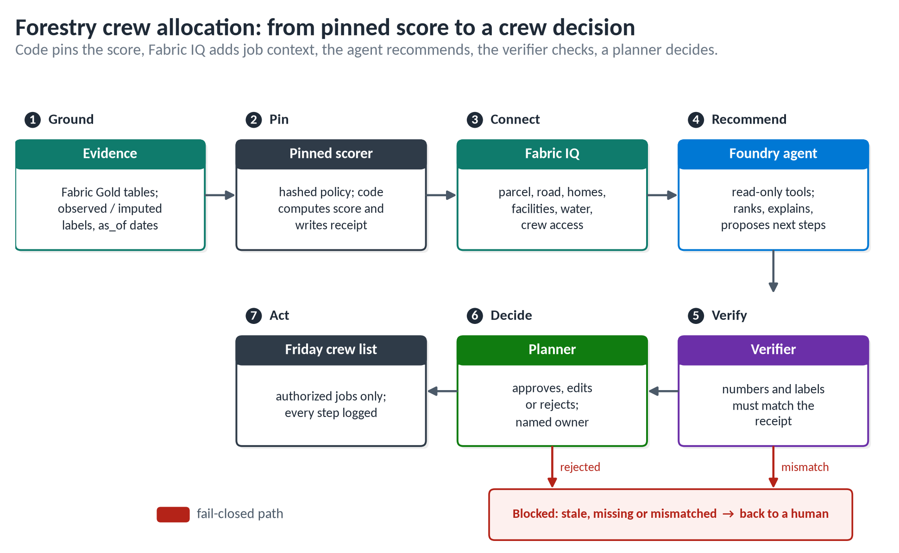
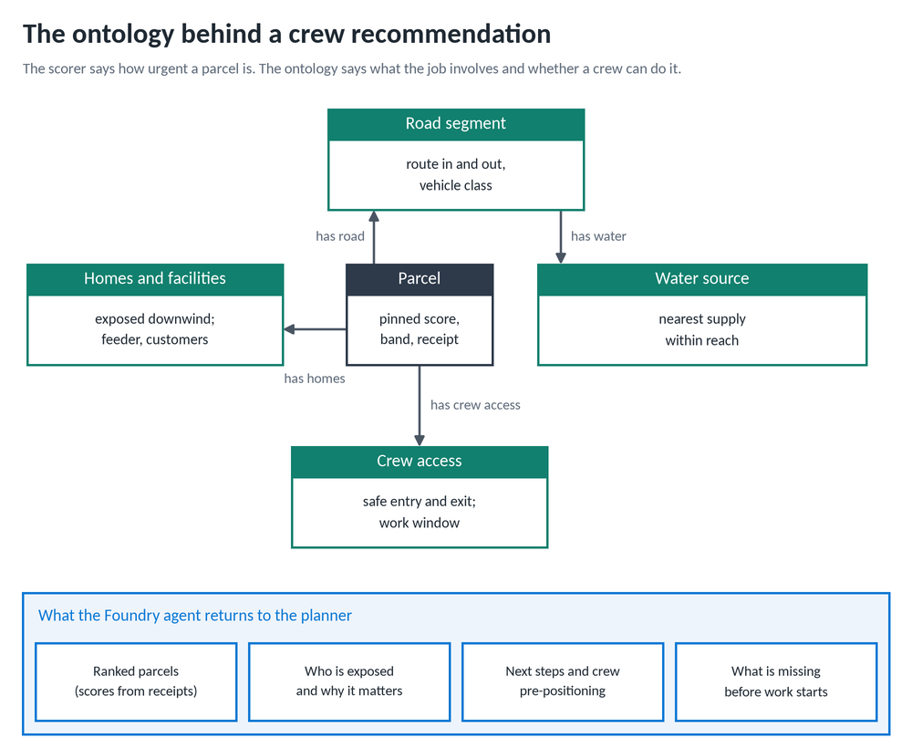
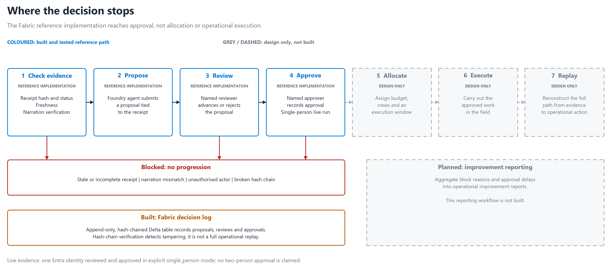
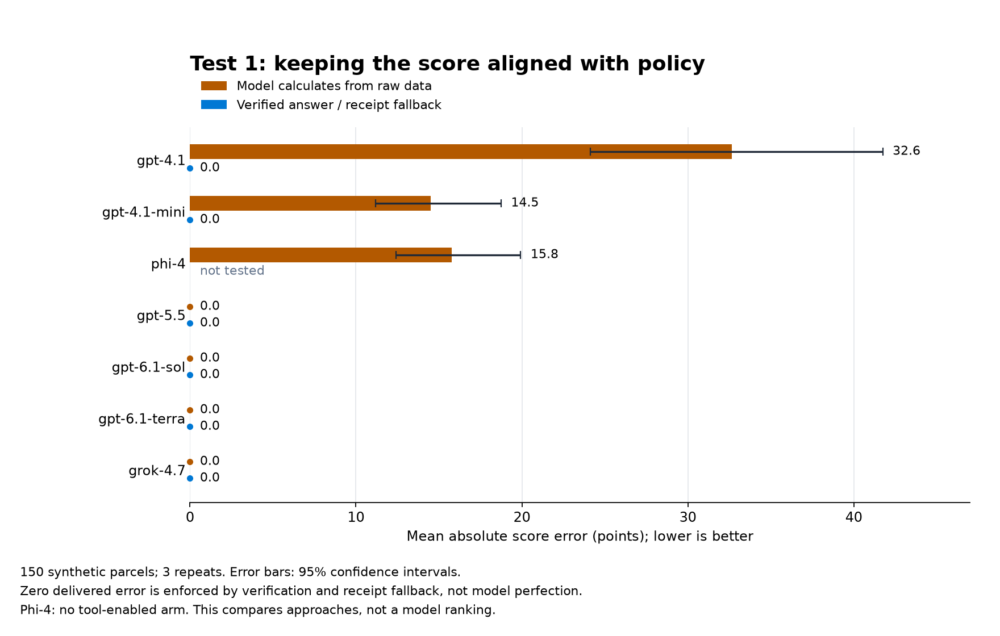
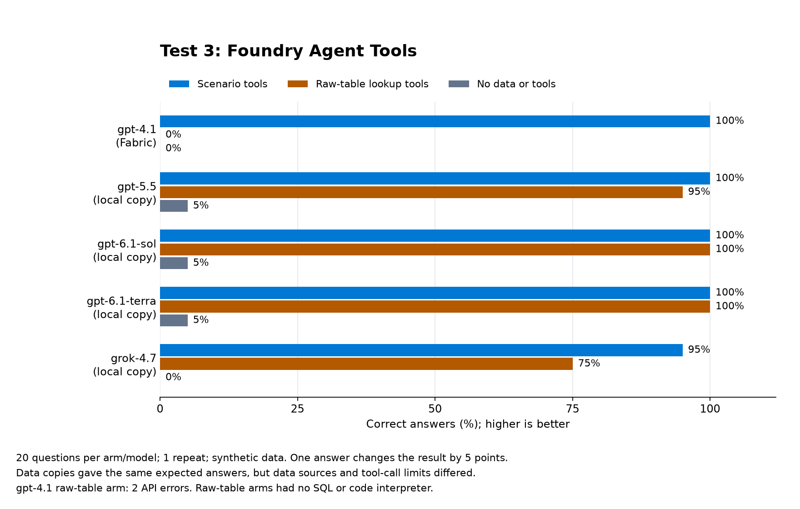

# Forestry planning with AI: the agent explains the wildfire risk score, but never calculates it

### Helping planners prioritise fuel-reduction work

*By Eneko Vallecillo, Principal Solution Engineer, Microsoft UK*

*Forest companies, such as pulp and paper producers, can manage thousands of plantation parcels. Across the EU, wildfire-prevention policy promotes managing vegetation to reduce the build-up of material that can fuel fires [1]. Specific legal duties depend on national and regional rules. For example, Portugal's Decree-Law 82/2021 requires fuel management around homes and other buildings used for economic activities on rural land, with a standard 50-metre strip where it covers forest land [2]. In Spain, Forest Law 43/2003 makes owners responsible for managing private forests, with regional governments setting detailed fire-prevention rules [3].*

*With limited crews and time, a forestry planner must decide which parcels need fuel-reduction work first and be able to explain those priorities to the board or, where required, an auditor or regulator.*

*This article tests whether a Microsoft Foundry agent can help that planner prioritise the right parcels in the most effective way possible, to maximise crew efficiency.*

> This post is accompanied by the [WFI Pinned Scoring Accelerator repository](https://github.com/enekazo/WFI-ScoringAccelerator) [4], which provides a [three-part test exercise](https://github.com/enekazo/WFI-ScoringAccelerator/tree/main/docs/reports) to evaluate the proposed design approach. The repository includes the full test evidence and detailed analysis, together with the accelerator's deployable code and setup instructions. You can reproduce the tests or adapt the solution to a different dataset or industry, using an appropriate scoring policy and data model.

## The planner's challenge

Picture a forestry planner with 100 parcels in her queue, each with a proposed fuel-reduction job, fewer crews than jobs and a window that closes on Friday. She needs to know which parcels get a crew first, and whether the crews can actually do the work.

Say an agent has already ranked the parcels and parcel PAX-0017 reads "high risk, score 72.4, fully assessed from measured inputs". There are three ways this can go wrong:

- The agent worked out 72.4 itself from raw readings, but the policy's real score was different. Ask the same question again and a model can return a different number, so getting it right once does not mean it will get it right every time.
- The wind reading for that parcel was missing and had been estimated to fill the gap, yet the agent described it as "observed", as if a sensor had measured it.
- A weather update arrived after the crew was booked and changed the parcel's risk, but nothing flagged the booking as out of date, so the crew could have been sent out on weather that was no longer safe.

In none of these is the model the main problem. It was asked to calculate, it was given unlabelled data, and nobody checked its answer. A ranked list is also not a plan. Knowing parcel PAX-0017 is urgent does not say whether a crew can reach it, who lives downwind or where the nearest water is.

## The approach

The WFI Pinned Scoring Accelerator is built on Microsoft Fabric and Microsoft Foundry around one idea: code does the arithmetic, Fabric holds the governed data, the model explains and connects, and people decide.

### The grounding framework

Grounding here means the agent can reach only controlled, labelled data, and nothing it says can move a decision forward on its own. The design is organised as three planes. It borrows from the NIST AI Risk Management Framework [5] and is in the spirit of the record-keeping (Article 12) and human-oversight (Article 14) requirements that the EU AI Act [6] sets for high-risk systems. This use case has not been assessed against the Act's risk classes.

*Figure 1. Three planes. Only a designated owner in the authority plane advances a decision. Coloured parts are built; grey parts are design only.*

- **Evidence (Microsoft Fabric OneLake).** Bronze, Silver and Gold tables use Fabric's medallion structure [7] to organise timestamped, traceable evidence. The agent reads Gold only. Missing, stale or conflicting evidence blocks progression.
- **Recommendation (Microsoft Azure and Foundry).** The agent ranks, explains and proposes next steps. Everything here is advisory and passes through the verifier.
- **Authority (the operator's platform).** The accelerator lets authorised people review and approve proposals, with decisions recorded in Fabric. Assigning budgets and crews, and confirming readiness for field work, remain planned features. The agent can propose an action, but it cannot approve it.

### How forestry crew allocation works

The following process describes how each parcel is assessed to determine crew allocation priorities.

*Figure 2. Forestry crew allocation, end to end. The agent stage represents two independent query paths. Numbers come only from the scorer; the agents advise; a named planner decides.*

Each parcel passes through seven steps before it can reach the crew list:

1. **Evidence:** every piece of data in Fabric is labelled as either measured or estimated, and carries the date it was last assessed.
2. **Scorer:** each score is calculated and locked by deterministic Python code under a hashed policy. The score is never guessed. Missing, expired or wrongly sourced evidence is marked as "incomplete".
3. **Fabric IQ:** adds context: access road, homes and facilities downwind, water and crew access.
4. **Agents:** two independent Foundry agents use separate read-only MCP connections. The receipt agent retrieves and compares parcel scores and their supporting evidence; the Fabric IQ agent queries relationships between parcels, roads, homes, water sources and crew access. Their answers support the planner's priorities and next steps. Neither changes a score.
5. **Verifier:** checks every number and label in the answer against the receipt and blocks any mismatch.
6. **Planner:** a named planner approves or rejects. A rejection or a verifier block sends the job back to the planner.
7. **Crew list:** only approved jobs reach the Friday crew list, and every step is logged.

### Locking the score

As part of this accelerator, a design decision was made that the Foundry agent should not compute the parcel risk score. The score is calculated by a deterministic scoring model. It applies a policy (weights, ranges, bands, allowed provenance) locked by SHA-256 and writes a hashed receipt with the score, band, status and the measured or estimated label of each factor. The receipt proves where a score came from: the policy that was applied and the evidence behind it. It does not prove the policy itself is right, so the policy owner remains accountable for the weights.

### Fabric IQ agent: context for planning

We added a Fabric IQ ontology to give the Foundry agent context for crew allocation. The score tells us how urgently a parcel needs treatment; Fabric IQ helps answer practical questions such as:

- Which road reaches the parcel?
- Which homes and facilities could be affected?
- Which water sources are linked to the parcel's access roads?
- Which crew types can reach the parcel using the recorded roads?

Fabric IQ is Microsoft's semantic layer for business entities and relationships. Its ontology defines these connections [8], so the agent reads them rather than guessing.

*Figure 3. The Fabric IQ ontology behind a crew recommendation, built and queried in Fabric on synthetic data.*

The agent helps the planner understand the parcel’s score, the homes and facilities linked to it, and any recorded gaps in road access, water supply or crew access. It can also explain why evidence is incomplete. These answers support planning; they do not allocate crews or authorise field work.

## Solution Architecture

*Figure 4. The cloud architecture maps the grounding framework to Azure and Fabric services. Connections show service relationships, not deployment-verification status.*

Figure 4 shows how the services connect. The two independent Foundry agents use separate MCP connections: the receipt agent accesses the receipt tools, while the Fabric IQ agent queries the ontology. These are separate query paths, not a single agent connected to both. Fabric stores the evidence and decision log, Microsoft Entra ID provides authentication, and Application Insights records traces.

The Azure Function exposes receipt tools to the receipt agent through MCP, using Foundry's support for remote MCP tools [9]. When answering a planner's question, this agent can use these tools to retrieve or compare parcel scores and their supporting evidence. The Function checks the receipt hashes and pinned policy before returning the results.

## Security and governance

Figure 5 shows the security and governance controls in the accelerator and how far we have taken each one. Some have been demonstrated in our tests, while the remaining controls are planned but have not yet been built.

*Figure 5. Control layers and their evidence status. Each status applies to the named capability, not to a complete production deployment.*

### What the agent can access

We give the agent tools to read and compare receipts, not change them. The accelerator uses Microsoft Entra ID to authenticate users and services, with managed identities [10] and Azure role assignments giving services the permissions they need, such as read access to receipt storage [11].

In the separate approval workflow, the agent can submit a proposal. Only people named in the accelerator's reviewer and approver lists can review or approve it.

### Answer verification controls

We calculate each score using the pinned policy, then check the policy and receipt hashes for mismatches and compare the agent's answer with the receipt. This helps keep the answer tied to the evidence used, but it cannot tell us whether the original observations are accurate or the policy is right. Application Insights lets us follow what happened during a run through agent tracing [12], rather than judge whether the answer was correct.

Tested run controls also include an estimated token-cost meter, a budget guard and a kill switch. The guard checks accumulated estimated spending before further model calls. It is not a cap on the Azure or Fabric bill, and its tests do not establish that it governs every deployed cloud call.

### What remains before production

Before using the accelerator in production, we still need to:

- Set up private networking, read-only access to the SQL endpoint and Azure budget alerts.
- Choose and test protections against prompt injection and sensitive-data exposure, along with controls for managing and monitoring agents. OWASP describes prompt-injection risks and mitigations, including least privilege and human approval [13]. Microsoft options include Foundry guardrails, Entra Agent ID, Defender, Purview and Agent 365, but we have not configured or tested them in this accelerator.

The reference implementation demonstrates specific checks, not a complete production security posture or a compliance assessment.

## Planner authority: from proposal to approval

*Figure 6. Where the decision stops. Coloured steps are built and tested in the reference implementation; grey, dashed steps are design only.*

The agent can submit a proposal only if the evidence is complete and recent enough, and its explanation passes verification. From there, the planner takes over, with each accepted step recorded in the Fabric decision log. Before accepting another step, the application checks the log's hash chain for signs of tampering. The Accelerator workflow currently ends at approval; it does not allocate crews or start work.

Allocating operational budgets and crews, carrying out the work and reporting on outcomes are still outside the current implementation. We can check the decision log for signs of tampering, but cannot yet replay a field operation from its original evidence. There is also no live weather feed to trigger a reassessment or withdraw an approval when conditions change.

## What we measured

To evaluate our proposed accelerator solution, we tested score consistency, answers from Fabric IQ and calculations through Foundry Agent Tools. The table summarises the tests and models. The linked repository reports contain the full methods, question sets, results and supporting evidence.

| Scenario | Test scope | Models tested |
|---|---|---|
| [Locking the score](https://github.com/enekazo/WFI-ScoringAccelerator/blob/main/docs/evidence/scenario-1-locking-the-score/combined-150/combined_150.md) | 150 synthetic parcels, three repeats; Phi-4 had no tool-enabled arm | gpt-4.1, gpt-4.1-mini, Phi-4, gpt-5.5, gpt-6.1-sol, gpt-6.1-terra, grok-4.7 |
| [Fabric IQ](https://github.com/enekazo/WFI-ScoringAccelerator/blob/main/docs/reports/scenario-2-ontology.md) | 5 connection questions against 150 parcels; separate 20-question usefulness comparison | Live checks: `scoring-agent-model2` deployment; usefulness: gpt-4.1, judged by gpt-4.1-mini |
| [Foundry Agent Tools](https://github.com/enekazo/WFI-ScoringAccelerator/blob/main/docs/reports/scenario-3-four-tools.md) | 20 questions per model, covering four scenarios | gpt-4.1, gpt-5.5, gpt-6.1-sol, gpt-6.1-terra, grok-4.7 |

**Locking the score.** We compared the models' own score calculations for 150 synthetic parcels with answers using code-calculated scores and verification, repeating each available test three times. The tests partly confirmed our concern: some AI models calculated scores incorrectly, while several newer models got them right. With the deterministic scoring model and verification in place, every delivered score matched the agreed policy. If the check failed, the system returned an answer based on the stored receipt instead. This meant the planner did not have to rely on the AI getting the calculation right. The [experiment report](https://github.com/enekazo/WFI-ScoringAccelerator/blob/main/docs/reports/scenario-1-locking-the-score.md) explains the test arms and earlier runs; the table links to the pooled 150-parcel results.

*Figure 7. Score consistency by model. Zero delivered error is enforced by verification and receipt fallback, not evidence of a perfect model.*

**Fabric IQ.** The latest live run used 150 parcels and 450 CrewAccess records. Direct GQL queries and a Microsoft Foundry agent connected to the Fabric IQ ontology MCP endpoint each matched all five C1–C5 answers against code-computed ground truth. C5 returned all 15 expected parcels without engine access, including those with passable but narrow roads. The recorded model field is the deployment alias `scoring-agent-model2`, not an independently verified underlying model/version.

| Latest 150-parcel relationship check | Correct answers |
|---|---|
| Direct Fabric graph GQL | 5/5 |
| Foundry agent using `ask_ontology` MCP | 5/5 |

The [sanitised live evidence](https://github.com/enekazo/WFI-ScoringAccelerator/blob/main/docs/evidence/cloud-acceptance/2026-11-11/summary.json) links the graph answers, Foundry tool calls, dataset/policy hashes and cloud runtime verification. These functional checks do not establish an accuracy advantage over alternative tools. A separate 20-question agent-versus-template usefulness comparison remains inconclusive; it was not rerun by the five-question check.

**Foundry Agent Tools.** We tested Foundry agents on 20 planning questions about a synthetic electricity network. The agents called Python functions to calculate the results, then explained those results in their answers. This experiment did not use Fabric IQ.

Some newer models matched the accuracy using raw tables, but needed about 46 table-lookup calls per question, compared with one calculation-tool call on average. The functions did not always improve accuracy; they kept arithmetic in code and made the returned numbers traceable. These experimental tools are included in the repository, but the provided cloud deployment does not enable them for the agent.

*Figure 8. Foundry Agent Tools compared with raw-table lookup tools and a model given no data. These small, synthetic tests compare approaches, not model rankings.*

### Limits of the study

- The tests used synthetic data, not field observations; crew access was derived from rules.
- Another AI model rated the answers for clarity, relevance and practical value; we have not yet asked planners whether they find them helpful.
- The decision-tool tests used one repeat per model, with different data sources and tool-call limits.
- Experiment 3 (Foundry Agent Tools) used locally executed Python tools rather than running entirely on cloud services. Integrating these tools into the provided cloud deployment remains to do.
- We have not demonstrated fewer fires, safer crews or lower operating costs.
- We tested answers and calculations, not live crew deployment or field operations.

## Conclusion and recommendations

The study supports keeping calculation, explanation and approval separate. The agent can help a planner work through the evidence, but its answer should not become the source of a score or permission to start work. The scoring policy still needs an accountable owner: reproducing its result does not establish that its weights predict real wildfire risk.

For teams adopting this approach, start with a decision that has stable rules and consequences worth checking. Calculate scores in code, record where the inputs came from, and give the agent only the tools and permissions it needs. Keep approval with the planner and make the evidence behind each decision inspectable.

One observation worth exploring is how the approach scales when more kinds of information need to be connected. In Fabric IQ, entity types represent categories such as parcels, roads and water sources. Relationships describe how they connect, such as which roads provide access to a parcel. Our ontology contains five entity types and four relationships. In a larger model, perhaps with 100 entity types and many more relationships, maintaining Python logic for the connections could become more demanding. Fabric IQ could make those relationships easier to manage and query, but we have not tested that scale, and Python can also support larger models.

The next step is a pilot with planners using real, governed data, comparing the agent with the simpler tools or templates they already use. That is where we would need to show that the accelerator improves planning, rather than only demonstrating that its components work.

The [companion repository](https://github.com/enekazo/WFI-ScoringAccelerator) contains the implementation, deployment instructions and detailed evaluation reports.

## When not to use it

- There are no stable rules to pin (the result is a judgement or forecast).
- Answers contain no numbers or labels the verifier can check.
- A wrong or unrepeatable answer costs nothing.
- Very high-volume, real-time use where extra tool calls and a verifier pass are too slow or costly (unmeasured here).

## References

[1] European Commission, [Wildfires: Policies to protect EU forests against fire](https://environment.ec.europa.eu/topics/forests/wildfires_en), including the 2026 integrated wildfire risk-management strategy and land-based prevention guidance. Cited as EU policy context, not a uniform legal duty on forest owners.

[2] Portugal, [Decreto-Lei n.º 82/2021: Sistema de Gestão Integrada de Fogos Rurais](https://diariodarepublica.pt/dr/legislacao-consolidada/decreto-lei/2021-172745166-172791110), consolidated text, article 49. See also the [Vendas Novas municipal explanation of fuel-management strips](https://www.cm-vendasnovas.pt/municipe/areas-de-acao/ambiente/florestas/faixas-de-gestao-de-combustivel/).

[3] Spain, [Ley 43/2003, de Montes](https://www.boe.es/buscar/act.php?id=BOE-A-2003-21339), consolidated text, articles 23 (private forest management) and 44 (fire prevention), incorporating the amendments in Ley 21/2015.

[4] [WFI Pinned Scoring Accelerator](https://github.com/enekazo/WFI-ScoringAccelerator): implementation, deployment instructions, test harnesses and recorded evidence.

[5] NIST, [AI Risk Management Framework](https://www.nist.gov/itl/ai-risk-management-framework).

[6] European Union, [Regulation (EU) 2024/1689: Artificial Intelligence Act](https://eur-lex.europa.eu/eli/reg/2024/1689/oj/eng), articles 12 (record-keeping) and 14 (human oversight). Cited as design context, not a compliance determination.

[7] Microsoft Learn, [Implement medallion lakehouse architecture in Microsoft Fabric](https://learn.microsoft.com/en-us/fabric/onelake/onelake-medallion-lakehouse-architecture).

[8] Microsoft Learn, [What is ontology (preview)?](https://learn.microsoft.com/en-us/fabric/iq/ontology/overview), including entity types and relationships in Fabric IQ.

[9] Microsoft Learn, [Connect agents to MCP server endpoints](https://learn.microsoft.com/en-us/azure/foundry/agents/how-to/tools/model-context-protocol).

[10] Microsoft Learn, [Managed identities for Azure resources](https://learn.microsoft.com/en-us/entra/identity/managed-identities-azure-resources/overview).

[11] Microsoft Learn, [Authorize access to blobs using Microsoft Entra ID](https://learn.microsoft.com/en-us/azure/storage/blobs/authorize-access-azure-active-directory).

[12] Microsoft Learn, [Agent tracing overview](https://learn.microsoft.com/en-us/azure/foundry/observability/concepts/trace-agent-concept).

[13] OWASP GenAI Security Project, [LLM01: Prompt injection](https://genai.owasp.org/llmrisk/llm01-prompt-injection/), risks and mitigation guidance.
