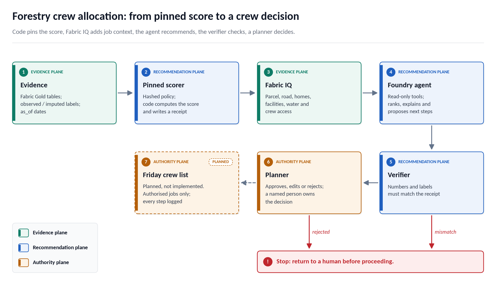
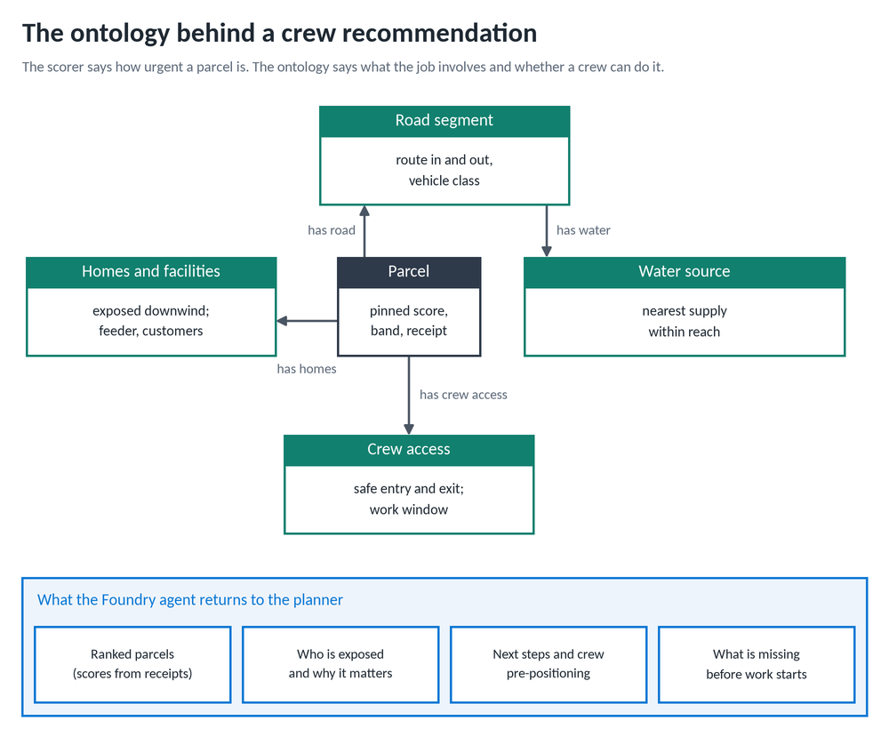
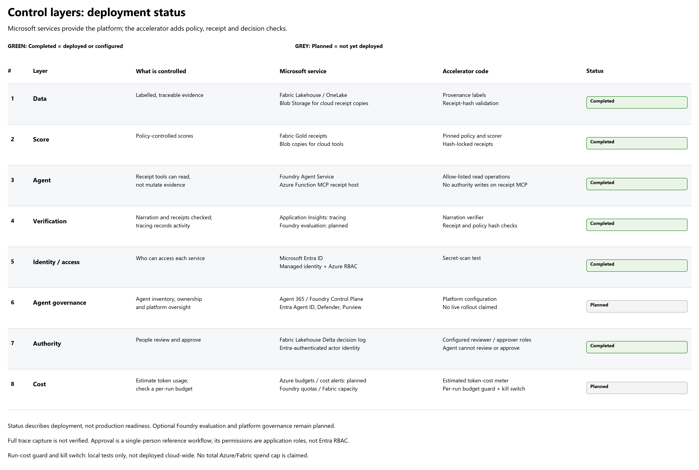
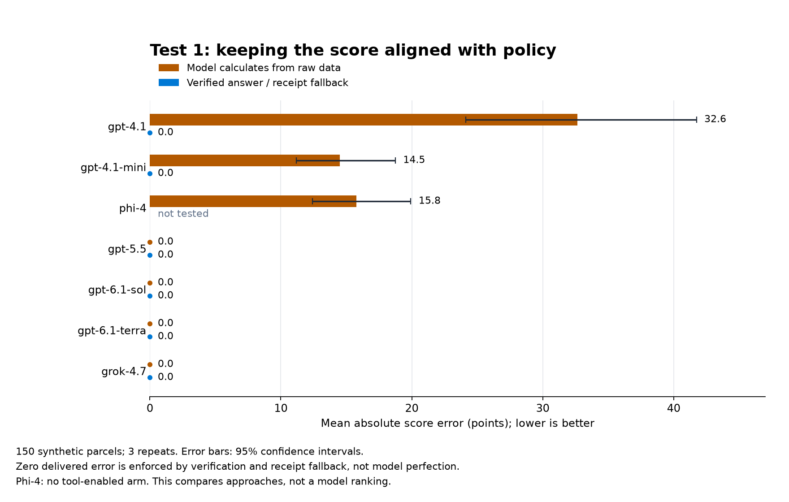
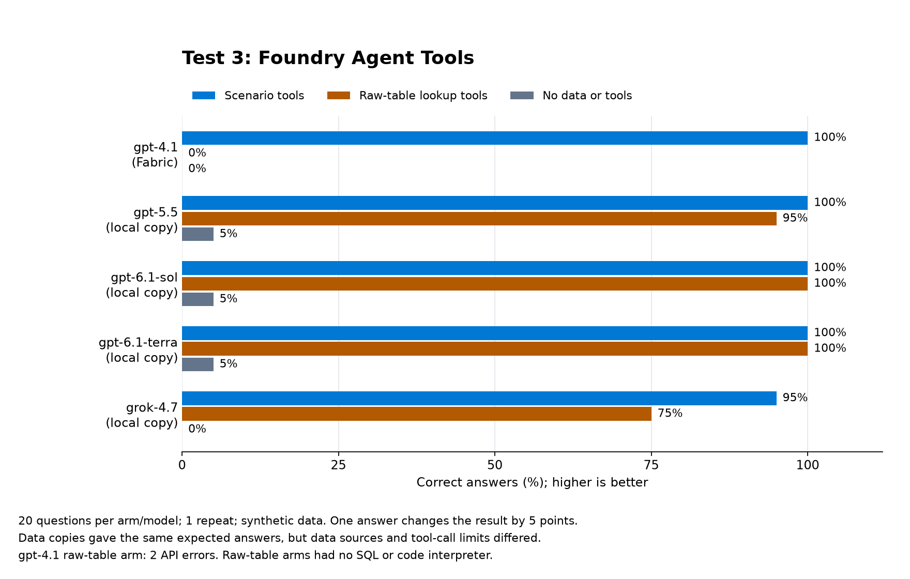

# Using AI to help forestry planners prioritise fuel-reduction work

*By Eneko Vallecillo, Principal Solution Engineer, Microsoft UK*

*Forestry companies, including pulp and paper producers, can manage thousands of plantation parcels. EU wildfire-prevention policy promotes reducing vegetation that can fuel fires [1], but legal duties vary. Portugal's Decree-Law 82/2021 requires fuel management around homes and other buildings used for economic activities on rural land, with a standard 50-metre strip where it covers forest land [2]. Spain's Forest Law 43/2003 makes owners responsible for managing private forests; regional governments set detailed fire-prevention rules [3].*

*I evaluated whether an AI agent built with Microsoft Foundry could help a forestry planner choose where to send limited crews for fuel-reduction work, and explain those choices to the board or, where required, an auditor or regulator.*

> The [WFI Pinned Scoring Accelerator repository](https://github.com/enekazo/WFI-ScoringAccelerator) [4] includes deployable code, setup instructions and a [three-part test exercise](https://github.com/enekazo/WFI-ScoringAccelerator/tree/main/docs/reports), with full evidence and analysis. You can reproduce the tests or adapt the solution to another dataset or industry using an appropriate scoring policy and data model.

## The planner's challenge

Picture a forestry planner with 100 parcels in her queue, each with a proposed fuel-reduction job. She has fewer crews than jobs and a window that closes on Friday. Which parcels get a crew first, and can those crews actually do the work?

The planner asks an AI agent for the risk scores of all parcels needing fuel-reduction work. For parcel PAX-0017, it reports 'high risk, score 72.4, fully assessed from measured inputs'. That answer could hide several problems:

- The AI agent calculates the risk score from raw data instead of retrieving one calculated by code using the organisation’s agreed rules. Ask the same question again and the AI agent may give a different number. AI agents are not guaranteed to produce the same answer each time.
- A missing wind reading was estimated, yet the agent called it "observed", as though a sensor had measured it.
- A weather update changed the parcel's risk after a crew was booked. Nothing flagged the booking as out of date, so the crew could have been sent out in weather that was no longer safe.

The AI agent was asked to calculate from unlabelled data, with no check on its answer. Even a correct ranking would leave the planner with questions: can a crew reach parcel PAX-0017, who lives downwind and where is the nearest water? The weather problem also needs a way to reassess an earlier decision.

## The approach

The WFI Scoring Accelerator calculates risk scores in Python and stores the data and its relationships in Microsoft Fabric. AI agents running in Microsoft Foundry explain the results, helping the planner decide what to do.

### Keeping data, advice and approval separate

The design separates data, advice and approval into three areas, called "planes" in the diagrams. It draws on the NIST AI Risk Management Framework [5] and the intent of the EU AI Act's record-keeping and human-oversight requirements, Articles 12 and 14 [6], for high-risk systems. 

*Figure 1. Three planes. Only a designated owner in the authority plane advances a decision. Coloured parts are built; grey parts are design only.*

- The **evidence plane** holds timestamped data in Fabric OneLake. Bronze, Silver and Gold are the stages of Fabric's medallion structure [7], which organises data as it is prepared for use. The agent reads only the Gold tables. Missing, stale or conflicting evidence blocks progression.
- The **recommendation plane** runs on Azure and Foundry. Agents use controlled, labelled data to rank parcels, explain results and propose next steps. A verifier, the code that checks an answer against its scoring record, checks their advisory output.
- The **authority plane** records authorised people's reviews and approvals in Fabric. An agent's answer cannot advance a decision on its own. 

### From parcel data to a planning decision

The intended workflow runs from parcel assessment to a crew list. Crew allocation components are not included in the accelerator.

*Figure 2. Forestry crew allocation, end to end. The agent stage represents two independent query paths. Numbers come only from the scorer; the agents advise; a named planner decides.*

Each parcel passes through seven steps before it can reach the crew prioritisation list:
1.	**Evidence**: Each scoring input in Fabric is labelled as either measured or estimated, and carries the date it was last assessed.
2.	**Scorer**: each score is calculated and locked by deterministic Python code under a hashed policy. The score is never guessed. Missing, expired or wrongly sourced evidence is marked as “incomplete”.
3.	**Fabric IQ**: adds context: access road, homes and facilities, water and crew access.
4.	**AI agents**: two independent Foundry agents use separate read-only MCP connections. The receipt agent retrieves and compares parcel scores and their supporting evidence; the Fabric IQ agent queries relationships between parcels, roads, homes, water sources and crew access. Their answers support the planner’s priorities and next steps. Neither changes a score.
5.	**Verifier (algorithm)**: checks scoring claims and evidence labels against the receipt and blocks any mismatch.
6.	**Forestry planner**: a named planner approves or rejects. A rejection or a verifier block sends the job back to the planner.
7.	**Crew list**: only approved jobs reach the Friday crew list, and every step is logged. 

### Calculating and recording the score

The scoring code is deterministic: the same inputs, policy and assessment time produce the same result. The policy is the set of rules specifying factor weights, input ranges, risk bands and allowed input sources. Missing, expired or wrongly sourced evidence produces an "incomplete" assessment instead of a guessed score.

Each assessment produces a **receipt**, a stored scoring record containing the score, risk band (such as "high"), assessment status and each factor's measured or estimated label. SHA-256 hashes act as digital fingerprints, helping to detect changes to the policy and receipt and trace each score back to the policy and evidence used to calculate it.

### Fabric IQ agent: context for planning

Fabric IQ holds an **ontology**, a model of business entities and their relationships [8]. Here, those entities include parcels, roads and water sources. It gives the agent recorded connections to query when the planner asks:

- Which road reaches the parcel?
- Which homes and facilities could be affected?
- Which water sources are linked to the parcel's access roads?
- Which crew types can reach the parcel using the recorded roads?

*Figure 3. The Fabric IQ ontology behind a crew recommendation, built and queried in Fabric on synthetic data.*

These answers help the planner interpret the score, understand incomplete evidence and spot recorded gaps in access or water supply. 

## Solution architecture

*Figure 4. The cloud architecture maps the grounding framework to Azure and Fabric services. Connections show service relationships, not deployment-verification status.*

Figure 4 shows how the services connect. The solution deploys two independent Foundry agents, each with its own MCP connection [9]. One uses the receipt tools to retrieve scoring records. The other queries the Fabric IQ ontology for relationships between parcels, roads, homes, water sources and crew access. Fabric keeps the evidence and a record of decisions, while Microsoft Entra ID checks user and service identities. Application Insights logs requests and tool calls so each agent’s activity can be traced.

Giving the AI agent deterministic Python tools makes scores reproducible: the same inputs, policy and assessment time produce the same result. The agent calls predefined functions instead of calculating scores itself. This helps manage token use by reducing repeated lookups and calculations by the model. In a separate [Foundry Agent Tools study](https://github.com/enekazo/WFI-ScoringAccelerator/blob/main/docs/reports/scenario-3-four-tools.md), four newer models averaged about 46 table-lookup calls per question, compared with one call when using predefined calculation tools.

## Security and governance

The accelerator has adopted security and governance controls. The figure below shows which controls have been implemented and which remain planned.

*Figure 5. Control layers and their deployment status as of 12 November 2026. Completed means deployed or configured; planned means not yet deployed.*

### What the agent can access
The receipt agent’s tools let it read and compare receipts, but not change them. The agent uses the Foundry project’s managed identity to call tools hosted in an Azure Function. The Azure Function uses its own managed identity [10] with Storage Blob Data Reader access to receipt storage, allowing it to retrieve receipts but not modify or delete them [11].

For review and approval, the agent uses verified parcel scores to propose priorities, but the forestry planner must decide whether to approve those priorities. The accelerator checks the planner’s Entra sign-in name against its reviewer and approver lists before allowing them to record a review or approve a reviewed proposal.

### Answer verification controls
The accelerator calculates each score using the pinned policy, checks the policy and receipt hashes for mismatches, and compares the agent’s answer with the receipt. These checks tie the answer to its supporting evidence. Application Insights [12] records agent activity to help trace what happened during a run.

### Cost
I also tested an estimated token-cost meter, a budget guard and a kill switch. The guard checks accumulated estimated spending before further model calls.

You should consider the following improvements to strengthen the accelerator’s security posture:

- Set up private networking, read-only access to the SQL endpoint and Azure budget alerts.
- Choose and test protections against prompt injection and sensitive-data exposure, and controls for managing and monitoring agents. OWASP describes prompt-injection risks and mitigations, including least privilege and human approval [13]. Microsoft options include Foundry guardrails, Entra Agent ID, Defender, Purview and Agent 365. These options have not been configured or tested in the accelerator.
- The accelerator does not provide a complete production security posture or a compliance assessment.

## Who approves the work?

*Figure 6. Where the decision stops. Coloured steps are built and tested in the reference implementation; grey, dashed steps are design only.*

The agent can submit a proposal only when the evidence is complete and verified. The planner then reviews it, and Fabric records each accepted step in the decision log. Before the next step can proceed, the application checks the log’s hash chain for signs of tampering. Approved decisions remain in Fabric, where you can use OneLake APIs to connect the records to your own systems and build the remaining stages, such as crew allocation and field-work scheduling.

## Evaluation and results

I tested score consistency, answers from Fabric IQ and calculations through Foundry Agent Tools. The repository reports contain the full methods, question sets, results and supporting evidence.

| Scenario | Test scope | Models tested |
|---|---|---|
| [Locking the score](https://github.com/enekazo/WFI-ScoringAccelerator/blob/main/docs/evidence/scenario-1-locking-the-score/combined-150/combined_150.md) | 150 synthetic parcels, three repeats | gpt-4.1, gpt-4.1-mini, Phi-4, gpt-5.5, gpt-6.1-sol, gpt-6.1-terra, grok-4.7 |
| [Fabric IQ](https://github.com/enekazo/WFI-ScoringAccelerator/blob/main/docs/reports/scenario-2-ontology.md) | 5 connection questions against 150 parcels; separate 20-question usefulness comparison | Live checks: Foundry agent; usefulness: gpt-4.1, judged by gpt-4.1-mini |
| [Foundry Agent Tools](https://github.com/enekazo/WFI-ScoringAccelerator/blob/main/docs/reports/scenario-3-four-tools.md) | 20 questions per model, covering four scenarios | gpt-4.1, gpt-5.5, gpt-6.1-sol, gpt-6.1-terra, grok-4.7 |

### Locking the score

The study compared 7 models’ own score calculations from raw data with answers using code-calculated scores and verification across 150 synthetic parcels. Each available test was repeated three times. Four newer models calculated the scores correctly and the other three made errors.

For the six models tested with verification and receipt fallback, delivered scores had zero error against the code-calculated reference. When a check failed, the system replaced the answer with values from the stored receipt. This is called **receipt fallback**. The [Locking the score evidence](https://github.com/enekazo/WFI-ScoringAccelerator/blob/main/docs/reports/scenario-1-locking-the-score.md) contains additional details of the tests and results.

*Figure 7. Score consistency by model. Verification and receipt fallback enforce zero delivered error.*

### Fabric IQ

The Fabric IQ experiment tested whether recorded relationships between parcels, roads, homes, water sources and crew access could answer planning questions. The dataset contained 150 parcels and 450 crew-access records. I asked five questions in two ways: directly through Fabric's Graph Query Language (GQL), and through the Fabric IQ agent's MCP connection. Both matched answers calculated independently in code, the test's **ground truth**. 
As an example, the crew-access question identified all 15 expected parcels with a critical facility but no access for a fire engine, including those with passable but narrow roads. 

| Latest 150-parcel relationship check | Correct answers |
|---|---|
| Direct Fabric graph GQL | 5/5 |
| Foundry agent using `ask_ontology` MCP | 5/5 |

The [sanitised live evidence](https://github.com/enekazo/WFI-ScoringAccelerator/blob/main/docs/evidence/cloud-acceptance/2026-11-11/summary.json) contains additional details of the tests and results.

### Foundry Agent Tools

I asked Foundry agents 20 planning questions about a synthetic electricity network, covering exposure, mitigation, electricity-feeder disconnection and sensitivity to scoring weights. The experiment compared three setups:

- **Foundry agent with calculation tools:** custom Python functions calculated the results for the agent to explain.
- **Foundry agent with table-lookup tools:** tools retrieved the data, leaving the model to connect the records and calculate the answers.
- **Direct model call without tools:** the model received only the question, without access to the dataset.

With calculation tools, four models answered all 20 questions correctly and one answered 19 correctly. Each averaged one tool call per question. With table-lookup tools, two models also answered every question correctly, while the others were less accurate. The four newer models averaged about 46 table-lookup calls per question. Without tools, correctness was between 0% and 5%.

The [Foundry Agent Tools evidence](https://github.com/enekazo/WFI-ScoringAccelerator/blob/main/docs/reports/scenario-3-four-tools.md) contains additional details of the tests and results.

*Figure 8. Foundry Agent Tools compared with raw-table lookup tools and a model given no data. These small, synthetic tests compare approaches, not model rankings.*

### Limits of the study

- The tests used synthetic data, not field observations; crew access was derived from rules.
- An AI model assessed the answers for clarity, relevance and practical value. Further studies should include forestry planners’ feedback to assess their usefulness in practice. 
- The decision-tool tests used one repeat per model, with different data sources and tool-call limits.
- Experiment 3 compared answers calculated by Python tools with those calculated by the model itself. The tools ran locally and are not yet part of the provided cloud deployment. 
- The study did not demonstrate reductions in fires, improvements in crew safety or operating-cost savings.
- The tests covered answers and calculations, not live crew deployment or field operations.

## Conclusion and recommendations

One observation worth exploring is how the proposed solution scales as more types of information need to be connected. In Fabric IQ, entity types represent categories such as parcels, roads and water sources. Relationships describe how they connect, such as which roads provide access to a parcel. The Fabric ontology contains five entity types and four relationships. In a larger model, perhaps with 100 entity types and many more relationships, maintaining Python logic for the connections could become more demanding. Fabric IQ could make those relationships easier to manage and query, although the study did not test a model of that size.

The study supports keeping calculation, explanation and approval separate. The agent can help a planner work through the evidence, but its answer should not become the source of a score or permission to start work. Getting the same score each time does not prove that the weights accurately reflect real wildfire risk.

For teams trying this approach, start with a decision that has stable rules and consequences worth checking. Calculate scores in code, record the inputs and give the agent only the tools and permissions it needs. Keep approval with the planner and make the supporting evidence inspectable. 

The next step is a pilot with forestry planners using real, governed data, comparing the agent with the simpler tools or templates they already use. This pilot would assess whether the accelerator improves planning compared with existing alternatives.

The [companion repository](https://github.com/enekazo/WFI-ScoringAccelerator) contains the implementation, deployment instructions and detailed evaluation reports.

This work is based on a broader wildfire intelligence project that has not yet been published. More details are planned for publication in the coming weeks.

## When not to use it

- There are no stable rules to pin: the result is a judgement or forecast.
- Answers contain no numbers or labels the verifier can check.
- A wrong or unrepeatable answer costs nothing.
- The use case requires very high volumes or real-time responses, and extra tool calls and verification would be too slow or costly. 

## References

[1] European Commission, [Wildfires: Policies to protect EU forests against fire](https://environment.ec.europa.eu/topics/forests/wildfires_en), including the 2026 integrated wildfire risk-management strategy and land-based prevention guidance. 

[2] Portugal, [Decreto-Lei n.º 82/2021: Sistema de Gestão Integrada de Fogos Rurais](https://diariodarepublica.pt/dr/legislacao-consolidada/decreto-lei/2021-172745166-172791110), consolidated text, article 49. See also the [Vendas Novas municipal explanation of fuel-management strips](https://www.cm-vendasnovas.pt/municipe/areas-de-acao/ambiente/florestas/faixas-de-gestao-de-combustivel/).

[3] Spain, [Ley 43/2003, de Montes](https://www.boe.es/buscar/act.php?id=BOE-A-2003-21339), consolidated text, articles 23 (private forest management) and 44 (fire prevention), incorporating the amendments in Ley 21/2015.

[4] [WFI Pinned Scoring Accelerator](https://github.com/enekazo/WFI-ScoringAccelerator): implementation, deployment instructions, test harnesses and recorded evidence.

[5] NIST, [AI Risk Management Framework](https://www.nist.gov/itl/ai-risk-management-framework).

[6] European Union, [Regulation (EU) 2024/1689: Artificial Intelligence Act](https://eur-lex.europa.eu/eli/reg/2024/1689/oj/eng), articles 12 (record-keeping) and 14 (human oversight). 

[7] Microsoft Learn, [Implement medallion lakehouse architecture in Microsoft Fabric](https://learn.microsoft.com/en-us/fabric/onelake/onelake-medallion-lakehouse-architecture).

[8] Microsoft Learn, [What is ontology (preview)?](https://learn.microsoft.com/en-us/fabric/iq/ontology/overview), including entity types and relationships in Fabric IQ.

[9] Microsoft Learn, [Connect agents to MCP server endpoints](https://learn.microsoft.com/en-us/azure/foundry/agents/how-to/tools/model-context-protocol).

[10] Microsoft Learn, [Managed identities for Azure resources](https://learn.microsoft.com/en-us/entra/identity/managed-identities-azure-resources/overview).

[11] Microsoft Learn, [Authorize access to blobs using Microsoft Entra ID](https://learn.microsoft.com/en-us/azure/storage/blobs/authorize-access-azure-active-directory).

[12] Microsoft Learn, [Agent tracing overview](https://learn.microsoft.com/en-us/azure/foundry/observability/concepts/trace-agent-concept).

[13] OWASP GenAI Security Project, [LLM01: Prompt injection](https://genai.owasp.org/llmrisk/llm01-prompt-injection/), risks and mitigation guidance.
